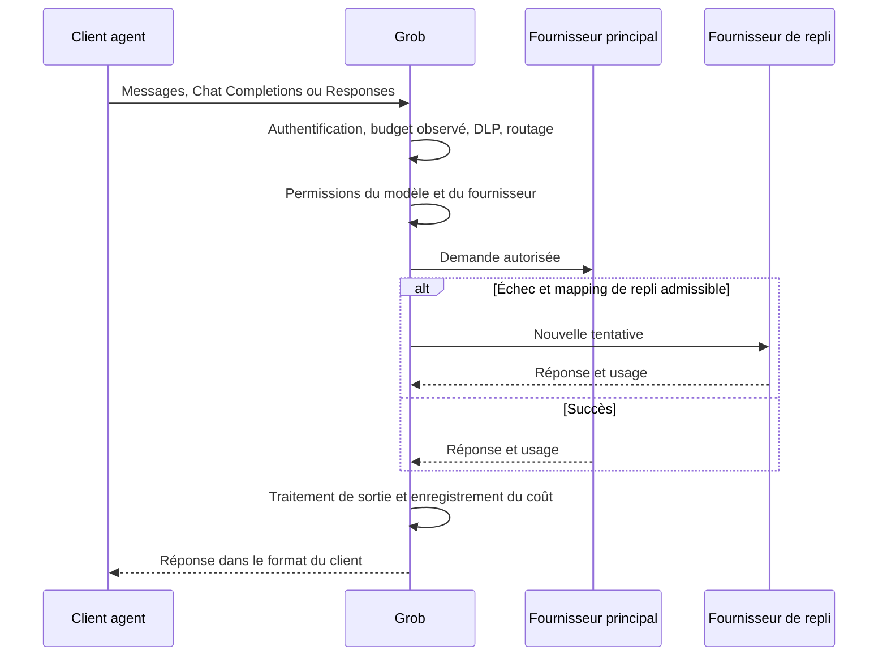

# Grob: proxy LLM Rust, filtrage de données et budgets

Évaluation du 9 octobre 2026. **Score de pertinence pour le guide : 3/5**, maintenu après challenge par un agent technical-writer. Décision : conserver une référence technique et un protocole de pilote. Les lacunes observées empêchent de recommander cette version comme protection de production pour des données sensibles.

## Ce que Grob apporte

[Grob](https://github.com/azerozero/grob) intercepte les appels entre un client et ses fournisseurs de modèles. Il expose Messages, Chat Completions et Responses, avec un format interne proche de Messages. Il combine règles de routage, repli entre fournisseurs, filtrage DLP, clés virtuelles, suivi des coûts, politiques d'approbation et journaux d'audit. Le binaire Rust et le stockage en fichiers évitent un serveur de base de données séparé.

La revue porte sur [l'arbre source du 5 octobre](https://github.com/azerozero/grob/tree/1b9e00c36cc31ff627a07beec5b67545a81b4758), dont `Cargo.toml` déclare 0.36.120. La [dernière distribution publiée](https://github.com/azerozero/grob/releases/tag/v0.36.120) porte le même numéro, avec une publication au 27 septembre. Les tests concernent le code cloné, pas le binaire de cette distribution. L'API GitHub consultée le 9 octobre indique 21 étoiles, aucun fork et trois issues ouvertes. Ces compteurs décrivent la diffusion publique, pas la fiabilité.

Grob rassemble ces contrôles dans un daemon local inspectable. Ses tests sémantiques, limites documentées et protections des identités justifient de l'étudier. Sa surface reste vaste par rapport aux preuves réunies ici.

## Fonctionnement lu dans le code

Le [dispatch](https://github.com/azerozero/grob/blob/1b9e00c36cc31ff627a07beec5b67545a81b4758/src/server/dispatch/mod.rs) exécute le précontrôle DLP, calcule la clé de cache, classe la demande, résout les mappings autorisés puis utilise le cache, le repli séquentiel ou le fan-out. Le [précontrôle](https://github.com/azerozero/grob/blob/1b9e00c36cc31ff627a07beec5b67545a81b4758/src/server/dispatch/preflight.rs#L16-L22) désactive la copie brute Responses lorsqu'une action DLP modifie la demande, pour éviter de transmettre les octets originaux après filtrage.



Ce schéma décrit le chemin séquentiel. Les exceptions du fan-out figurent en F3.

Le [routeur](https://github.com/azerozero/grob/blob/1b9e00c36cc31ff627a07beec5b67545a81b4758/src/routing/classify/mod.rs#L298-L452) applique un ordre explicite : outil web, nom du modèle de fond, auto-mapping, balise de sous-agent, regex du prompt, `thinking.type == "enabled"`, tiers déclaratifs, score heuristique. Le [score](https://github.com/azerozero/grob/blob/1b9e00c36cc31ff627a07beec5b67545a81b4758/src/routing/classify/classify.rs#L458-L480) additionne taille du contexte, présence d'outils, plafond de sortie, mots-clés et prompt système. Il n'établit pas quel modèle réussira le mieux la tâche.

Pour Claude Code, `ANTHROPIC_BASE_URL` est une interface documentée par [Anthropic](https://code.claude.com/docs/en/model-config). Le [lanceur Grob](https://github.com/azerozero/grob/blob/1b9e00c36cc31ff627a07beec5b67545a81b4758/src/commands/exec.rs#L73-L85) renseigne les URLs des clients, sans configurer leurs en-têtes d'authentification. La branche de réflexion ne reconnaît que `enabled`, tandis que les modèles Claude récents utilisent un raisonnement adaptatif : ne pas assimiler cette branche à toute utilisation de Plan Mode.

## Constats qui changent la décision

### F1. Un secret dans un retour d'outil échappe au masquage

**Confirmé par exécution ciblée.** Le [sanitizer de requête](https://github.com/azerozero/grob/blob/1b9e00c36cc31ff627a07beec5b67545a81b4758/src/features/dlp/mod.rs#L329-L387) parcourt le prompt système, les messages texte et les blocs `Text`. Il ne masque pas le texte contenu dans `ToolResult`, ni les arguments JSON de `ToolUse`. Une détection d'injection distincte inspecte les retours d'outils, sans leur appliquer ce masquage des secrets.

Le probe reproduit le cas avec un jeton factice et une règle personnalisée : le jeton disparaît du message texte de contrôle, mais reste intact dans `tool_result`, sans rapport DLP. Dans un agent de développement, un fichier lu ou la sortie d'une commande arrive souvent par ce format. Ce test porte sur le sanitizer appelé par le précontrôle, pas sur une fuite vers un fournisseur réel.

### F2. Le blocage d'injection en sortie varie avec le mode de réponse

**Confirmé par exécution ciblée.** Avec `response_action = "block"`, le contrôle explicite d'injection rejette le texte factice. Pourtant, [le sanitizer de sortie](https://github.com/azerozero/grob/blob/1b9e00c36cc31ff627a07beec5b67545a81b4758/src/features/dlp/mod.rs#L714-L733) traite `IndirectInjectionResult::Blocked` comme une absence d'action et renvoie ce texte intact, sans rapport. Le [traitement non streaming](https://github.com/azerozero/grob/blob/1b9e00c36cc31ff627a07beec5b67545a81b4758/src/server/helpers.rs#L341-L357) utilise ce sanitizer. Le streaming utilise un contrôle bloquant séparé.

Le probe établit le comportement des fonctions concernées. La livraison HTTP du texte bloqué n'a pas été reproduite dans cette session.

### F3. Le fan-out ouvre des chemins sans tous les contrôles ordinaires

**Confirmé par lecture du code, non reproduit en HTTP.** Le chemin séquentiel non streaming appelle l'[autorisation des outils retournés](https://github.com/azerozero/grob/blob/1b9e00c36cc31ff627a07beec5b67545a81b4758/src/server/dispatch/retry.rs#L491-L505). Le [succès fan-out](https://github.com/azerozero/grob/blob/1b9e00c36cc31ff627a07beec5b67545a81b4758/src/server/dispatch/mod.rs#L834-L883) filtre et enregistre la réponse, puis la retourne sans cet appel HIT. Une politique d'approbation humaine ne doit pas être supposée active sur ce chemin.

Le [juge de qualité](https://github.com/azerozero/grob/blob/1b9e00c36cc31ff627a07beec5b67545a81b4758/src/server/fan_out.rs#L159-L176) sélectionne directement un fournisseur et appelle `send_message`, hors du dispatch ordinaire. Les réponses candidates entrent dans son prompt avant le filtrage final. Les restrictions de fournisseur, budgets et politiques de la requête principale ne couvrent pas automatiquement cet appel. La [documentation du fan-out](https://github.com/azerozero/grob/blob/1b9e00c36cc31ff627a07beec5b67545a81b4758/docs/reference/fan-out.md#L124-L136) reconnaît ce dernier écart.

### F4. Les budgets et coûts ne constituent pas un plafond financier exact

**Confirmé par lecture du code et documenté.** Le [contrôle de budget](https://github.com/azerozero/grob/blob/1b9e00c36cc31ff627a07beec5b67545a81b4758/src/server/budget.rs#L149-L201) compare les dépenses déjà enregistrées, sans réservation du coût futur. Des requêtes acceptées simultanément ou une réponse en cours peuvent dépasser le seuil. Les requêtes identifiées utilisent les compteurs du tenant, pas un plafond monétaire agrégé couvrant tous les tenants.

Le fan-out applique l'usage du gagnant aux participants retournés et omet l'appel du juge. Une annulation locale ne prouve pas l'arrêt de la facturation amont. Les connexions OAuth sont valorisées à zéro dans le suivi : ce chiffre ne mesure ni le prix de l'abonnement ni son quota restant. Les économies et la réconciliation avec une facture restent **non vérifiées**.

### F5. Le nom d'un preset ne prouve ni filtrage actif ni résidence

**Confirmé par configuration et code.** Le [preset `gdpr`](https://github.com/azerozero/grob/blob/1b9e00c36cc31ff627a07beec5b67545a81b4758/presets/gdpr.toml) configure le routage régional sans section activant la DLP. Le [défaut DLP](https://github.com/azerozero/grob/blob/1b9e00c36cc31ff627a07beec5b67545a81b4758/src/features/dlp/config.rs#L5-L12) est désactivé. Le filtre régional accepte aussi `global`, y compris lorsqu'une région n'est pas renseignée, comme le montre le [resolver](https://github.com/azerozero/grob/blob/1b9e00c36cc31ff627a07beec5b67545a81b4758/src/server/helpers.rs#L218-L231).

Les régions sont des étiquettes de configuration. Elles ne vérifient pas le lieu de traitement du fournisseur. La [matrice de fonctions](https://github.com/azerozero/grob/blob/1b9e00c36cc31ff627a07beec5b67545a81b4758/docs/reference/features.md) distingue ces contrôles d'une certification ou d'une conformité organisationnelle. L'interprétation « appliquer un preset rend conforme » est **réfutée**.

## Points favorables et limites de compatibilité

Le cache exécuté dans le dispatch est exact. Sa clé inclut le tenant, les permissions, l'époque de configuration, la demande et ses extensions. Les helpers SimHash ne sont pas utilisés par ce chemin : leur présence ne suffit pas à conclure à une fuite du cache entre tenants. Le cache de réponses évite le streaming ; aucune économie sur une session Claude Code streaming n'a été mesurée ici.

Les protections de credentials sont concrètes : stockage chiffré, portée tenant/service, contrôle de génération, destinations autorisées et restrictions de transport. Leur présence ne protège pas toutes les traces. Le [handler Responses](https://github.com/azerozero/grob/blob/1b9e00c36cc31ff627a07beec5b67545a81b4758/src/server/handlers.rs#L756-L764) peut journaliser le corps entrant brut en mode debug avant filtrage. La garde des clés de chiffrement et la rétention des traces restent des responsabilités de déploiement.

Le [test de conformité](https://github.com/azerozero/grob/blob/1b9e00c36cc31ff627a07beec5b67545a81b4758/tests/integration/conformance_test.rs) inspecte les octets reçus par des fournisseurs simulés : arguments d'outils, ordre des messages, images, prompt système, cache Anthropic et erreurs structurées. La [matrice publiée](https://github.com/azerozero/grob/blob/1b9e00c36cc31ff627a07beec5b67545a81b4758/docs/reference/conformance.md) laisse des cases non testées et exclut Gemini de ce gate. Le mot « certified » y désigne des assertions du projet, pas une qualification externe. Sa déclaration de validation par mutation de chaque assertion n'a pas été vérifiée indépendamment.

L'adaptateur Responses [rejette `previous_response_id`](https://github.com/azerozero/grob/blob/1b9e00c36cc31ff627a07beec5b67545a81b4758/src/server/responses_compat/transform.rs#L174-L179) et demande l'historique complet. Sa conversion omet les items non modélisés et le raisonnement entrant. Une copie brute préservée peut maintenir ces données pour un backend OpenAI streaming ; une transformation DLP désactive cette copie. La compatibilité Codex doit être qualifiée par la route, le mode et les fonctions activées.

Les [benchmarks du projet](https://github.com/azerozero/grob/blob/1b9e00c36cc31ff627a07beec5b67545a81b4758/docs/reference/benchmarks.md) rapportent 90 µs de surcoût médian avec une pile de contrôles sur une instance ARM à quatre vCPU, avec backend simulé local. Cette mesure n'a pas été reproduite. Les comparaisons avec d'autres gateways mélangent les conditions et les fonctions activées ; elles ne démontrent pas une supériorité de bout en bout.

La description GitHub « zero deps » ne signifie pas absence de dépendances Rust : `Cargo.toml` en contient. Les archives de la distribution publiée vont de 8,25 à 9,45 MB compressés selon la cible. Le descriptif « 6 MB » ne décrit pas ces archives et la taille du binaire installé n'a pas été mesurée ici.

## Validation effectuée et état distant

| Vérification | Résultat | Portée |
|---|---|---|
| `cargo test --locked --test lib conformance -- --nocapture` | 1 test passé | Gate sémantique du dépôt, fournisseurs simulés |
| `cargo test --locked --offline --test lib responses_e2e -- --nocapture` | 1 test passé | Échanges Responses, texte et arguments d'outils ; fournisseur simulé |
| Probe joint | 2 tests passés | Reproduction des lacunes F1 et F2 avec contrôles positifs |
| Client Claude Code/Codex réel, OAuth fournisseur, charge et facture | Non vérifiés | Aucun appel de modèle réel effectué |

Le premier lancement Responses dans un environnement restreint a échoué avant les assertions, car le serveur simulé ne pouvait pas ouvrir un port local. Le même test passe avec cette ouverture autorisée. Cet échec initial ne constitue pas une régression Grob.

Au commit analysé, le [contrôle CI requis](https://github.com/azerozero/grob/actions/runs/37255214371/job/111594439797) échoue. Le [journal du quality gate](https://github.com/azerozero/grob/actions/runs/37255214371/job/111590753649) identifie `no-commit-to-branch`, appliqué à `main`, comme cause de son échec. Le test Ubuntu, la couverture, les exemples de documentation et CodeQL réussissent ; les jobs de publication et les E2E de cette exécution sont ignorés. L'[audit planifié du 9 octobre](https://github.com/azerozero/grob/actions/runs/37922890042/job/113794822012) échoue sur un avertissement refusé : `yoke-derive` 0.8.3 a été retiré de la sélection normale du registre (« yanked »). Ce job ne détecte aucune vulnérabilité connue dans sa base. Des contrôles nightly échouent aussi, sans cause établie ici. Le commit n'a donc pas une CI entièrement verte.

## Reproduire les deux lacunes sans fournisseur réel

Le [probe Rust](fixtures/grob-boundary-probe.rs) utilise uniquement des valeurs factices et les fonctions publiques de Grob. Il affirme le comportement observé, y compris les défauts : deux tests verts signifient que les défauts ont été reproduits, pas corrigés.

Depuis la racine d'un clone du Claude Code Ultimate Guide, avec Git et Rust installés :

```bash
git clone https://github.com/azerozero/grob.git /path/to/grob
git -C /path/to/grob checkout 1b9e00c36cc31ff627a07beec5b67545a81b4758
cp docs/resource-evaluations/fixtures/grob-boundary-probe.rs /path/to/grob/tests/grob_boundary_probe.rs
cd /path/to/grob
cargo test --locked --test grob_boundary_probe -- --nocapture
```

L'accès réseau sert au clone et, si nécessaire, au téléchargement des dépendances. Le probe ne contacte aucun fournisseur de modèles. Il ne reproduit pas le bypass HIT du fan-out, son appel de juge ou un dépassement concurrent de budget.

## Décision pour le guide et pilote admissible

Le guide couvre déjà les gateways, les budgets et l'observabilité dans [API Gateway](../../guide/ops/api-gateway.md) et [AI Unit Economics](../../guide/ops/ai-unit-economics.md). Grob apporte un exemple Rust local combinant ces fonctions avec une DLP inspectable. Le score 3/5 porte sur cet intérêt documentaire ; il ne classe pas sa sécurité de production.

Un pilote de routage sur données non sensibles est raisonnable, avec clé API, mapping explicite et chemin séquentiel. Avant tout usage comme contrôle de sécurité, exiger le masquage des secrets dans tous les blocs utiles à l'agent, des refus identiques en streaming et hors streaming, et la vérification HIT de chaque réponse porteuse d'outils. Qualifier séparément les appels du juge, les restrictions de fournisseur et la comptabilisation réelle si le fan-out est envisagé.

La décision éditoriale reste une référence accompagnée de ces limites. L'analyse n'établit pas une intégration réelle Claude Code/Codex ou une qualification de production.
