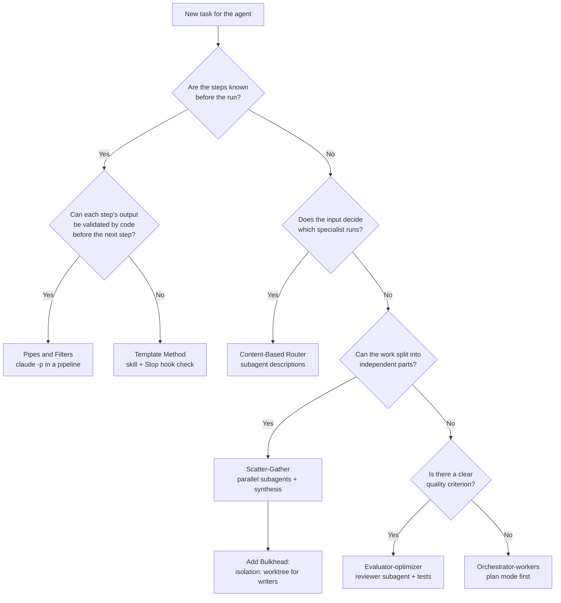

# AI design patterns

Developers already share a vocabulary for structure: Observer, Chain of Responsibility, Circuit Breaker, Saga. This page maps that vocabulary onto agent harnesses, names the Claude Code mechanism behind each mapping, and states where the mapping fails.

> **Status:** No standard crosswalk exists. Published mappings agree on some pairs and disagree on others, and none of the sources read for this page maps classic patterns to Claude Code mechanisms except for hooks and CLAUDE.md. Every other Claude Code column entry is this guide's mapping, marked `Our mapping`. Mechanisms are checked against the [official documentation](https://code.claude.com/docs/llms-full.txt) (last verified 2026-10-27).
>
> **Use this page for:** explaining an agent design to developers in terms they know, and checking a design against the failure modes each pattern carries. For the components of a harness, see [Agent Harness Engineering](./agent-harness.md). For loop and graph contracts, see [Loop & Graph Engineering](./loop-graph-engineering.md). For patterns inside a single skill, see [Skill Design Patterns](./skill-design-patterns.md).

The tables on this page are generated from [`machine-readable/ai-design-patterns.json`](../../machine-readable/ai-design-patterns.json) by `scripts/build-ai-design-patterns.py`. Edit the dataset, not the tables.

## Contents

1. [TL;DR](#tldr)
2. [Lineage](#lineage)
3. [How to read](#how-to-read)
4. [Crosswalk](#crosswalk)
5. [Pattern cards](#pattern-cards)
6. [Where the analogy breaks](#where-the-analogy-breaks)
7. [Native agent patterns](#native-agent-patterns)
8. [Choose a pattern](#choose-a-pattern)
9. [Anti-patterns](#anti-patterns)
10. [Classic side](#classic-side)
11. [Sources](#sources)

---

## TL;DR

- The classic patterns in this table still describe agent systems, but the component in the middle is now a model that decides at runtime. A pattern that relied on a fixed order or a guaranteed call needs a deterministic check next to it.
- In Claude Code, the mappings with the clearest documented mechanism are Observer to hooks, Memento to checkpoints, Mediator to the main conversation coordinating subagents, Bulkhead to subagent context and worktree isolation, and Circuit Breaker to turn and budget limits. Only Observer and Facade are named by a source; the others are this guide's mapping.
- Two common assumptions are wrong in detail. Hooks for the same event run in parallel, so they do not form a chain. Checkpoints track Claude's file edits only, so rewind does not undo shell commands or remote effects.
- Each pattern card ends with a check you can run.

## Lineage

Three generations of patterns solve the same kind of problem at different scales:

- **Object patterns** (Gamma, Helm, Johnson, Vlissides, 1994) describe how objects collaborate inside one program. The structure is fixed when the code is written.
- **Integration and distributed patterns** (Hohpe and Woolf's [Enterprise Integration Patterns](https://www.enterpriseintegrationpatterns.com/), 2003, and the resilience patterns that followed) describe how services exchange messages and survive partial failure.
- **Agent patterns** (Anthropic's [Building effective agents](https://www.anthropic.com/engineering/building-effective-agents), 2024, and the catalogs that followed) describe how a harness steers a model that chooses its next action itself.

Jia Huang's [Pattern Evolution](https://kage-ai.com/research/pattern-evolution/) frames the third step as the shift from a structure chosen at design time to a decision taken at runtime by a model working with incomplete information. That shift is why each card below carries a failure mode: the classic name describes the structure, and the card states which behavior the harness no longer guarantees.

## How to read

Each crosswalk row carries two labels.

| Label | Meaning |
|---|---|
| `Consensus` | Two or more distinct sources map the classic pattern to the same main agent analogue. A card may add a second reading that refines it. |
| `Single source` | One source proposes the mapping. Treat it as a proposal. |
| `Divergent` | Sources map the same classic pattern to different agent analogues. The card lists each reading with its source. |
| `Named by a source` | A source names the Claude Code mechanism itself. |
| `Our mapping` | Sources give the generic agent analogue; this guide maps it to Claude Code. |

A row enters the table only when three conditions hold: a public source maps the classic pattern to an agent analogue, a documented Claude Code mechanism exists, and a failure mode can be stated. Saga is the one deliberate exception: Claude Code has no native compensation mechanism, and the row documents that gap.

## Crosswalk

<!-- BEGIN GENERATED: crosswalk-table -->

| Classic pattern | Family | Agent analogue | In Claude Code | Evidence | Mapping |
|---|---|---|---|---|---|
| [Factory Method](#factory-method) | GoF creational | Subagent spawning from a named definition | Subagent definitions and the Agent tool | Consensus | Our mapping |
| [Singleton](#singleton) | GoF creational | Shared tool registry / Layered memory governance: decide which state is shared, isolated, persisted, or ephemeral | CLAUDE.md hierarchy and auto memory | Divergent | Our mapping |
| [Adapter](#adapter) | GoF structural | Tool adapter that exposes an external system to the model | MCP servers | Consensus | Our mapping |
| [Composite](#composite) | GoF structural | An agent that delegates to agents that can delegate again | Nested subagents (spawn depth) | Consensus | Our mapping |
| [Decorator](#decorator) | GoF structural | Guardrail wrapped around a model call / Context-injection middleware that enriches each request | UserPromptSubmit and PostToolUse hooks | Divergent | Our mapping |
| [Facade](#facade) | GoF structural | Project instruction file as the single entry point for conventions | CLAUDE.md | Single source | Named by a source |
| [Chain of Responsibility](#chain-of-responsibility) | GoF behavioral | Hook or permission pipeline in front of tool calls / Agents chained so each one handles what it can and passes the rest | Permission rules: deny, then ask, then allow | Divergent | Our mapping |
| [Command](#command) | GoF behavioral | A tool call: a named action with structured arguments | Tool calls and PreToolUse hooks | Consensus | Our mapping |
| [Mediator](#mediator) | GoF behavioral | Orchestrator that coordinates workers which never talk to each other | Main conversation coordinating subagents; Agent teams (experimental, off by default; peer messaging, the non-mediated alternative) | Consensus | Our mapping |
| [Memento](#memento) | GoF behavioral | Checkpoint and rewind of agent state | Checkpointing and /rewind | Consensus | Our mapping |
| [Observer](#observer) | GoF behavioral | Lifecycle hooks that react to agent events | Hooks (PreToolUse, PostToolUse, Stop, SubagentStop) | Consensus | Named by a source |
| [Strategy](#strategy) | GoF behavioral | Model or approach selected per task / Runtime strategy switching, with the harness recording why, at what cost, and how to roll back | model field per subagent and /model | Consensus | Our mapping |
| [Template Method](#template-method) | GoF behavioral | System prompt that defines the steps / Fixed agent-loop skeleton with pluggable steps | Skills that define a procedure; Stop hook as the final step check | Divergent | Our mapping |
| [Pipes and Filters](#pipes-and-filters) | Enterprise integration | Pipeline where each agent or model call is a filter | Print mode in a shell pipeline (claude -p) | Consensus | Our mapping |
| [Content-Based Router](#content-based-router) | Enterprise integration | Classifier that sends a request to a specialized handler | Automatic delegation by subagent description; Skill selection by description | Consensus | Our mapping |
| [Scatter-Gather](#scatter-gather) | Enterprise integration | Parallel agents followed by a synthesis step | Parallel subagents; Dynamic workflows | Consensus | Our mapping |
| [Bulkhead](#bulkhead) | Distributed and resilience | Per-agent isolation of context, tools, and budget | Subagent context isolation; isolation: worktree | Consensus | Our mapping |
| [Circuit Breaker](#circuit-breaker) | Distributed and resilience | Hard caps on turns, cost, and loop depth / Breakers on tools, models, and the agent's own loop | --max-turns and --max-budget-usd (print mode); maxTurns in subagent frontmatter | Consensus | Our mapping |
| [Saga](#saga) | Distributed and resilience | Compensating actions for an agent plan | No native saga: checkpoints plus scripted compensation | Consensus | Our mapping |
| [Sidecar](#sidecar) | Distributed and resilience | The agent harness around the model loop | Hooks, permissions, and sandboxing around the loop | Single source | Our mapping |
| [Event Sourcing](#event-sourcing) | Distributed and resilience | The trace log as the event stream of an agent run | Session transcripts, --resume and --continue | Single source | Our mapping |

<!-- END GENERATED: crosswalk-table -->

## Pattern cards

<!-- BEGIN GENERATED: pattern-cards -->

### Factory Method

`GoF creational` `Consensus` `Our mapping`

- **Classic intent:** Let a creator decide which concrete product to instantiate, behind a common interface.
- **Agent side:** Subagent spawning from a named definition ([AgentPatterns.ai](https://agentpatterns.ai/patterns/agent-design/classical-se-patterns-agent-analogues/), [Esther Aznar, Ivan Garcia Villar](https://aicodingpatterns.com/patterns/patrones-gof-patrones-agenticos-mapeo-completo/))
- **In Claude Code:** [Subagent definitions and the Agent tool](https://code.claude.com/docs/en/sub-agents)
- **Failure mode:** The factory hands every product the full toolbox: a subagent definition without a tools field inherits every tool available to subagents.
- **How to verify:** List the tools field of each definition in .claude/agents/ and fail review when a write-capable agent has no explicit allowlist.

### Singleton

`GoF creational` `Divergent` `Our mapping`

- **Classic intent:** Guarantee one shared instance of a component with a global access point.
- **Agent side, sources disagree:**
  - Shared tool registry ([Esther Aznar, Ivan Garcia Villar](https://aicodingpatterns.com/patterns/patrones-gof-patrones-agenticos-mapeo-completo/))
  - Layered memory governance: decide which state is shared, isolated, persisted, or ephemeral ([Jia Huang](https://kage-ai.com/research/pattern-evolution/))
- **In Claude Code:** [CLAUDE.md hierarchy and auto memory](https://code.claude.com/docs/en/memory)
- **Failure mode:** One shared memory file becomes mutable global state: parallel sessions or agents that write it at the same time can overwrite each other's entries.
- **How to verify:** Run two sessions that both append to the same memory file and check whether either entry is lost.

### Adapter

`GoF structural` `Consensus` `Our mapping`

- **Classic intent:** Convert the interface of an existing component into the interface a client expects.
- **Agent side:** Tool adapter that exposes an external system to the model ([Esther Aznar, Ivan Garcia Villar](https://aicodingpatterns.com/patterns/patrones-gof-patrones-agenticos-mapeo-completo/), [Marco Nissen](https://github.com/agentpatternscatalog/patterns))
- **In Claude Code:** [MCP servers](https://code.claude.com/docs/en/mcp)
- **Failure mode:** The adapter mirrors every upstream endpoint, so tool definitions crowd the context and the model picks among near-duplicate tools.
- **How to verify:** Run /mcp and /context, then remove or defer the tools that no task in the last sprint used.

### Composite

`GoF structural` `Consensus` `Our mapping`

- **Classic intent:** Treat a single object and a tree of objects through the same interface.
- **Agent side:** An agent that delegates to agents that can delegate again ([AgentPatterns.ai](https://agentpatterns.ai/patterns/agent-design/classical-se-patterns-agent-analogues/), [Esther Aznar, Ivan Garcia Villar](https://aicodingpatterns.com/patterns/patrones-gof-patrones-agenticos-mapeo-completo/))
- **In Claude Code:** [Nested subagents (spawn depth)](https://code.claude.com/docs/en/sub-agents)
- **Failure mode:** Recursion without a budget: each layer multiplies token use. Claude Code caps nesting with CLAUDE_CODE_MAX_SUBAGENT_SPAWN_DEPTH, which can be adjusted but not removed.
- **How to verify:** Set CLAUDE_CODE_MAX_SUBAGENT_SPAWN_DEPTH explicitly for automated runs and log spawned subagents with a SubagentStop hook.

### Decorator

`GoF structural` `Divergent` `Our mapping`

- **Classic intent:** Add behavior to an object by wrapping it, without changing its class.
- **Agent side, sources disagree:**
  - Guardrail wrapped around a model call ([Esther Aznar, Ivan Garcia Villar](https://aicodingpatterns.com/patterns/patrones-gof-patrones-agenticos-mapeo-completo/))
  - Context-injection middleware that enriches each request ([AgentPatterns.ai](https://agentpatterns.ai/patterns/agent-design/classical-se-patterns-agent-analogues/))
- **In Claude Code:** [UserPromptSubmit and PostToolUse hooks](https://code.claude.com/docs/en/hooks)
- **Failure mode:** A classic decorator stack has a fixed order. Matching hooks run in parallel, so a wrapper that assumes another wrapper already ran is a race.
- **How to verify:** Write each hook so it passes when run alone, and test it with the other hooks disabled.

### Facade

`GoF structural` `Single source` `Named by a source`

- **Classic intent:** Offer one simple entry point in front of a complex subsystem.
- **Agent side:** Project instruction file as the single entry point for conventions ([AgentPatterns.ai](https://agentpatterns.ai/patterns/agent-design/classical-se-patterns-agent-analogues/))
- **In Claude Code:** [CLAUDE.md](https://code.claude.com/docs/en/memory)
- **Failure mode:** The facade is read as a contract. The docs state that Claude treats CLAUDE.md as context, not enforced configuration: a rule written there is a request, not a guarantee.
- **How to verify:** For every must-never rule in CLAUDE.md, add a PreToolUse hook or a deny rule and a test that triggers it.

### Chain of Responsibility

`GoF behavioral` `Divergent` `Our mapping`

- **Classic intent:** Pass a request along a chain of handlers until one of them handles it.
- **Agent side, sources disagree:**
  - Hook or permission pipeline in front of tool calls ([AgentPatterns.ai](https://agentpatterns.ai/patterns/agent-design/classical-se-patterns-agent-analogues/), [Ashish Patel](https://github.com/ashishpatel26/agent-harness-engineering-pattern))
  - Agents chained so each one handles what it can and passes the rest ([Esther Aznar, Ivan Garcia Villar](https://aicodingpatterns.com/patterns/patrones-gof-patrones-agenticos-mapeo-completo/))
- **In Claude Code:** [Permission rules: deny, then ask, then allow](https://code.claude.com/docs/en/permissions)
- **Failure mode:** Teams expect declaration order or rule specificity to decide. The docs state that rules are evaluated deny, then ask, then allow, and specificity does not change that order: a broad deny beats a narrow allow.
- **How to verify:** Add a deny and a more specific allow for the same command in a test project and check that the command stays blocked.

### Command

`GoF behavioral` `Consensus` `Our mapping`

- **Classic intent:** Turn a request into an object that can be queued, logged, checked, or undone.
- **Agent side:** A tool call: a named action with structured arguments ([Esther Aznar, Ivan Garcia Villar](https://aicodingpatterns.com/patterns/patrones-gof-patrones-agenticos-mapeo-completo/), [Ashish Patel](https://github.com/ashishpatel26/agent-harness-engineering-pattern))
- **In Claude Code:** [Tool calls and PreToolUse hooks](https://code.claude.com/docs/en/tools-reference)
- **Failure mode:** The command object is written by the model. Without validation before dispatch, a malformed or out-of-scope argument executes as written.
- **How to verify:** Feed a PreToolUse hook a recorded tool input with an out-of-scope path and assert that it blocks.

### Mediator

`GoF behavioral` `Consensus` `Our mapping`

- **Classic intent:** Centralize how a set of components talk, so they do not reference each other directly.
- **Agent side:** Orchestrator that coordinates workers which never talk to each other ([Esther Aznar, Ivan Garcia Villar](https://aicodingpatterns.com/patterns/patrones-gof-patrones-agenticos-mapeo-completo/), [Sarkar and Sarkar](https://arxiv.org/abs/2506.05364))
- **In Claude Code:** [Main conversation coordinating subagents](https://code.claude.com/docs/en/sub-agents); [Agent teams (experimental, off by default; peer messaging, the non-mediated alternative)](https://code.claude.com/docs/en/agent-teams)
- **Failure mode:** The mediator becomes the bottleneck: if workers return transcripts instead of summaries, the coordinating context fills with material it never reads again.
- **How to verify:** Check that each subagent prompt asks for a bounded final report, and compare /context before and after a delegation.

### Memento

`GoF behavioral` `Consensus` `Our mapping`

- **Classic intent:** Capture an object's state so it can be restored later without exposing its internals.
- **Agent side:** Checkpoint and rewind of agent state ([AgentPatterns.ai](https://agentpatterns.ai/patterns/agent-design/classical-se-patterns-agent-analogues/), [Ashish Patel](https://github.com/ashishpatel26/agent-harness-engineering-pattern))
- **In Claude Code:** [Checkpointing and /rewind](https://code.claude.com/docs/en/checkpointing)
- **Failure mode:** The snapshot is partial. The docs state that checkpoints only track changes made through Claude's file editing tools; Bash commands and external processes are not captured, and edits made by a background subagent usually are not either.
- **How to verify:** Use a Bash command to change a file Claude has not edited in this session, rewind, and confirm the change survives. Commit with git before risky shell work or delegated edits.

### Observer

`GoF behavioral` `Consensus` `Named by a source`

- **Classic intent:** Notify subscribers automatically when a subject changes state.
- **Agent side:** Lifecycle hooks that react to agent events ([AgentPatterns.ai](https://agentpatterns.ai/patterns/agent-design/classical-se-patterns-agent-analogues/), [Esther Aznar, Ivan Garcia Villar](https://aicodingpatterns.com/patterns/patrones-gof-patrones-agenticos-mapeo-completo/))
- **In Claude Code:** [Hooks (PreToolUse, PostToolUse, Stop, SubagentStop)](https://code.claude.com/docs/en/hooks)
- **Failure mode:** Subscribers assume an order. The docs state that matching hooks run in parallel, each one runs to completion, and for permission decisions the most restrictive result applies: one hook's deny does not stop a sibling hook's side effects.
- **How to verify:** Run each hook alone against a recorded event payload; a hook that only passes after another one is not an observer.

### Strategy

`GoF behavioral` `Consensus` `Our mapping`

- **Classic intent:** Swap one algorithm for another behind the same interface at runtime.
- **Agent side, main reading first:**
  - Model or approach selected per task ([AgentPatterns.ai](https://agentpatterns.ai/patterns/agent-design/classical-se-patterns-agent-analogues/), [Esther Aznar, Ivan Garcia Villar](https://aicodingpatterns.com/patterns/patrones-gof-patrones-agenticos-mapeo-completo/))
  - Runtime strategy switching, with the harness recording why, at what cost, and how to roll back ([Jia Huang](https://kage-ai.com/research/pattern-evolution/))
- **In Claude Code:** [model field per subagent and /model](https://code.claude.com/docs/en/model-config)
- **Failure mode:** The strategy changes silently. Nobody can tell afterwards which model produced which result or what the switch cost.
- **How to verify:** Pin model in each subagent definition and check /usage or the session transcript after a run.

### Template Method

`GoF behavioral` `Divergent` `Our mapping`

- **Classic intent:** Fix the skeleton of an algorithm and let subclasses fill in some steps.
- **Agent side, sources disagree:**
  - System prompt that defines the steps ([Esther Aznar, Ivan Garcia Villar](https://aicodingpatterns.com/patterns/patrones-gof-patrones-agenticos-mapeo-completo/))
  - Fixed agent-loop skeleton with pluggable steps ([Ashish Patel](https://github.com/ashishpatel26/agent-harness-engineering-pattern))
- **In Claude Code:** [Skills that define a procedure](https://code.claude.com/docs/en/skills); [Stop hook as the final step check](https://code.claude.com/docs/en/hooks)
- **Failure mode:** A prose skeleton is not enforced: the model can skip or reorder a step, unlike a base class that calls the steps itself.
- **How to verify:** Give the last step an artifact (a file, a test run) and block completion with a Stop hook when the artifact is missing.

### Pipes and Filters

`Enterprise integration` `Consensus` `Our mapping`

- **Classic intent:** Process a message through a sequence of independent steps connected by channels.
- **Agent side:** Pipeline where each agent or model call is a filter ([Roan Brasil](https://github.com/roanbrasil/agents-integration-patterns), [Marco Nissen](https://github.com/agentpatternscatalog/patterns))
- **In Claude Code:** [Print mode in a shell pipeline (claude -p)](https://code.claude.com/docs/en/headless)
- **Failure mode:** A filter emits free text that the next filter misreads, and the error travels down the pipe.
- **How to verify:** Use --output-format json between steps and validate the shape before the next filter runs.

### Content-Based Router

`Enterprise integration` `Consensus` `Our mapping`

- **Classic intent:** Route each message to a destination based on its content.
- **Agent side:** Classifier that sends a request to a specialized handler ([Roan Brasil](https://github.com/roanbrasil/agents-integration-patterns), [Anthropic](https://www.anthropic.com/engineering/building-effective-agents))
- **In Claude Code:** [Automatic delegation by subagent description](https://code.claude.com/docs/en/sub-agents); [Skill selection by description](https://code.claude.com/docs/en/skills)
- **Failure mode:** Overlapping descriptions route the same request to different handlers from one run to the next.
- **How to verify:** Keep a set of routing prompts with the expected subagent or skill, and rerun it after every description change.

### Scatter-Gather

`Enterprise integration` `Consensus` `Our mapping`

- **Classic intent:** Send a request to several recipients and aggregate their replies.
- **Agent side:** Parallel agents followed by a synthesis step ([Esther Aznar, Ivan Garcia Villar](https://aicodingpatterns.com/patterns/patrones-gof-patrones-agenticos-mapeo-completo/), [Roan Brasil](https://github.com/roanbrasil/agents-integration-patterns))
- **In Claude Code:** [Parallel subagents](https://code.claude.com/docs/en/sub-agents); [Dynamic workflows](https://code.claude.com/docs/en/workflows)
- **Failure mode:** The gather step averages contradicting answers instead of reconciling them, and token cost grows with every branch.
- **How to verify:** Make the synthesis step list disagreements explicitly, and compare the run's cost with a single-agent baseline.

### Bulkhead

`Distributed and resilience` `Consensus` `Our mapping`

- **Classic intent:** Isolate resources per consumer so one failure cannot sink the whole system.
- **Agent side:** Per-agent isolation of context, tools, and budget ([Esther Aznar, Ivan Garcia Villar](https://aicodingpatterns.com/patterns/patrones-gof-patrones-agenticos-mapeo-completo/), [Jia Huang](https://kage-ai.com/research/pattern-evolution/))
- **In Claude Code:** [Subagent context isolation](https://code.claude.com/docs/en/sub-agents); [isolation: worktree](https://code.claude.com/docs/en/worktrees)
- **Failure mode:** Only the context is isolated. Parallel agents still share one checkout and overwrite each other's files.
- **How to verify:** Give write-capable parallel subagents isolation: worktree and check that git status in the main checkout stays clean during the run.

### Circuit Breaker

`Distributed and resilience` `Consensus` `Our mapping`

- **Classic intent:** Stop calling a failing dependency after repeated failures, and fail fast.
- **Agent side, main reading first:**
  - Hard caps on turns, cost, and loop depth ([AgentPatterns.ai](https://agentpatterns.ai/patterns/agent-design/classical-se-patterns-agent-analogues/), [Esther Aznar, Ivan Garcia Villar](https://aicodingpatterns.com/patterns/patrones-gof-patrones-agenticos-mapeo-completo/), [James Davies](https://github.com/jlldavies/go4-llm-design-patterns))
  - Breakers on tools, models, and the agent's own loop ([Jia Huang](https://kage-ai.com/research/pattern-evolution/))
- **In Claude Code:** [--max-turns and --max-budget-usd (print mode)](https://code.claude.com/docs/en/cli-reference); [maxTurns in subagent frontmatter](https://code.claude.com/docs/en/sub-agents)
- **Failure mode:** The breaker is static, not failure-triggered, and often set on one layer only: --max-turns has no limit by default and counts turns, not cost, so it needs --max-budget-usd beside it.
- **How to verify:** Run the automated job with --max-turns and --max-budget-usd set, on a task designed to loop, and check that it exits with an error.

### Saga

`Distributed and resilience` `Consensus` `Our mapping`

- **Classic intent:** Run a long transaction as local steps, each with a compensating action if a later step fails.
- **Agent side:** Compensating actions for an agent plan ([AgentPatterns.ai](https://agentpatterns.ai/patterns/agent-design/classical-se-patterns-agent-analogues/), [Esther Aznar, Ivan Garcia Villar](https://aicodingpatterns.com/patterns/patrones-gof-patrones-agenticos-mapeo-completo/), [Jia Huang](https://kage-ai.com/research/pattern-evolution/), [Vasundra Srinivasan](https://arxiv.org/abs/2605.20173))
- **In Claude Code:** [No native saga: checkpoints plus scripted compensation](https://code.claude.com/docs/en/checkpointing)
- **Failure mode:** Rewind is mistaken for compensation. It restores local file edits only; a push, an API call, or a database write stays done.
- **How to verify:** For every side-effecting step in an agent plan, write down its compensating action before the run, and test that action once.

### Sidecar

`Distributed and resilience` `Single source` `Our mapping`

- **Classic intent:** Attach cross-cutting capabilities (logging, policy, networking) next to a service instead of inside it.
- **Agent side:** The agent harness around the model loop ([Jia Huang](https://kage-ai.com/research/pattern-evolution/))
- **In Claude Code:** [Hooks, permissions, and sandboxing around the loop](https://code.claude.com/docs/en/sandboxing)
- **Failure mode:** Policy lives in the prompt instead of the sidecar, so the model can talk itself out of it. A policy hook can also fail open: on most events, a hook that crashes or times out lets the action through unless it sets onFailure: "block".
- **How to verify:** List each safety rule and name the layer that enforces it: hook, permission rule, sandbox, or prompt only. For each policy hook, point it at a missing script and check that the action is blocked.

### Event Sourcing

`Distributed and resilience` `Single source` `Our mapping`

- **Classic intent:** Store every state change as an event, and rebuild state by replaying the log.
- **Agent side:** The trace log as the event stream of an agent run ([Jia Huang](https://kage-ai.com/research/pattern-evolution/))
- **In Claude Code:** [Session transcripts, --resume and --continue](https://code.claude.com/docs/en/sessions)
- **Failure mode:** Replay is assumed to reproduce the result. Resuming a session restores the conversation, but the model calls that follow are not deterministic.
- **How to verify:** Treat the transcript as an audit trail, not a replay log: pin the inputs you need to reproduce outside it.

<!-- END GENERATED: pattern-cards -->

## Where the analogy breaks

Every break below has the same root: a classic pattern assumes the component in the middle executes what it is given, and a model does not.

**Order is not guaranteed.** A decorator stack and a chain of handlers run in a known order. Claude Code runs the matching hooks for one event in parallel, and for permission decisions the most restrictive result applies ([hooks reference](https://code.claude.com/docs/en/hooks)). Every matching hook runs to completion, so one hook's deny does not stop the side effects of another. Write each hook so it is correct alone. Permission rules, by contrast, are evaluated in a documented order: deny, then ask, then allow, with specificity not changing that order ([permissions](https://code.claude.com/docs/en/permissions)).

**Restore is partial.** A memento captures the whole state it needs. Checkpoints only track changes made through Claude's file editing tools; changes made through Bash commands or external processes are not captured ([checkpointing](https://code.claude.com/docs/en/checkpointing)). Edits made by a background subagent are usually outside the checkpoints too: rewinding restores only the files Claude had already edited in the conversation. For anything outside that scope, the Saga question applies: what is the compensating action, and who runs it?

**Replay does not reproduce.** An event-sourced system rebuilds the same state from the same log. A resumed Claude Code session restores the conversation, and the model calls that follow can differ. Keep the transcript as an audit trail, and pin elsewhere the inputs you need to reproduce a result.

**Prose does not enforce.** A template method calls its steps; a facade hides the subsystem behind a contract. A skill that lists steps, or a CLAUDE.md file that states rules, is context the model reads. The docs say so directly: Claude treats CLAUDE.md as context, not enforced configuration, and points to a PreToolUse hook to block an action regardless of what Claude decides ([memory](https://code.claude.com/docs/en/memory)).

**Observers can veto.** A classic observer is notified and cannot change what its subject does. A PreToolUse hook can block the tool call it observes, so a hook is closer to a guard than to a listener. The veto only goes one way: a hook that returns allow does not bypass permission rules, and a matching deny or ask rule still applies ([permissions](https://code.claude.com/docs/en/permissions)).

**Guards fail open.** A classic guard that throws stops the request. On most events, a Claude Code hook that crashes, cannot start, or times out lets the action through, so a policy hook with a wrong path enforces nothing. Set `"onFailure": "block"` on a command or HTTP hook to reverse that, available from Claude Code v2.1.295 ([hooks reference](https://code.claude.com/docs/en/hooks)).

**Limits are static.** A classic circuit breaker opens after repeated failures and closes again after a cool-down. `--max-turns`, `--max-budget-usd`, and `maxTurns` are fixed caps set before the run ([CLI reference](https://code.claude.com/docs/en/cli-reference)): they bound a loop, they do not detect a failing dependency.

**The wrapper is probabilistic too.** Several sources map Decorator to guardrails or to context injection. A guardrail that is itself a model call inherits the uncertainty it is meant to contain. Keep at least one deterministic check on any path that must not fail.

## Native agent patterns

These patterns sit close to classic ones, but they depend on two things classic patterns never had to manage: a context window as the scarce resource, and a model as the decision-maker. Where a crosswalk row covers a similar mechanism, the card names the closest classic pattern and what changes.

<!-- BEGIN GENERATED: native-cards -->

### Orchestrator-workers

A central model breaks a task down at runtime, delegates the parts, and synthesizes the results.

- **What is new:** Closest classic pattern: Mediator. The difference is that the model decides the decomposition during the run instead of the designer drawing it. Delegation pays on parallel work: in Google Research's controlled study, every multi-agent variant degraded a sequential planning task by 39 to 70%.
- **In Claude Code:** [Subagents](https://code.claude.com/docs/en/sub-agents); [Dynamic workflows](https://code.claude.com/docs/en/workflows)
- **Sources:** [Anthropic](https://www.anthropic.com/engineering/building-effective-agents), [Claude Code docs: Subagents](https://code.claude.com/docs/en/sub-agents), [Claude Code docs: Dynamic workflows](https://code.claude.com/docs/en/workflows), [Yubin Kim, Xin Liu (Google Research)](https://research.google/blog/towards-a-science-of-scaling-agent-systems-when-and-why-agent-systems-work/)

### Evaluator-optimizer

One call produces an answer, another evaluates it and sends feedback, in a loop.

- **What is new:** The test oracle is itself a model, so the loop can converge on a wrong answer both sides accept.
- **In Claude Code:** [Reviewer subagent with its own context](https://code.claude.com/docs/en/sub-agents); [Stop hook that runs the real tests](https://code.claude.com/docs/en/hooks)
- **Sources:** [Anthropic](https://www.anthropic.com/engineering/building-effective-agents), [Claude Code docs: Subagents](https://code.claude.com/docs/en/sub-agents), [Claude Code docs: Hooks reference](https://code.claude.com/docs/en/hooks)

### Plan-then-execute

Separate a read-only planning phase from the phase that changes files.

- **What is new:** The plan is produced by the same model that will execute it, so the human review point is the plan, not the code.
- **In Claude Code:** [Plan mode](https://code.claude.com/docs/en/permission-modes)
- **Sources:** [Nikola Balic and contributors](https://github.com/nibzard/awesome-agentic-patterns), [Claude Code docs: Permission modes](https://code.claude.com/docs/en/permission-modes)

### Context isolation

Run a noisy side task in its own context and return only its conclusion.

- **What is new:** Closest classic pattern: Bulkhead. Here the resource being protected is the context window, not threads or connections.
- **In Claude Code:** [Subagents return only their final response](https://code.claude.com/docs/en/sub-agents)
- **Sources:** [Lance Martin](https://rlancemartin.github.io/2026/01/09/agent_design/), [Claude Code docs: Subagents](https://code.claude.com/docs/en/sub-agents)

### Context compaction

Summarize the conversation when it approaches the window limit, and continue from the summary.

- **What is new:** State is lossy by design: what the summary drops is no longer in the model's context for the rest of the session.
- **In Claude Code:** [Auto compaction and /compact](https://code.claude.com/docs/en/context-window)
- **Sources:** [Lance Martin](https://rlancemartin.github.io/2026/01/09/agent_design/), [Nikola Balic and contributors](https://github.com/nibzard/awesome-agentic-patterns), [Claude Code docs: Context window](https://code.claude.com/docs/en/context-window)

### Progressive disclosure

Load short descriptions first and the full instructions only when they are needed.

- **What is new:** Selection happens by the model reading descriptions, so a vague description hides a capability. Skills preloaded through a subagent's skills field are the exception: their full content loads at launch.
- **In Claude Code:** [Skills: descriptions at start, full content on use](https://code.claude.com/docs/en/skills); [MCP tool search](https://code.claude.com/docs/en/mcp)
- **Sources:** [Lance Martin](https://rlancemartin.github.io/2026/01/09/agent_design/), [Claude Code docs: Skills](https://code.claude.com/docs/en/skills), [Claude Code docs: MCP](https://code.claude.com/docs/en/mcp)

### Deterministic gate

Put anything that must always happen in code that runs outside the model's judgment.

- **What is new:** Closest classic patterns: Sidecar and Chain of Responsibility. The difference is that the rest of the system is probabilistic, so the line between suggestion and enforcement has to be drawn on purpose.
- **In Claude Code:** [PreToolUse hooks](https://code.claude.com/docs/en/hooks); [Permission deny rules](https://code.claude.com/docs/en/permissions)
- **Sources:** [Anthropic](https://claude.com/resources/articles/steering-claude-code-skills-hooks-rules-subagents-and-more), [Claude Code docs: Memory (CLAUDE.md)](https://code.claude.com/docs/en/memory), [Claude Code docs: Hooks reference](https://code.claude.com/docs/en/hooks)

### Goal loop

Keep the agent working until a stated completion condition is met.

- **What is new:** Whether the goal is met is judged by a model, so the condition must be checkable.
- **In Claude Code:** [/goal](https://code.claude.com/docs/en/goal); [Stop hook continuation](https://code.claude.com/docs/en/hooks)
- **Sources:** [Nikola Balic and contributors](https://github.com/nibzard/awesome-agentic-patterns), [Claude Code docs: Keep Claude working toward a goal](https://code.claude.com/docs/en/goal), [Claude Code docs: Hooks reference](https://code.claude.com/docs/en/hooks)

<!-- END GENERATED: native-cards -->

## Choose a pattern

Pick by the shape of the problem, then use the simplest structure that passes its check, as Anthropic's guidance recommends.

Three questions apply to every branch, whatever the pattern:

- **Which side effects leave the machine?** Each one needs a written compensating action (Saga), because rewind will not undo it.
- **Which rules must never be broken?** Each one needs a deterministic gate (a PreToolUse hook or a deny rule), because a prompt does not enforce anything.
- **What stops the run?** Every automated branch needs a Circuit Breaker: a turn limit and a budget limit, set before the run.

## Anti-patterns

The first three categories come from the MAST taxonomy of multi-agent failures ([Cemri et al.](https://arxiv.org/abs/2503.13657)), which groups 14 failure modes into three categories: specification issues, inter-agent misalignment, and task verification (labels shortened in the table). The fourth category covers Claude Code mechanics that MAST does not address. The assignment of each anti-pattern to a category is this guide's reading.

<!-- BEGIN GENERATED: anti-patterns-table -->

| Anti-pattern | Symptom | Fix | Category | Related patterns |
|---|---|---|---|---|
| **Prompt as enforcement** | A must-never rule lives only in CLAUDE.md or a system prompt. | Deterministic gate: a PreToolUse hook with onFailure: "block", or a deny rule, with a test. | Specification issues | [Deterministic gate](#deterministic-gate), [Facade](#facade) |
| **Context flooding** | Workers return full transcripts or logs to the coordinating thread. | Context isolation: ask each worker for a bounded final report. | Inter-agent misalignment | [Context isolation](#context-isolation), [Mediator](#mediator) |
| **Unbounded loop** | An automated run has no turn, cost, or depth limit. | Circuit breaker on every layer: --max-turns, --max-budget-usd, maxTurns, spawn depth. | Specification issues | [Circuit Breaker](#circuit-breaker), [Composite](#composite) |
| **Unverified done** | The agent declares success without running a check, or stops early. | Evaluator-optimizer with a real test, enforced by a Stop hook. | Task verification | [Evaluator-optimizer](#evaluator-optimizer), [Template Method](#template-method) |
| **Step repetition** | The agent redoes completed steps after an interruption or a reset of the conversation. | Durable progress outside the context (a task list or a file) and idempotent side effects. | Specification issues | [Event Sourcing](#event-sourcing), [Saga](#saga) |
| **Rewind as rollback** | A team counts on /rewind to undo shell commands or remote effects. | Saga thinking: git commits before risky work, a written compensation for each external effect. | Harness mechanics (beyond MAST) | [Memento](#memento), [Saga](#saga) |
| **Ordered hooks assumption** | A hook relies on another hook for the same event having run first. | Independent observers: each hook passes or blocks on its own. | Harness mechanics (beyond MAST) | [Observer](#observer), [Decorator](#decorator) |
| **Specific allow overrides deny** | A narrow allow rule is added to punch a hole in a broad deny. | Permission rules are evaluated deny, then ask, then allow: narrow the deny instead. | Harness mechanics (beyond MAST) | [Chain of Responsibility](#chain-of-responsibility) |
| **Unguarded shared checkout** | Parallel write-capable agents edit the same working tree. | Bulkhead: isolation: worktree per writing agent. | Inter-agent misalignment | [Bulkhead](#bulkhead), [Scatter-Gather](#scatter-gather) |
| **Untrusted content as instructions** | Fetched pages, issue text, or tool output are allowed to steer the agent's next action. | Trust boundary: treat external content as data, and keep write and network tools behind permission rules. | Harness mechanics (beyond MAST) | [Sidecar](#sidecar), [Command](#command) |

<!-- END GENERATED: anti-patterns-table -->

## Classic side

The guide already ships a skill that detects the 23 GoF patterns in a codebase: [`examples/skills/design-patterns/`](../../examples/skills/design-patterns/), described in [Example 3: Design Patterns Analyzer Skill](../ultimate-guide.md#example-3-design-patterns-analyzer-skill). Use it on the code an agent produces; use this page on the harness that produces it.

## Sources

Licenses differ. Text and diagrams from sources without a stated license are cited and linked, never copied. Several widely shared repositories that describe Claude Code design patterns are built from leaked source code; they are excluded, and every Claude Code mechanism on this page is sourced from the official documentation only.

<!-- BEGIN GENERATED: sources -->

**Crosswalks and catalogs**

- AgentPatterns.ai, [Classical SE Patterns as Agent Design Analogues](https://agentpatterns.ai/patterns/agent-design/classical-se-patterns-agent-analogues/)
- Esther Aznar, Ivan Garcia Villar, [Patrones GoF en agentes IA: el mapeo completo](https://aicodingpatterns.com/patterns/patrones-gof-patrones-agenticos-mapeo-completo/)
- Jia Huang, [Pattern Evolution: GoF, distributed, agent](https://kage-ai.com/research/pattern-evolution/)
- Roan Brasil, [Agents Integration Patterns](https://github.com/roanbrasil/agents-integration-patterns)
- James Davies, [GO4: A Pattern Language for LLM Engineering](https://github.com/jlldavies/go4-llm-design-patterns)
- Ashish Patel, [Agent Harness Engineering Patterns](https://github.com/ashishpatel26/agent-harness-engineering-pattern)
- Marco Nissen, [Agent Patterns Catalog](https://github.com/agentpatternscatalog/patterns)
- Nikola Balic and contributors, [Awesome Agentic Patterns](https://github.com/nibzard/awesome-agentic-patterns)

**Papers**

- Jia Huang, Joey Tianyi Zhou, [A Two-Dimensional Framework for AI Agent Design Patterns (arXiv 2605.13850)](https://arxiv.org/abs/2605.13850)
- Jia Huang, Bingsheng Ru, Bo Liang, Yuke Xiong, Haiyan Fan, Joey Tianyi Zhou, [Selecting and Composing Agent Design Patterns: Industrial Case Evidence and Controlled Reference-System Experiments (arXiv 2610.25629)](https://arxiv.org/abs/2610.25629)
- Vasundra Srinivasan, [Selecting and Composing Runtime Architecture Patterns for Production LLM Agents (arXiv 2605.20173)](https://arxiv.org/abs/2605.20173)
- Sarkar and Sarkar, [Survey of LLM Agent Communication with MCP: A Software Design Pattern Centric Review (arXiv 2506.05364)](https://arxiv.org/abs/2506.05364)
- Cemri et al., [Why Do Multi-Agent LLM Systems Fail? (arXiv 2503.13657)](https://arxiv.org/abs/2503.13657)
- Yubin Kim, Xin Liu (Google Research), [Towards a Science of Scaling Agent Systems (arXiv 2512.08296)](https://research.google/blog/towards-a-science-of-scaling-agent-systems-when-and-why-agent-systems-work/)

**Vendor guidance and articles**

- Anthropic, [Building effective agents](https://www.anthropic.com/engineering/building-effective-agents)
- Anthropic, [Steering Claude Code: skills, hooks, rules, subagents and more](https://claude.com/resources/articles/steering-claude-code-skills-hooks-rules-subagents-and-more)
- Lance Martin, [Agent design patterns](https://rlancemartin.github.io/2026/01/09/agent_design/)

**Classic references**

- Gregor Hohpe, Bobby Woolf, [Enterprise Integration Patterns](https://www.enterpriseintegrationpatterns.com/)
- Martin Fowler, [CircuitBreaker](https://martinfowler.com/bliki/CircuitBreaker.html)

**Claude Code documentation**

- Claude Code docs, [Hooks reference](https://code.claude.com/docs/en/hooks)
- Claude Code docs, [Permissions](https://code.claude.com/docs/en/permissions)
- Claude Code docs, [Permission modes](https://code.claude.com/docs/en/permission-modes)
- Claude Code docs, [Checkpointing](https://code.claude.com/docs/en/checkpointing)
- Claude Code docs, [Subagents](https://code.claude.com/docs/en/sub-agents)
- Claude Code docs, [Agent teams](https://code.claude.com/docs/en/agent-teams)
- Claude Code docs, [Dynamic workflows](https://code.claude.com/docs/en/workflows)
- Claude Code docs, [Memory (CLAUDE.md)](https://code.claude.com/docs/en/memory)
- Claude Code docs, [Skills](https://code.claude.com/docs/en/skills)
- Claude Code docs, [MCP](https://code.claude.com/docs/en/mcp)
- Claude Code docs, [CLI reference](https://code.claude.com/docs/en/cli-reference)
- Claude Code docs, [Run Claude Code programmatically](https://code.claude.com/docs/en/headless)
- Claude Code docs, [Environment variables](https://code.claude.com/docs/en/env-vars)
- Claude Code docs, [Model configuration](https://code.claude.com/docs/en/model-config)
- Claude Code docs, [Tools reference](https://code.claude.com/docs/en/tools-reference)
- Claude Code docs, [Worktrees](https://code.claude.com/docs/en/worktrees)
- Claude Code docs, [Sandboxing](https://code.claude.com/docs/en/sandboxing)
- Claude Code docs, [Sessions](https://code.claude.com/docs/en/sessions)
- Claude Code docs, [Context window](https://code.claude.com/docs/en/context-window)
- Claude Code docs, [Keep Claude working toward a goal](https://code.claude.com/docs/en/goal)
- Claude Code docs, [Security](https://code.claude.com/docs/en/security)

<!-- END GENERATED: sources -->
