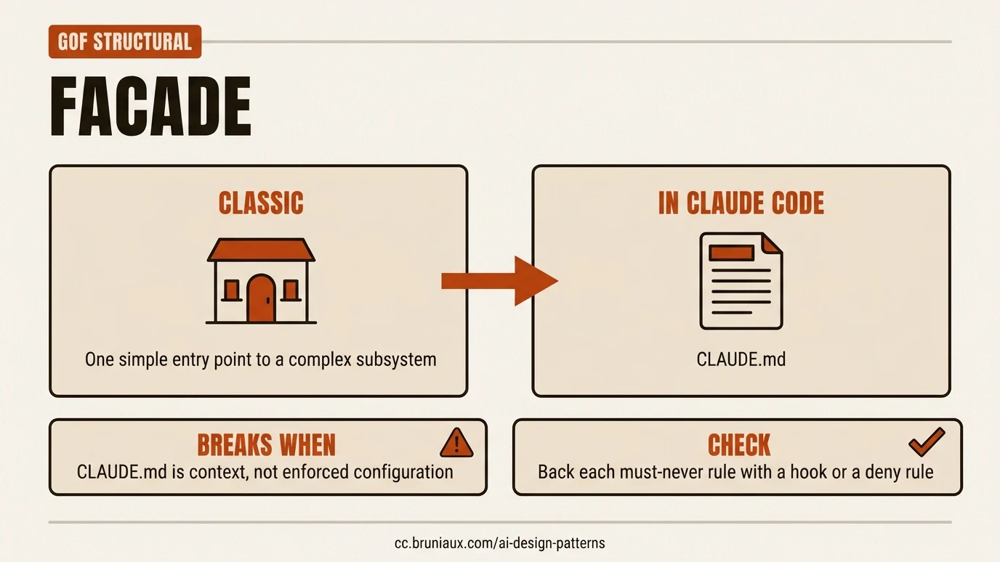
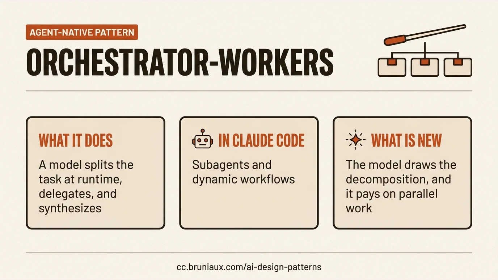
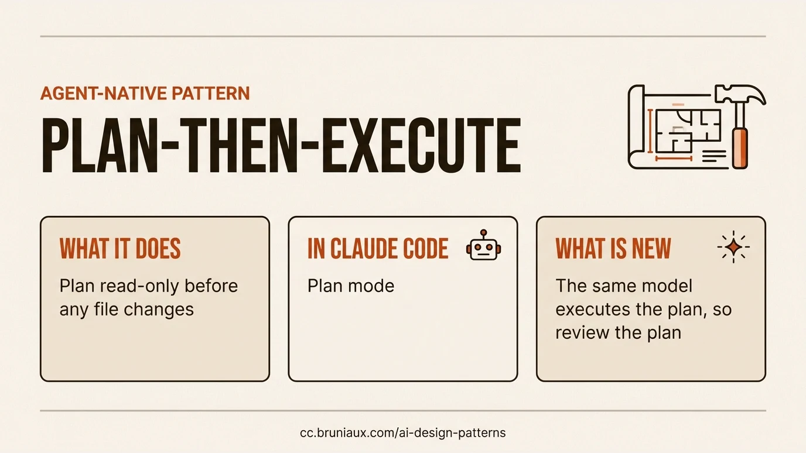
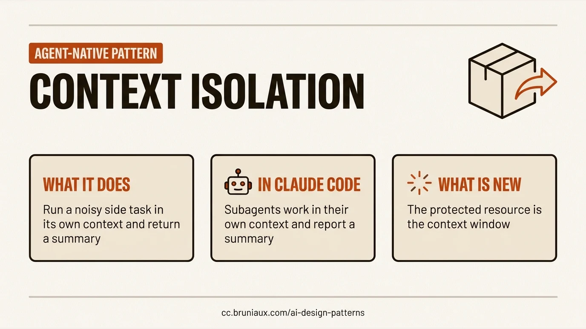
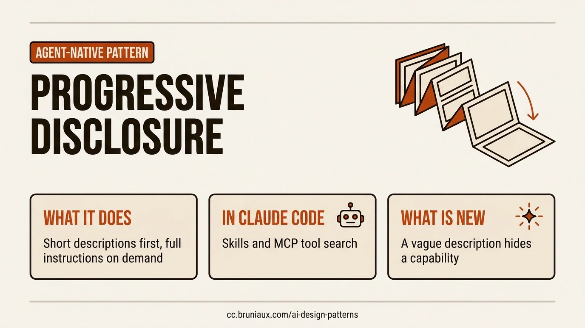
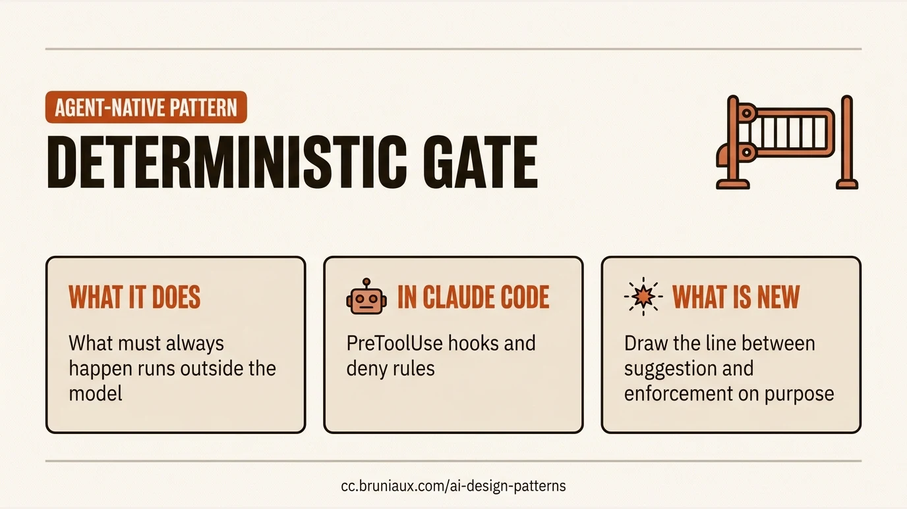
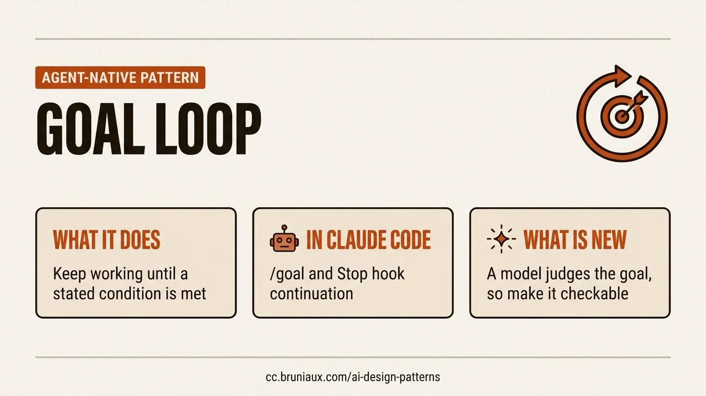
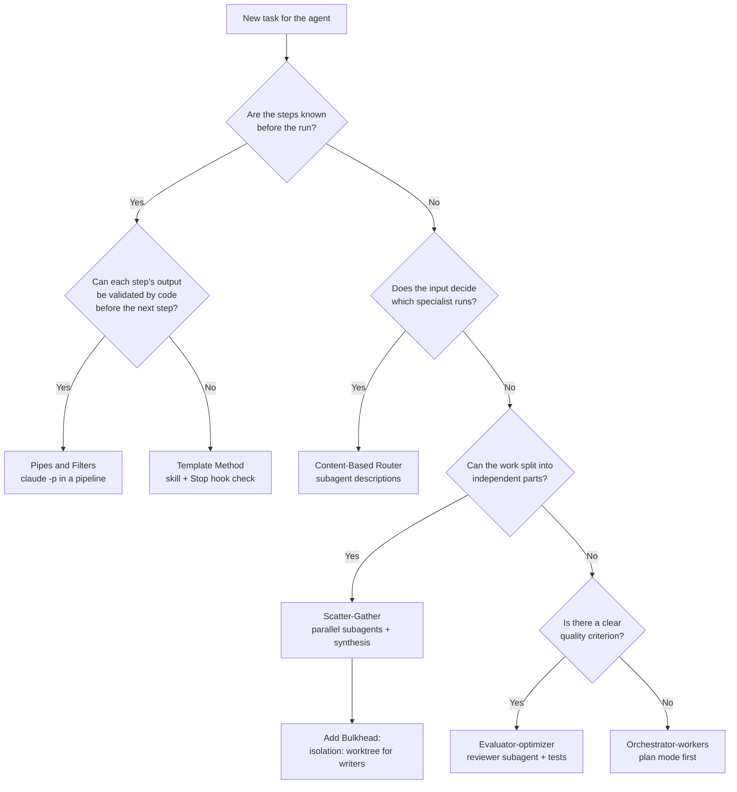

# AI design patterns

Developers already share a vocabulary for structure: Observer, Chain of Responsibility, Circuit Breaker, Saga. This page maps that vocabulary onto agent harnesses, names the Claude Code mechanism behind each mapping, and states where the mapping fails.

> **Work in progress:** this page is an attempt to connect two vocabularies, not a reference. The mappings are a reading to discuss and correct, and they will change as Claude Code and the sources change. If a mapping does not hold for you, [open an issue](https://github.com/FlorianBruniaux/claude-code-ultimate-guide/issues) with the case where it breaks. The research behind it also relies on two of the author's local research tools, which help find and cite source material: [youtube-video-insights](https://github.com/FlorianBruniaux/youtube-video-insights) for searchable conference talk transcripts with timestamps, and [paper-insights](https://github.com/FlorianBruniaux/paper-insights) for a local corpus of papers with verified citations.
>
> **Status:** No standard crosswalk exists. Published mappings agree on some pairs and disagree on others, and none of the sources read for this page maps classic patterns to Claude Code mechanisms except for hooks and CLAUDE.md. Every other Claude Code column entry is this guide's mapping, marked `Our mapping`. Mechanisms are checked against the [official documentation](https://code.claude.com/docs/llms-full.txt) (last verified 2026-10-27).
>
> **Use this page for:** explaining an agent design to developers in terms they know, and checking a design against the failure modes each pattern carries. For the components of a harness, see [Agent Harness Engineering](./agent-harness.md). For loop and graph contracts, see [Loop & Graph Engineering](./loop-graph-engineering.md). For patterns inside a single skill, see [Skill Design Patterns](./skill-design-patterns.md).

The tables on this page are generated from [`machine-readable/ai-design-patterns.json`](../../machine-readable/ai-design-patterns.json) by `scripts/build-ai-design-patterns.py`. Edit the dataset, not the tables.

## Contents

1. [TL;DR](#tldr)
2. [Lineage](#lineage)
3. [How to read](#how-to-read)
4. [Crosswalk](#crosswalk)
5. [Pattern cards](#pattern-cards)
6. [Where the analogy breaks](#where-the-analogy-breaks)
7. [Native agent patterns](#native-agent-patterns)
8. [Choose a pattern](#choose-a-pattern)
9. [Anti-patterns](#anti-patterns)
10. [Classic side](#classic-side)
11. [Further reading](#further-reading)
12. [Sources](#sources)

---

## TL;DR

- The classic patterns in this table still describe agent systems, but the component in the middle is now a model that decides at runtime. A pattern that relied on a fixed order or a guaranteed call needs a deterministic check next to it.
- In Claude Code, the mappings with the clearest documented mechanism are Observer to hooks, Memento to checkpoints, Mediator to the main conversation coordinating subagents, Bulkhead to subagent context and worktree isolation. Turn and budget limits give bounded execution, the static half of a Circuit Breaker: they stop a run, they do not detect failures. Only Observer and Facade are named by a source; the others are this guide's mapping.
- Two common assumptions are wrong in detail. Hooks for the same event run in parallel, so they do not form a chain. Checkpoints track Claude's file edits only, so rewind does not undo shell commands or remote effects.
- Each classic pattern card ends with a check you can run.

## Lineage

Three generations of patterns solve the same kind of problem at different scales:

- **Object patterns** (Gamma, Helm, Johnson, Vlissides, 1994) describe how objects collaborate inside one program. A developer writes the structure, even when it swaps behavior at runtime, as Strategy does.
- **Integration and distributed patterns** (Hohpe and Woolf's [Enterprise Integration Patterns](https://www.enterpriseintegrationpatterns.com/), 2003, and the resilience patterns that followed) describe how services exchange messages and survive partial failure.
- **Agent patterns** (Anthropic's [Building effective agents](https://www.anthropic.com/engineering/building-effective-agents), 2024, and the catalogs that followed) describe how a harness steers a model that chooses its next action itself.

Jia Huang's [Pattern Evolution](https://kage-ai.com/research/pattern-evolution/) frames the third step as a shift in who chooses the structure: a developer who writes it, or a model that picks its next step while running, with incomplete information. That shift is why each card below carries a failure mode: the classic name describes the structure, and the card states which behavior the harness no longer guarantees.

Practitioners make the same connection on stage. Frank Coyle (UC Berkeley) recalls the 1990s movement: "We now have patterns for agents, but there's also anti-patterns" ([talk, 2:13](https://www.youtube.com/watch?v=Z-c11pV_uvU&t=133s)). Nishant Gupta (Meta Superintelligence Labs) maps the older layer directly: "Distributed systems have solved something similar for decades" ([talk, 6:03](https://www.youtube.com/watch?v=APh1Vx0oLmQ&t=363s)). On The Pragmatic Engineer, the case is that agents need the guardrails of enterprise patterns: "old patterns are seeming to coming back" ([episode, 44:04](https://www.youtube.com/watch?v=5wks1W-auKY&t=2644s)). Talks for individual patterns are linked from each card under **Watch**.

![Overview of the 29 patterns on this page in six columns: GoF creational (Factory Method, Singleton), GoF structural (Adapter, Composite, Decorator, Facade), GoF behavioral (Chain of Responsibility, Command, Mediator, Memento, Observer, Strategy, Template Method), Enterprise integration (Pipes and Filters, Content-Based Router, Scatter-Gather), Distributed and resilience (Bulkhead, Circuit Breaker, Saga, Sidecar, Event Sourcing), and Agent-native (Orchestrator-workers, Evaluator-optimizer, Plan-then-execute, Context isolation, Context compaction, Progressive disclosure, Deterministic gate, Goal loop).](../images/ai-design-patterns/overview-en.webp)

## How to read

Each crosswalk row carries two labels.

| Label | Meaning |
|---|---|
| `Consensus` | Two or more distinct sources map the classic pattern to the same main agent analogue. A card may add a second reading that refines it. |
| `Single source` | One source proposes the mapping. Treat it as a proposal. |
| `Divergent` | Sources map the same classic pattern to different agent analogues. The card lists each reading with its source. |
| `Named by a source` | A source names the Claude Code mechanism itself. |
| `Our mapping` | Sources give the generic agent analogue; this guide maps it to Claude Code. |

A row enters the table only when three conditions hold: a public source maps the classic pattern to an agent analogue, a documented Claude Code mechanism exists, and a failure mode can be stated. Saga is the one deliberate exception: Claude Code has no native compensation mechanism, and the row documents that gap.

## Crosswalk

<!-- BEGIN GENERATED: crosswalk-table -->

| Classic pattern | Family | Agent analogue | In Claude Code | Evidence | Mapping |
|---|---|---|---|---|---|
| [Factory Method](#factory-method) | GoF creational | Subagent spawning from a named definition | Subagent definitions and the Agent tool | Consensus | Our mapping |
| [Singleton](#singleton) | GoF creational | Shared tool registry / Layered memory governance: decide which state is shared, isolated, persisted, or ephemeral | CLAUDE.md hierarchy and auto memory (shared state, not a Singleton) | Divergent | Our mapping |
| [Adapter](#adapter) | GoF structural | Tool adapter that exposes an external system to the model | MCP servers | Consensus | Our mapping |
| [Composite](#composite) | GoF structural | An agent that delegates to agents that can delegate again | Nested subagents (spawn depth) | Consensus | Our mapping |
| [Decorator](#decorator) | GoF structural | Guardrail wrapped around a model call / Context-injection middleware that enriches each request | UserPromptSubmit and PostToolUse hooks | Divergent | Our mapping |
| [Facade](#facade) | GoF structural | Project instruction file as the single entry point for conventions | CLAUDE.md | Single source | Named by a source |
| [Chain of Responsibility](#chain-of-responsibility) | GoF behavioral | Hook or permission pipeline in front of tool calls / Agents chained so each one handles what it can and passes the rest | Permission rules: deny, then ask, then allow | Divergent | Our mapping |
| [Command](#command) | GoF behavioral | A tool call: a named action with structured arguments | Tool calls and PreToolUse hooks | Consensus | Our mapping |
| [Mediator](#mediator) | GoF behavioral | Orchestrator that coordinates workers which never talk to each other | Main conversation coordinating subagents; Agent teams (experimental, off by default; peer messaging, the non-mediated alternative) | Consensus | Our mapping |
| [Memento](#memento) | GoF behavioral | Checkpoint and rewind of agent state | Checkpointing and /rewind | Consensus | Our mapping |
| [Observer](#observer) | GoF behavioral | Lifecycle hooks that react to agent events | Hooks (PreToolUse, PostToolUse, Stop, SubagentStop) | Consensus | Named by a source |
| [Strategy](#strategy) | GoF behavioral | Model or approach selected per task / Runtime strategy switching, with the harness recording why, at what cost, and how to roll back | model field per subagent and /model | Consensus | Our mapping |
| [Template Method](#template-method) | GoF behavioral | System prompt that defines the steps / Fixed agent-loop skeleton with pluggable steps | Skills that define a procedure; Stop hook as the final step check | Divergent | Our mapping |
| [Pipes and Filters](#pipes-and-filters) | Enterprise integration | Pipeline where each agent or model call is a filter | Print mode in a shell pipeline (claude -p) | Consensus | Our mapping |
| [Content-Based Router](#content-based-router) | Enterprise integration | Classifier that sends a request to a specialized handler | Automatic delegation by subagent description; Skill selection by description | Consensus | Our mapping |
| [Scatter-Gather](#scatter-gather) | Enterprise integration | Parallel agents followed by a synthesis step | Parallel subagents; Dynamic workflows | Consensus | Our mapping |
| [Bulkhead](#bulkhead) | Distributed and resilience | Per-agent isolation of context, tools, and budget | Subagent context isolation; isolation: worktree | Consensus | Our mapping |
| [Circuit Breaker](#circuit-breaker) | Distributed and resilience | Stop limits on turns, estimated cost, and loop depth / Breakers on tools, models, and the agent's own loop | Bounded execution: --max-turns and --max-budget-usd (print mode); maxTurns in subagent frontmatter | Consensus | Our mapping |
| [Saga](#saga) | Distributed and resilience | Compensating actions for an agent plan | No native saga: checkpoints plus scripted compensation | Consensus | Our mapping |
| [Sidecar](#sidecar) | Distributed and resilience | The agent harness around the model loop | Hooks, permissions, and sandboxing around the loop | Single source | Our mapping |
| [Event Sourcing](#event-sourcing) | Distributed and resilience | The trace log as the event stream of an agent run | Session transcripts and resume (conversation persistence) | Single source | Our mapping |

<!-- END GENERATED: crosswalk-table -->

## Pattern cards

<!-- BEGIN GENERATED: pattern-cards -->

### Factory Method

`GoF creational` `Consensus` `Our mapping`

- **Classic intent:** Let a creator decide which concrete product to instantiate, behind a common interface.
- **Agent side:** Subagent spawning from a named definition ([AgentPatterns.ai](https://agentpatterns.ai/patterns/agent-design/classical-se-patterns-agent-analogues/), [Esther Aznar, Ivan Garcia Villar](https://aicodingpatterns.com/patterns/patrones-gof-patrones-agenticos-mapeo-completo/))
- **In Claude Code:** [Subagent definitions and the Agent tool](https://code.claude.com/docs/en/sub-agents)
- **Failure mode:** The factory hands every product the full toolbox: a subagent definition without a tools field inherits every tool available to subagents.
- **How to verify:** List the tools field of each definition in .claude/agents/ and fail review when a write-capable agent has no explicit allowlist.

### Singleton

`GoF creational` `Divergent` `Our mapping`

- **Classic intent:** Guarantee one shared instance of a component with a global access point.
- **Agent side, sources disagree:**
  - Shared tool registry ([Esther Aznar, Ivan Garcia Villar](https://aicodingpatterns.com/patterns/patrones-gof-patrones-agenticos-mapeo-completo/))
  - Layered memory governance: decide which state is shared, isolated, persisted, or ephemeral ([Jia Huang](https://kage-ai.com/research/pattern-evolution/))
- **In Claude Code:** [CLAUDE.md hierarchy and auto memory (shared state, not a Singleton)](https://code.claude.com/docs/en/memory)
- **Failure mode:** Claude Code provides no Singleton here: several CLAUDE.md and memory files load and combine, and nothing enforces one instance or one access point. What carries over is the risk of unmanaged shared state: parallel sessions or agents that write the same memory file at the same time can overwrite each other's entries.
- **How to verify:** Run two sessions that both append to the same memory file and check whether either entry is lost.
- **Go further:** [Memory systems: the native Claude Code memory stack](memory-systems.md#2-native-claude-code-memory-stack) (guide); [Persistent memory: the six failures that never raise an error](https://www.florian.bruniaux.com/guides/persistent-memory-silent-failures/) (author's article)

### Adapter

`GoF structural` `Consensus` `Our mapping`

- **Classic intent:** Convert the interface of an existing component into the interface a client expects.
- **Agent side:** Tool adapter that exposes an external system to the model ([Esther Aznar, Ivan Garcia Villar](https://aicodingpatterns.com/patterns/patrones-gof-patrones-agenticos-mapeo-completo/), [Marco Nissen](https://github.com/agentpatternscatalog/patterns))
- **In Claude Code:** [MCP servers](https://code.claude.com/docs/en/mcp)
- **Failure mode:** The adapter mirrors every upstream endpoint, so tool definitions crowd the context and the model picks among near-duplicate tools.
- **How to verify:** Run /mcp and /context, then remove or defer the tools that no task in the last sprint used.
- **Go further:** [MCP servers ecosystem](../ecosystem/mcp-servers-ecosystem.md) (guide); [MCP servers: what they actually cost and when to use them](https://www.florian.bruniaux.com/guides/mcp-servers-token-cost/) (author's article)
- **Watch:** Christian Tzolov and Dariusz Jędrzejczyk (Devoxx), [Unifying AI integration with Model Context Protocol](https://www.youtube.com/watch?v=PJOthBhLbao&t=1262s) at 21:02: The speakers explain that each vendor exposes its own APIs through an MCP server layer, a unified wrapper the LLM can use.

### Composite

`GoF structural` `Consensus` `Our mapping`

- **Classic intent:** Treat a single object and a tree of objects through the same interface.
- **Agent side:** An agent that delegates to agents that can delegate again ([AgentPatterns.ai](https://agentpatterns.ai/patterns/agent-design/classical-se-patterns-agent-analogues/), [Esther Aznar, Ivan Garcia Villar](https://aicodingpatterns.com/patterns/patrones-gof-patrones-agenticos-mapeo-completo/))
- **In Claude Code:** [Nested subagents (spawn depth)](https://code.claude.com/docs/en/sub-agents)
- **Failure mode:** Recursion without a budget: each layer multiplies token use. Claude Code caps nesting with CLAUDE_CODE_MAX_SUBAGENT_SPAWN_DEPTH, which can be adjusted but not removed.
- **How to verify:** Set CLAUDE_CODE_MAX_SUBAGENT_SPAWN_DEPTH explicitly for automated runs and log spawned subagents with a SubagentStop hook.
- **Watch:** Clément Escoffier and Mario Fusco (Devoxx), [From LLM orchestration to autonomous agents: Agentic AI patterns with LangChain4j](https://www.youtube.com/watch?v=SrFXsjeGc6Q&t=6741s) at 112:21: The speakers show an agent in a sequence that is itself a loop of two agents, so a workflow is used like a single sub agent.

### Decorator

`GoF structural` `Divergent` `Our mapping`

- **Classic intent:** Add behavior to an object by wrapping it, without changing its class.
- **Agent side, sources disagree:**
  - Guardrail wrapped around a model call ([Esther Aznar, Ivan Garcia Villar](https://aicodingpatterns.com/patterns/patrones-gof-patrones-agenticos-mapeo-completo/))
  - Context-injection middleware that enriches each request ([AgentPatterns.ai](https://agentpatterns.ai/patterns/agent-design/classical-se-patterns-agent-analogues/))
- **In Claude Code:** [UserPromptSubmit and PostToolUse hooks](https://code.claude.com/docs/en/hooks)
- **Failure mode:** A classic decorator stack has a fixed order. Matching hooks run in parallel, so a wrapper that assumes another wrapper already ran is a race.
- **How to verify:** Write each hook so it passes when run alone, and test it with the other hooks disabled.
- **Go further:** [Hooks events reference](hooks-events-reference.md) (guide); [Smart-Suggest routing: a UserPromptSubmit hook that adds skill candidates to the prompt](../workflows/smart-suggest-routing.md#claude-code-architecture) (guide)
- **Watch:** Mark Pollack, Christian Tzolov, Josh Long, James Ward (Devoxx), [Bootiful Spring AI](https://www.youtube.com/watch?v=Sw3PlFXfWj4&t=703s) at 11:43: The speaker explains Spring AI advisors as a filter or pre-processor that wraps calls to and from the model and can mutate or log each request.
- **Watch:** Thariq Shihipar, [Claude Agent SDK [Full Workshop]](https://www.youtube.com/watch?v=TqC1qOfiVcQ&t=6430s) at 107:10: An Anthropic speaker says hooks fire as events in the Agent SDK and are used for deterministic verification or for inserting context.

### Facade

`GoF structural` `Single source` `Named by a source`

- **Classic intent:** Offer one simple entry point in front of a complex subsystem.
- **Agent side:** Project instruction file as the single entry point for conventions ([AgentPatterns.ai](https://agentpatterns.ai/patterns/agent-design/classical-se-patterns-agent-analogues/))
- **In Claude Code:** [CLAUDE.md](https://code.claude.com/docs/en/memory)
- **Failure mode:** The facade is read as a contract. The docs state that Claude treats CLAUDE.md as context, not enforced configuration: a rule written there is a request, not a guarantee.
- **How to verify:** For every must-never rule in CLAUDE.md, add a PreToolUse hook or a deny rule and a test that triggers it.
- **Go further:** [Your CLAUDE.md is too long](https://www.florian.bruniaux.com/blog/articles/your-claudemd-is-too-long/) (author's article); [ctxharness: checks that claims in CLAUDE.md and rules still match the project](https://github.com/FlorianBruniaux/ctxharness) (author's project); [Team AI instructions](../workflows/team-ai-instructions.md) (guide)

### Chain of Responsibility

`GoF behavioral` `Divergent` `Our mapping`

- **Classic intent:** Pass a request along a chain of handlers until one of them handles it.
- **Agent side, sources disagree:**
  - Hook or permission pipeline in front of tool calls ([AgentPatterns.ai](https://agentpatterns.ai/patterns/agent-design/classical-se-patterns-agent-analogues/), [Ashish Patel](https://github.com/ashishpatel26/agent-harness-engineering-pattern))
  - Agents chained so each one handles what it can and passes the rest ([Esther Aznar, Ivan Garcia Villar](https://aicodingpatterns.com/patterns/patrones-gof-patrones-agenticos-mapeo-completo/))
- **In Claude Code:** [Permission rules: deny, then ask, then allow](https://code.claude.com/docs/en/permissions)
- **Failure mode:** Teams expect declaration order or rule specificity to decide. The docs state that rules are evaluated deny, then ask, then allow, and specificity does not change that order: a broad deny beats a narrow allow.
- **How to verify:** Add a deny and a more specific allow for the same command in a test project and check that the command stays blocked.

### Command

`GoF behavioral` `Consensus` `Our mapping`

- **Classic intent:** Turn a request into an object that can be queued, logged, checked, or undone.
- **Agent side:** A tool call: a named action with structured arguments ([Esther Aznar, Ivan Garcia Villar](https://aicodingpatterns.com/patterns/patrones-gof-patrones-agenticos-mapeo-completo/), [Ashish Patel](https://github.com/ashishpatel26/agent-harness-engineering-pattern))
- **In Claude Code:** [Tool calls and PreToolUse hooks](https://code.claude.com/docs/en/tools-reference)
- **Failure mode:** The command object is written by the model. Without validation before dispatch, a malformed or out-of-scope argument executes as written.
- **How to verify:** Feed a PreToolUse hook a recorded tool input with an out-of-scope path and assert that it blocks.
- **Go further:** [Hooks events reference](hooks-events-reference.md) (guide)

### Mediator

`GoF behavioral` `Consensus` `Our mapping`

- **Classic intent:** Centralize how a set of components talk, so they do not reference each other directly.
- **Agent side:** Orchestrator that coordinates workers which never talk to each other ([Esther Aznar, Ivan Garcia Villar](https://aicodingpatterns.com/patterns/patrones-gof-patrones-agenticos-mapeo-completo/), [Sarkar and Sarkar](https://arxiv.org/abs/2506.05364))
- **In Claude Code:** [Main conversation coordinating subagents](https://code.claude.com/docs/en/sub-agents); [Agent teams (experimental, off by default; peer messaging, the non-mediated alternative)](https://code.claude.com/docs/en/agent-teams)
- **Failure mode:** The topology is not enforced, and the mediator can become the bottleneck. A subagent whose tools include SendMessage can message other named agents directly, without agent teams. And if workers return transcripts instead of summaries, the coordinating context fills with material it never reads again.
- **How to verify:** Leave SendMessage out of a worker's tools when all traffic must go through the coordinator, ask each subagent for a bounded final report, and compare /context before and after a delegation.
- **Go further:** [Agent teams](../workflows/agent-teams.md) (guide); [Cross-session messaging: peer messages without a mediator](../workflows/cross-session-messaging.md) (guide)
- **Watch:** Sandipan Bhaumik, [From Chaos to Choreography: Multi-Agent Orchestration Patterns That Actually Work](https://www.youtube.com/watch?v=2czYyrTzILg&t=529s) at 8:49: In orchestration, every call goes through the orchestrator and agents never call each other.

### Memento

`GoF behavioral` `Consensus` `Our mapping`

- **Classic intent:** Capture an object's state so it can be restored later without exposing its internals.
- **Agent side:** Checkpoint and rewind of agent state ([AgentPatterns.ai](https://agentpatterns.ai/patterns/agent-design/classical-se-patterns-agent-analogues/), [Ashish Patel](https://github.com/ashishpatel26/agent-harness-engineering-pattern))
- **In Claude Code:** [Checkpointing and /rewind](https://code.claude.com/docs/en/checkpointing)
- **Failure mode:** The snapshot is partial. The docs state that checkpoints only track changes made through Claude's file editing tools; Bash commands and external processes are not captured, and edits made by a background subagent usually are not either.
- **How to verify:** Use a Bash command to change a file Claude has not edited in this session, rewind, and confirm the change survives. Commit with git before risky shell work or delegated edits.
- **Watch:** Hamza Tahir, [Your Agents Need a Save Button](https://www.youtube.com/watch?v=bZISsg7H7DA&t=14s) at 0:14: The speaker argues agents need a save button: runtime checkpoints that let you replay, diff and decide, instead of read-only traces.

### Observer

`GoF behavioral` `Consensus` `Named by a source`

- **Classic intent:** Notify subscribers automatically when a subject changes state.
- **Agent side:** Lifecycle hooks that react to agent events ([AgentPatterns.ai](https://agentpatterns.ai/patterns/agent-design/classical-se-patterns-agent-analogues/), [Esther Aznar, Ivan Garcia Villar](https://aicodingpatterns.com/patterns/patrones-gof-patrones-agenticos-mapeo-completo/))
- **In Claude Code:** [Hooks (PreToolUse, PostToolUse, Stop, SubagentStop)](https://code.claude.com/docs/en/hooks)
- **Failure mode:** Subscribers assume an order. The docs state that matching hooks run in parallel, that Claude Code combines their outputs after all of them finish, and that for permission decisions the most restrictive result applies: one hook's deny does not stop a sibling hook's side effects.
- **How to verify:** Run each hook alone against a recorded event payload; a hook that only passes after another one is not an observer.
- **Go further:** [Hooks events reference](hooks-events-reference.md) (guide); [Claude Code under the hood](https://www.florian.bruniaux.com/blog/articles/claude-code-under-the-hood/) (author's article)
- **Watch:** Cole Medin, [Watch This If Your Coding Agent is Ignoring Your Rules (You Need Hooks)](https://www.youtube.com/watch?v=msfMqW92Y8Q&t=44s) at 0:44: The speaker defines hooks as actions guaranteed to fire on agent events, such as just before a file read or when the conversation stops.

### Strategy

`GoF behavioral` `Consensus` `Our mapping`

- **Classic intent:** Swap one algorithm for another behind the same interface at runtime.
- **Agent side, main reading first:**
  - Model or approach selected per task ([AgentPatterns.ai](https://agentpatterns.ai/patterns/agent-design/classical-se-patterns-agent-analogues/), [Esther Aznar, Ivan Garcia Villar](https://aicodingpatterns.com/patterns/patrones-gof-patrones-agenticos-mapeo-completo/))
  - Runtime strategy switching, with the harness recording why, at what cost, and how to roll back ([Jia Huang](https://kage-ai.com/research/pattern-evolution/))
- **In Claude Code:** [model field per subagent and /model](https://code.claude.com/docs/en/model-config)
- **Failure mode:** The strategy changes silently. Nobody can tell afterwards which model produced which result or what the switch cost.
- **How to verify:** Pin model in each subagent definition and check /usage or the session transcript after a run.
- **Go further:** [agent-router-core: experimental deterministic routing CLI for agent workflows](https://github.com/FlorianBruniaux/agent-router-core) (author's project); [cc-copilot-bridge: multi-provider routing for Claude Code](https://github.com/FlorianBruniaux/cc-copilot-bridge) (author's project); [Measuring your own AI usage: three meters, three different answers](https://www.florian.bruniaux.com/blog/articles/real-cost-of-ai-measuring-your-own-usage/) (author's article)
- **Watch:** Archana Kamath and Tyler Gillam, [Preferences Over Benchmarks: Model Routing](https://www.youtube.com/watch?v=FvxY8oPoI8o&t=106s) at 1:46: The speaker argues that one model for every task is overkill and that routing each task to a fitting model cuts cost and risk.

### Template Method

`GoF behavioral` `Divergent` `Our mapping`

- **Classic intent:** Fix the skeleton of an algorithm and let subclasses fill in some steps.
- **Agent side, sources disagree:**
  - System prompt that defines the steps ([Esther Aznar, Ivan Garcia Villar](https://aicodingpatterns.com/patterns/patrones-gof-patrones-agenticos-mapeo-completo/))
  - Fixed agent-loop skeleton with pluggable steps ([Ashish Patel](https://github.com/ashishpatel26/agent-harness-engineering-pattern))
- **In Claude Code:** [Skills that define a procedure](https://code.claude.com/docs/en/skills); [Stop hook as the final step check](https://code.claude.com/docs/en/hooks)
- **Failure mode:** A prose skeleton is not enforced: the model can skip or reorder a step, unlike a base class that calls the steps itself.
- **How to verify:** Give the last step an artifact (a file, a test run) and block completion with a Stop hook when the artifact is missing.
- **Go further:** [Skill design patterns](skill-design-patterns.md) (guide); [TDD with Claude](../workflows/tdd-with-claude.md) (guide); [TDD with Claude Code](https://www.florian.bruniaux.com/guides/tdd-with-claude-code/) (author's article)
- **Watch:** Cole Medin, [Stripe's Coding Agents Ship 1,300 PRs EVERY Week - Here's How They Do It](https://www.youtube.com/watch?v=NMWgXvm--to&t=421s) at 7:01: The speaker describes Stripe's blueprints: agent skills interwoven with deterministic code in a fixed workflow.

### Pipes and Filters

`Enterprise integration` `Consensus` `Our mapping`

- **Classic intent:** Process a message through a sequence of independent steps connected by channels.
- **Agent side:** Pipeline where each agent or model call is a filter ([Roan Brasil](https://github.com/roanbrasil/agents-integration-patterns), [Marco Nissen](https://github.com/agentpatternscatalog/patterns))
- **In Claude Code:** [Print mode in a shell pipeline (claude -p)](https://code.claude.com/docs/en/headless)
- **Failure mode:** A filter emits free text that the next filter misreads, and the error travels down the pipe.
- **How to verify:** Use --output-format json between steps and validate the shape before the next filter runs.
- **Go further:** [GitHub Actions workflows](../workflows/github-actions.md) (guide)
- **Watch:** Mark Pollack, Christian Tzolov, Josh Long, James Ward (Devoxx), [Bootiful Spring AI](https://www.youtube.com/watch?v=Sw3PlFXfWj4&t=2291s) at 38:11: The speaker pipes git log into claude -p to generate release notes and calls it pipes and filters all over again.
- **Watch:** Kevin Dubois and Mario Fusco (Devoxx), [Agentic AI Patterns](https://www.youtube.com/watch?v=X9baI7RBhqk&t=491s) at 8:11: The speakers present the sequence pattern, calling one agent after another, also known as prompt chaining.

### Content-Based Router

`Enterprise integration` `Consensus` `Our mapping`

- **Classic intent:** Route each message to a destination based on its content.
- **Agent side:** Classifier that sends a request to a specialized handler ([Roan Brasil](https://github.com/roanbrasil/agents-integration-patterns), [Anthropic](https://www.anthropic.com/engineering/building-effective-agents))
- **In Claude Code:** [Automatic delegation by subagent description](https://code.claude.com/docs/en/sub-agents); [Skill selection by description](https://code.claude.com/docs/en/skills)
- **Failure mode:** Overlapping descriptions route the same request to different handlers from one run to the next.
- **How to verify:** Keep a set of routing prompts with the expected subagent or skill, and rerun it after every description change.
- **Go further:** [BM25 router, step by step](../workflows/smart-suggest-routing.md#bm25-router-step-by-step) (guide); [Runnable BM25 routing hook](../../examples/hooks/bm25-routing/README.md) (template); [cc-skill-usage: counts real Skill invocations in transcripts](https://github.com/FlorianBruniaux/cc-skill-usage) (author's project)
- **Watch:** Goulven Le Dû (Doctolib), [Alfred le système Agentic AI de Doctolib au service des professionnels de santé](https://www.youtube.com/watch?v=uTM3fRgbUN0&t=252s) at 4:12: Doctolib's Alfred has a route agent that uses an intention classification model to send each request to a specialized agent.
- **Watch:** Renato Guerra Cavalcanti (Devoxx), [Akka: an enterprise runtime for resilient agentic AI](https://www.youtube.com/watch?v=PrIh_9HomfI&t=821s) at 13:41: The speaker describes a router that receives a message and decides which agent gets it, by LLM or plain if and else.

### Scatter-Gather

`Enterprise integration` `Consensus` `Our mapping`

- **Classic intent:** Send a request to several recipients and aggregate their replies.
- **Agent side:** Parallel agents followed by a synthesis step ([Esther Aznar, Ivan Garcia Villar](https://aicodingpatterns.com/patterns/patrones-gof-patrones-agenticos-mapeo-completo/), [Roan Brasil](https://github.com/roanbrasil/agents-integration-patterns))
- **In Claude Code:** [Parallel subagents](https://code.claude.com/docs/en/sub-agents); [Dynamic workflows](https://code.claude.com/docs/en/workflows)
- **Failure mode:** The gather step averages contradicting answers instead of reconciling them, and token cost grows with every branch.
- **How to verify:** Make the synthesis step list disagreements explicitly, and compare the run's cost with a single-agent baseline.
- **Go further:** [Dynamic workflows](../workflows/dynamic-workflows.md) (guide); [Best-of-N](../workflows/best-of-n.md) (guide); [Multi-provider code review](../workflows/multi-provider-code-review.md) (guide)
- **Watch:** Renato Guerra Cavalcanti (Devoxx), [Akka: an enterprise runtime for resilient agentic AI](https://www.youtube.com/watch?v=PrIh_9HomfI&t=786s) at 13:06: The speaker describes calling several agents in parallel, waiting for all results and passing them to a summarizer.
- **Watch:** Colin (LangChain), [Dynamic Subagents: How to Run Parallel Agents Reliably in Deep Agents](https://www.youtube.com/watch?v=5AkdMangfNk&t=46s) at 0:46: In a demo, the agent fans out 15 subagents in parallel and then picks the best result.

### Bulkhead

`Distributed and resilience` `Consensus` `Our mapping`

- **Classic intent:** Isolate resources per consumer so one failure cannot sink the whole system.
- **Agent side:** Per-agent isolation of context, tools, and budget ([Esther Aznar, Ivan Garcia Villar](https://aicodingpatterns.com/patterns/patrones-gof-patrones-agenticos-mapeo-completo/), [Jia Huang](https://kage-ai.com/research/pattern-evolution/))
- **In Claude Code:** [Subagent context isolation](https://code.claude.com/docs/en/sub-agents); [isolation: worktree](https://code.claude.com/docs/en/worktrees)
- **Failure mode:** Only the context is isolated. Parallel agents still share one checkout and overwrite each other's files.
- **How to verify:** Give write-capable parallel subagents isolation: worktree and check that git status in the main checkout stays clean during the run.
- **Go further:** [Sandbox isolation](../security/sandbox-isolation.md) (guide); [Plan-execute: running 20+ agents on a migration (worktree isolation)](https://www.florian.bruniaux.com/guides/plan-execute-migrations/) (author's article); [wt-sweep: discovers Git worktrees and reviews integration evidence](https://github.com/FlorianBruniaux/wt-sweep) (author's project)

### Circuit Breaker

`Distributed and resilience` `Consensus` `Our mapping`

- **Classic intent:** Stop calling a failing dependency after repeated failures, and fail fast.
- **Agent side, main reading first:**
  - Stop limits on turns, estimated cost, and loop depth ([AgentPatterns.ai](https://agentpatterns.ai/patterns/agent-design/classical-se-patterns-agent-analogues/), [Esther Aznar, Ivan Garcia Villar](https://aicodingpatterns.com/patterns/patrones-gof-patrones-agenticos-mapeo-completo/), [James Davies](https://github.com/jlldavies/go4-llm-design-patterns))
  - Breakers on tools, models, and the agent's own loop ([Jia Huang](https://kage-ai.com/research/pattern-evolution/))
- **In Claude Code:** [Bounded execution: --max-turns and --max-budget-usd (print mode)](https://code.claude.com/docs/en/cli-reference); [maxTurns in subagent frontmatter](https://code.claude.com/docs/en/sub-agents)
- **Failure mode:** These limits are bounded execution, not a breaker. A circuit breaker watches failures and opens; these caps are fixed before the run and do not track failures. --max-turns has no limit by default and counts turns, not cost. --max-budget-usd stops on a client-side cost estimate, and the docs warn that spend can pass the cap, so leave headroom.
- **How to verify:** Run the automated job with --max-turns and --max-budget-usd set, on a task designed to loop, and check that it exits with an error and how far the reported spend went past the cap.
- **Go further:** [Loop & Graph Engineering: write a loop contract](loop-graph-engineering.md#2-write-a-loop-contract) (guide); [Designing a bounded review loop](https://www.florian.bruniaux.com/guides/bounded-code-review-loop/) (author's article)
- **Watch:** Sandipan Bhaumik, [From Chaos to Choreography: Multi-Agent Orchestration Patterns That Actually Work](https://www.youtube.com/watch?v=2czYyrTzILg&t=1011s) at 16:51: The speaker applies the circuit breaker to agent-to-agent calls: after repeated failures the circuit opens, fails fast, then half-opens to test recovery.
- **Watch:** Tisha Chawla and Susheem Koul, [FinOps for AI Agents: Who Spent All the Tokens?](https://www.youtube.com/watch?v=GJX19pNhmSw&t=1056s) at 17:36: In a demo, an agent that exceeds its per-run budget is killed immediately, which the speaker calls a simple circuit breaker.

### Saga

`Distributed and resilience` `Consensus` `Our mapping`

- **Classic intent:** Run a long transaction as local steps, each with a compensating action if a later step fails.
- **Agent side:** Compensating actions for an agent plan ([AgentPatterns.ai](https://agentpatterns.ai/patterns/agent-design/classical-se-patterns-agent-analogues/), [Esther Aznar, Ivan Garcia Villar](https://aicodingpatterns.com/patterns/patrones-gof-patrones-agenticos-mapeo-completo/), [Jia Huang](https://kage-ai.com/research/pattern-evolution/), [Vasundra Srinivasan](https://arxiv.org/abs/2605.20173))
- **In Claude Code:** [No native saga: checkpoints plus scripted compensation](https://code.claude.com/docs/en/checkpointing)
- **Failure mode:** Rewind is mistaken for compensation. It restores local file edits only; a push, an API call, or a database write stays done.
- **How to verify:** For every side-effecting step in an agent plan, write down its compensating action before the run, and test that action once.
- **Go further:** [Loop & Graph Engineering: reconcile interrupted effects before retrying](loop-graph-engineering.md#reconcile-interrupted-effects-before-retrying) (guide); [Production safety](../security/production-safety.md) (guide)
- **Watch:** Sandipan Bhaumik, [From Chaos to Choreography: Multi-Agent Orchestration Patterns That Actually Work](https://www.youtube.com/watch?v=2czYyrTzILg&t=1142s) at 19:02: The speaker presents the compensation or saga pattern: each agent has execute and compensate, and on failure the orchestrator walks backward calling compensate.
- **Watch:** Salman Munaf, [AI Agents Are Just Distributed Systems Now](https://www.youtube.com/watch?v=hD9-V56FNRI&t=730s) at 12:10: The speaker says a multi-step agent that fails midway must reverse the whole transaction across systems and needs a defined compensation operation.

### Sidecar

`Distributed and resilience` `Single source` `Our mapping`

- **Classic intent:** Attach cross-cutting capabilities (logging, policy, networking) next to a service instead of inside it.
- **Agent side:** The agent harness around the model loop ([Jia Huang](https://kage-ai.com/research/pattern-evolution/))
- **In Claude Code:** [Hooks, permissions, and sandboxing around the loop](https://code.claude.com/docs/en/sandboxing)
- **Failure mode:** Policy lives in the prompt instead of the sidecar, so the model can talk itself out of it. A policy hook can also fail open: on most events, a hook that crashes or times out lets the action through unless it sets onFailure: "block".
- **How to verify:** List each safety rule and name the layer that enforces it: hook, permission rule, sandbox, or prompt only. For each policy hook, point it at a missing script and check that the action is blocked.
- **Go further:** [Native sandbox](../security/sandbox-native.md) (guide); [Claude Code security: the attack surface few teams audit](https://www.florian.bruniaux.com/guides/claude-code-attack-surface/) (author's article)

### Event Sourcing

`Distributed and resilience` `Single source` `Our mapping`

- **Classic intent:** Store every state change as an event, and rebuild state by replaying the log.
- **Agent side:** The trace log as the event stream of an agent run ([Jia Huang](https://kage-ai.com/research/pattern-evolution/))
- **In Claude Code:** [Session transcripts and resume (conversation persistence)](https://code.claude.com/docs/en/sessions)
- **Failure mode:** The transcript is taken for the whole event log. It records the conversation, including model outputs and tool results, so --resume rebuilds the conversation without calling the model again. It does not record the state of files, branches, or services the session changed, so it cannot rebuild that state, and the turns after a resume are new model calls.
- **How to verify:** Before relying on a resumed session, check that the files, branch, and services it assumes still match, and keep the state you need to rebuild in git or an explicit log.
- **Go further:** [Observability: session search and resume](../ops/observability.md) (guide); [AI traceability](../ops/ai-traceability.md) (guide); [cc-sessions: search and analyze Claude Code session history](https://github.com/FlorianBruniaux/cc-sessions) (author's project)
- **Watch:** Jonas Templestein, [Make your own event-sourced agent harness using stream processors](https://www.youtube.com/watch?v=vi-2nasppAg&t=105s) at 1:45: The speaker wants to build a coding agent harness that is purely event sourced, because the agent already keeps a log of events.
- **Watch:** Ishaan Sehgal, [The Log Is The Agent](https://www.youtube.com/watch?v=UPwGaM2MKHY&t=259s) at 4:19: The speaker argues the log is the durable history from which every view of the agent (debugging, auditing, compaction) is a projection.

<!-- END GENERATED: pattern-cards -->

## Where the analogy breaks

Every break below has the same root: a classic pattern assumes the component in the middle executes what it is given, and a model does not.

**Order is not guaranteed.** A decorator stack and a chain of handlers run in a known order. Claude Code runs the matching hooks for one event in parallel, and for permission decisions the most restrictive result applies ([hooks reference](https://code.claude.com/docs/en/hooks)). Claude Code combines the outputs after all matching hooks finish, so one hook's deny does not stop the side effects of another; only a hook that reaches its timeout is canceled ([hooks guide](https://code.claude.com/docs/en/hooks-guide)). Write each hook so it is correct alone. Permission rules, by contrast, are evaluated in a documented order: deny, then ask, then allow, with specificity not changing that order ([permissions](https://code.claude.com/docs/en/permissions)).

**Restore is partial.** A memento captures the whole state it needs. Checkpoints only track changes made through Claude's file editing tools; changes made through Bash commands or external processes are not captured ([checkpointing](https://code.claude.com/docs/en/checkpointing)). Edits made by a background subagent are usually outside the checkpoints too: rewinding restores only the files Claude had already edited in the conversation. For anything outside that scope, the Saga question applies: what is the compensating action, and who runs it?

**The log is not the whole state.** An event-sourced system rebuilds its state from the log, because every state change is an event in it. A Claude Code transcript records the conversation, including tool results, so a resumed session gets the conversation back without new model calls. It does not record the files, branches, or services the session changed, so it cannot rebuild them, and what the model does after the resume is a new run. Keep the transcript as an audit trail, and keep the state you need to rebuild in git or an explicit log.

**Prose does not enforce.** A template method calls its steps; a facade is code, so every call goes through it. A skill that lists steps, or a CLAUDE.md file that states rules, is context the model reads. The docs say so directly: Claude treats CLAUDE.md as context, not enforced configuration, and points to a PreToolUse hook to block an action regardless of what Claude decides ([memory](https://code.claude.com/docs/en/memory)).

**Observers can veto.** A classic observer is notified and cannot change what its subject does. A PreToolUse hook can block the tool call it observes, so a hook is closer to a guard than to a listener. The veto only goes one way: a hook that returns allow does not bypass permission rules, and a matching deny or ask rule still applies ([permissions](https://code.claude.com/docs/en/permissions)).

**Guards fail open.** A classic guard that throws stops the request. On most events, a Claude Code hook that crashes, cannot start, or times out lets the action through, so a policy hook with a wrong path enforces nothing. Set `"onFailure": "block"` on a command or HTTP hook to reverse that, available from Claude Code v2.1.295 ([hooks reference](https://code.claude.com/docs/en/hooks)).

**Limits are static.** A classic circuit breaker opens after repeated failures and closes again after a cool-down. `--max-turns`, `--max-budget-usd`, and `maxTurns` are fixed caps set before the run ([CLI reference](https://code.claude.com/docs/en/cli-reference)): they bound a loop, they do not detect a failing dependency. The budget cap is checked against a client-side cost estimate, and the docs warn that spend can pass it.

**The wrapper is probabilistic too.** Several sources map Decorator to guardrails or to context injection. A guardrail that is itself a model call inherits the uncertainty it is meant to contain. Keep at least one deterministic check on any path that must not fail.

## Native agent patterns

These patterns sit close to classic ones, but they depend on two things classic patterns never had to manage: a context window as the scarce resource, and a model as the decision-maker. Where a crosswalk row covers a similar mechanism, the card names the closest classic pattern and what changes.

<!-- BEGIN GENERATED: native-cards -->

### Orchestrator-workers

A central model breaks a task down at runtime, delegates the parts, and synthesizes the results.

- **What is new:** Closest classic pattern: Mediator. The difference is that the model decides the decomposition during the run instead of the designer drawing it. Delegation pays on parallel work: in Google Research's controlled study, every multi-agent variant degraded a sequential planning task by 39 to 70%.
- **In Claude Code:** [Subagents](https://code.claude.com/docs/en/sub-agents); [Dynamic workflows](https://code.claude.com/docs/en/workflows)
- **Sources:** [Anthropic](https://www.anthropic.com/engineering/building-effective-agents), [Claude Code docs: Subagents](https://code.claude.com/docs/en/sub-agents), [Claude Code docs: Dynamic workflows](https://code.claude.com/docs/en/workflows), [Yubin Kim, Xin Liu (Google Research)](https://research.google/blog/towards-a-science-of-scaling-agent-systems-when-and-why-agent-systems-work/)
- **Go further:** [Dynamic workflows](../workflows/dynamic-workflows.md) (guide); [Agent teams](../workflows/agent-teams.md) (guide); [Plan-execute: running 20+ agents on a migration](https://www.florian.bruniaux.com/guides/plan-execute-migrations/) (author's article)
- **Watch:** Luke Alvoeiro, [The Multi-Agent Architecture That Actually Ships](https://www.youtube.com/watch?v=ow1we5PzK-o&t=276s) at 4:36: The speaker describes Factory's Missions system as an orchestrator that plans, workers that execute, and validators that verify.

### Evaluator-optimizer

One call produces an answer, another evaluates it and sends feedback, in a loop.

- **What is new:** The test oracle is itself a model, so the loop can converge on a wrong answer both sides accept.
- **In Claude Code:** [Reviewer subagent with its own context](https://code.claude.com/docs/en/sub-agents); [Stop hook that runs the real tests](https://code.claude.com/docs/en/hooks)
- **Sources:** [Anthropic](https://www.anthropic.com/engineering/building-effective-agents), [Claude Code docs: Subagents](https://code.claude.com/docs/en/sub-agents), [Claude Code docs: Hooks reference](https://code.claude.com/docs/en/hooks)
- **Go further:** [Best-of-N](../workflows/best-of-n.md) (guide); [When an independent reviewer earns its place](https://www.florian.bruniaux.com/blog/articles/reviewer-you-ignore/) (author's article); [Designing a bounded review loop](https://www.florian.bruniaux.com/guides/bounded-code-review-loop/) (author's article)
- **Watch:** Ash Prabaker and Andrew Wilson, [Anthropic Workshop: Build Agents That Run for Hours](https://www.youtube.com/watch?v=mR-WAvEPRwE&t=1141s) at 19:01: The speakers describe a generator and evaluator split into separate contexts, where the evaluator tests the result with Playwright and feeds critique back.
- **Watch:** Luke Alvoeiro, [The Multi-Agent Architecture That Actually Ships](https://www.youtube.com/watch?v=ow1we5PzK-o&t=334s) at 5:34: A separate validator role verifies the work, including end-to-end behavior, instead of only reading the code.

### Plan-then-execute

Separate a read-only planning phase from the phase that changes files.

- **What is new:** The plan is a reviewable artifact written before any file changes, so a wrong approach can be caught before it costs edits. Reviewing it adds a checkpoint; it does not replace review of the code that follows, and the executing model can differ from the planning one (opusplan plans with Opus and executes with Sonnet).
- **In Claude Code:** [Plan mode](https://code.claude.com/docs/en/permission-modes)
- **Sources:** [Nikola Balic and contributors](https://github.com/nibzard/awesome-agentic-patterns), [Claude Code docs: Permission modes](https://code.claude.com/docs/en/permission-modes), [Claude Code docs: Model configuration](https://code.claude.com/docs/en/model-config)
- **Go further:** [Plan-driven workflow](../workflows/plan-driven.md) (guide); [Dual-instance planning](../workflows/dual-instance-planning.md) (guide); [Plan-execute: running 20+ agents on a migration](https://www.florian.bruniaux.com/guides/plan-execute-migrations/) (author's article)
- **Watch:** Matt Pocock, [I was an AI skeptic. Then I tried plan mode](https://www.youtube.com/watch?v=WNx-s-RxVxk&t=22s) at 0:22: The speaker plans every change in plan mode, has the AI execute the plan, then tests and commits.

### Context isolation

Run a noisy side task in its own context and return a summary of the result.

- **What is new:** Closest classic pattern: Bulkhead. Here the resource being protected is the context window, not threads or connections.
- **In Claude Code:** [Subagents work in their own context and report a summary](https://code.claude.com/docs/en/sub-agents)
- **Sources:** [Lance Martin](https://rlancemartin.github.io/2026/01/09/agent_design/), [Claude Code docs: Subagents](https://code.claude.com/docs/en/sub-agents)
- **Go further:** [Agent Harness Engineering: sub-agent management](agent-harness.md#24-sub-agent-management) (guide)
- **Watch:** Colin (LangChain), [Dynamic Subagents: How to Run Parallel Agents Reliably in Deep Agents](https://www.youtube.com/watch?v=5AkdMangfNk&t=110s) at 1:50: Subagents give context isolation: each runs in its own context window and returns only its results, so the main agent's context stays clean.
- **Watch:** Frank Coyle, [Anthropic's CCA Exam as a Field-Guide for Agentic Engineering](https://www.youtube.com/watch?v=Z-c11pV_uvU&t=917s) at 15:17: The speaker names the anti-pattern of letting every subtask dump its full output into the primary thread and says to isolate subtask output instead.

### Context compaction

Summarize the conversation when it approaches the window limit, and continue from the summary.

- **What is new:** State is lossy by design: what the summary drops leaves the active context until something reloads it. Claude Code re-injects the project CLAUDE.md, auto memory, the plan, and invoked skills (capped), and re-reads up to five recent files; the rest of the conversation survives only as the summary.
- **In Claude Code:** [Auto compaction and /compact](https://code.claude.com/docs/en/context-window)
- **Sources:** [Lance Martin](https://rlancemartin.github.io/2026/01/09/agent_design/), [Nikola Balic and contributors](https://github.com/nibzard/awesome-agentic-patterns), [Claude Code docs: Context window](https://code.claude.com/docs/en/context-window)
- **Go further:** [Architecture: auto-compaction](architecture.md#auto-compaction) (guide); [Memory systems: keep history distinct from compaction](memory-systems.md#keep-history-distinct-from-compaction) (guide)
- **Watch:** Louis-François Bouchard, Omar Solano and Samridhi Vaid (Towards AI), [Context Engineering in 2026](https://www.youtube.com/watch?v=WP3hjUXd918&t=535s) at 8:55: The speakers define compaction as keeping the smallest context that can still answer the question and dropping or saving the rest.
- **Watch:** Ishaan Sehgal, [The Log Is The Agent](https://www.youtube.com/watch?v=UPwGaM2MKHY&t=272s) at 4:32: The speaker explains that a log can grow forever while a model's view cannot, so the log must be compacted into a smaller lossy representation.

### Progressive disclosure

Load short descriptions first and the full instructions only when they are needed.

- **What is new:** Selection happens by the model reading descriptions, so a vague description hides a capability. Skills preloaded through a subagent's skills field are the exception: their full content loads at launch.
- **In Claude Code:** [Skills: descriptions at start, full content on use](https://code.claude.com/docs/en/skills); [MCP tool search](https://code.claude.com/docs/en/mcp)
- **Sources:** [Lance Martin](https://rlancemartin.github.io/2026/01/09/agent_design/), [Claude Code docs: Skills](https://code.claude.com/docs/en/skills), [Claude Code docs: MCP](https://code.claude.com/docs/en/mcp)
- **Go further:** [Skill design patterns](skill-design-patterns.md) (guide); [Smart-Suggest routing](../workflows/smart-suggest-routing.md) (guide); [Your CLAUDE.md is too long](https://www.florian.bruniaux.com/blog/articles/your-claudemd-is-too-long/) (author's article)
- **Watch:** Pedro Rodrigues, [Skill Issue: How We Used AI to Make Agents Actually Good at Supabase](https://www.youtube.com/watch?v=GmAQKINjv1E&t=265s) at 4:25: The speaker says skills brought progressive disclosure, which MCP tools lacked, and later ties Claude Code tool search to the same idea for MCP tools.

### Deterministic gate

Put anything that must always happen in code that runs outside the model's judgment.

- **What is new:** Closest classic patterns: Sidecar and Chain of Responsibility. The difference is that the rest of the system is probabilistic, so the line between suggestion and enforcement has to be drawn on purpose.
- **In Claude Code:** [PreToolUse hooks](https://code.claude.com/docs/en/hooks); [Permission deny rules](https://code.claude.com/docs/en/permissions)
- **Sources:** [Anthropic](https://claude.com/resources/articles/steering-claude-code-skills-hooks-rules-subagents-and-more), [Claude Code docs: Memory (CLAUDE.md)](https://code.claude.com/docs/en/memory), [Claude Code docs: Hooks reference](https://code.claude.com/docs/en/hooks)
- **Go further:** [Hooks events reference](hooks-events-reference.md) (guide); [A green review is not a merge gate](https://www.florian.bruniaux.com/blog/articles/your-gate-is-decorative/) (author's article); [Turn recurring review comments into tested controls](https://www.florian.bruniaux.com/blog/articles/recurring-review-comments-controls/) (author's article)
- **Watch:** Sachin Malhotra, [Give the Agent a Budget, Not a Token](https://www.youtube.com/watch?v=rbjWzZK2LU0&t=967s) at 16:07: An Anthropic speaker describes a proxy layer that counts and compares, returns a 403 when a budget is crossed or a delete is attempted, and cannot be talked out of the rule by prompt injection.
- **Watch:** Matt Pocock, [How to actually force Claude Code to use the right CLI (don't use CLAUDE.md)](https://www.youtube.com/watch?v=3CSi8QAoN-s&t=146s) at 2:26: The speaker uses a PreToolUse hook that blocks a tool call before it executes, turning CLAUDE.md instructions into deterministic hooks.

### Goal loop

Keep the agent working until a stated completion condition is met.

- **What is new:** Whether the goal is met is judged by a model, so the condition must be checkable.
- **In Claude Code:** [/goal](https://code.claude.com/docs/en/goal); [Stop hook continuation](https://code.claude.com/docs/en/hooks)
- **Sources:** [Nikola Balic and contributors](https://github.com/nibzard/awesome-agentic-patterns), [Claude Code docs: Keep Claude working toward a goal](https://code.claude.com/docs/en/goal), [Claude Code docs: Hooks reference](https://code.claude.com/docs/en/hooks)
- **Go further:** [Loop & Graph Engineering](loop-graph-engineering.md) (guide); [Designing a bounded review loop](https://www.florian.bruniaux.com/guides/bounded-code-review-loop/) (author's article)
- **Watch:** Ash Prabaker and Andrew Wilson, [Anthropic Workshop: Build Agents That Run for Hours](https://www.youtube.com/watch?v=mR-WAvEPRwE&t=506s) at 8:26: The speakers explain the Ralph loop: feed one prompt to the CLI and run it in a loop until all tasks are complete, with a stop hook and a max iteration count in Anthropic's plugin.

<!-- END GENERATED: native-cards -->

## Choose a pattern

Pick by the shape of the problem, then use the simplest structure that passes its check, as Anthropic's guidance recommends.

Three questions apply to every branch, whatever the pattern:

- **Which side effects leave the machine?** Each one needs a written compensating action (Saga), because rewind will not undo it.
- **Which rules must never be broken?** Each one needs a deterministic gate (a PreToolUse hook or a deny rule), because a prompt does not enforce anything.
- **What stops the run?** Every automated branch needs bounded execution, the static half of a Circuit Breaker: a turn limit and a budget limit with headroom, set before the run.

## Anti-patterns

The first three categories come from the MAST taxonomy of multi-agent failures ([Cemri et al.](https://arxiv.org/abs/2503.13657)), which groups 14 failure modes into three categories: specification issues, inter-agent misalignment, and task verification (labels shortened in the table). The fourth category covers Claude Code mechanics that MAST does not address. The assignment of each anti-pattern to a category is this guide's reading.

<!-- BEGIN GENERATED: anti-patterns-table -->

| Anti-pattern | Symptom | Fix | Category | Related patterns |
|---|---|---|---|---|
| **Prompt as enforcement** | A must-never rule lives only in CLAUDE.md or a system prompt. | Deterministic gate: a PreToolUse hook with onFailure: "block", or a deny rule, with a test. | Specification issues | [Deterministic gate](#deterministic-gate), [Facade](#facade) |
| **Context flooding** | Workers return full transcripts or logs to the coordinating thread. | Context isolation: ask each worker for a bounded final report. | Inter-agent misalignment | [Context isolation](#context-isolation), [Mediator](#mediator) |
| **Unbounded loop** | An automated run has no turn, cost, or depth limit. | Bounded execution on every layer: --max-turns, --max-budget-usd with headroom, maxTurns, spawn depth. | Specification issues | [Circuit Breaker](#circuit-breaker), [Composite](#composite) |
| **Unverified done** | The agent declares success without running a check, or stops early. | Evaluator-optimizer with a real test, enforced by a Stop hook. | Task verification | [Evaluator-optimizer](#evaluator-optimizer), [Template Method](#template-method) |
| **Step repetition** | The agent redoes completed steps after an interruption or a reset of the conversation. | Durable progress outside the context (a task list or a file) and idempotent side effects. | Specification issues | [Event Sourcing](#event-sourcing), [Saga](#saga) |
| **Rewind as rollback** | A team counts on /rewind to undo shell commands or remote effects. | Saga thinking: git commits before risky work, a written compensation for each external effect. | Harness mechanics (beyond MAST) | [Memento](#memento), [Saga](#saga) |
| **Ordered hooks assumption** | A hook relies on another hook for the same event having run first. | Independent observers: each hook passes or blocks on its own. | Harness mechanics (beyond MAST) | [Observer](#observer), [Decorator](#decorator) |
| **Specific allow overrides deny** | A narrow allow rule is added to punch a hole in a broad deny. | Permission rules are evaluated deny, then ask, then allow: narrow the deny instead. | Harness mechanics (beyond MAST) | [Chain of Responsibility](#chain-of-responsibility) |
| **Unguarded shared checkout** | Parallel write-capable agents edit the same working tree. | Bulkhead: isolation: worktree per writing agent. | Inter-agent misalignment | [Bulkhead](#bulkhead), [Scatter-Gather](#scatter-gather) |
| **Untrusted content as instructions** | Fetched pages, issue text, or tool output are allowed to steer the agent's next action. | Trust boundary: treat external content as data, and keep write and network tools behind permission rules. | Harness mechanics (beyond MAST) | [Sidecar](#sidecar), [Command](#command) |

<!-- END GENERATED: anti-patterns-table -->

## Classic side

The guide already ships a skill that detects the 23 GoF patterns in a codebase: [`examples/skills/design-patterns/`](../../examples/skills/design-patterns/), described in [Example 3: Design Patterns Analyzer Skill](../ultimate-guide.md#example-3-design-patterns-analyzer-skill). Use it on the code an agent produces; use this page on the harness that produces it.

## Further reading

Practitioner writing and repositories that cover the same ground from other angles. None of them uses this page's crosswalk; the related links point to the closest card here.

<!-- BEGIN GENERATED: further-reading -->

- Addy Osmani, [Agent Harness Engineering](https://addyosmani.com/blog/agent-harness-engineering/): April 19, 2026. A catalog of harness practices: Git as durable state, compaction, skills with progressive disclosure, hooks as the enforcement layer, planner, generator and evaluator splits, and turning each agent mistake into a permanent rule. Related: [Context compaction](#context-compaction), [Progressive disclosure](#progressive-disclosure), [Deterministic gate](#deterministic-gate), [Evaluator-optimizer](#evaluator-optimizer), [Goal loop](#goal-loop).
- Birgitta Böckeler (martinfowler.com), [Harness engineering for coding agent users](https://martinfowler.com/articles/harness-engineering.html): April 2, 2026. A mental model of feedforward guides and feedback sensors, each computational or inferential, with a human steering the loop. Related: [Deterministic gate](#deterministic-gate), [Evaluator-optimizer](#evaluator-optimizer).
- Simon Willison, [Agentic Engineering Patterns](https://simonwillison.net/guides/agentic-engineering-patterns/): A guide of practical patterns for coding agents: subagents, red/green TDD, running the tests first, manual testing and anti-patterns. Related: [Context isolation](#context-isolation), [Evaluator-optimizer](#evaluator-optimizer).
- Andrew Ng, [Agentic Design Patterns Part 1 (The Batch)](https://www.deeplearning.ai/the-batch/how-agents-can-improve-llm-performance/): March 2024. The four agentic design patterns that popularized the term: reflection, tool use, planning and multi-agent collaboration. Related: [Evaluator-optimizer](#evaluator-optimizer), [Plan-then-execute](#plan-then-execute), [Orchestrator-workers](#orchestrator-workers).
- Chip Huyen, [Agents](https://huyenchip.com/2025/01/07/agents.html): January 2025. Tool use, planning and plan validation, reflection, failure modes and agent evaluation. Related: [Plan-then-execute](#plan-then-execute), [Evaluator-optimizer](#evaluator-optimizer).
- Lilian Weng, [LLM Powered Autonomous Agents](https://lilianweng.github.io/posts/2023-06-23-agent/): June 2023. The planning, memory and tool-use decomposition that most later catalogs start from. Related: [Plan-then-execute](#plan-then-execute), [Context compaction](#context-compaction).
- DenisSergeevitch, [agents-best-practices](https://github.com/DenisSergeevitch/agents-best-practices): An MIT-licensed Agent Skill for designing and auditing harnesses, built on one rule: the model proposes actions, the harness validates, authorizes, executes and records them. Related: [Deterministic gate](#deterministic-gate), [Sidecar](#sidecar).
- gtzheng, [Awesome Agentic System Design](https://github.com/gtzheng/Awesome-Agentic-System-Design): An MIT-licensed reading hub on orchestration, context and memory, tools and protocols, evaluation and production safety. Related: [Context isolation](#context-isolation), [Context compaction](#context-compaction).
- josephsenior, [Agentic-Design-Patterns](https://github.com/josephsenior/Agentic-Design-Patterns): MIT-licensed, small runnable Python implementations of workflow patterns such as chaining, routing, parallelization, reflection and planning. Related: [Pipes and Filters](#pipes-and-filters), [Content-Based Router](#content-based-router), [Scatter-Gather](#scatter-gather), [Evaluator-optimizer](#evaluator-optimizer).

<!-- END GENERATED: further-reading -->

## Sources

Licenses differ. Text and diagrams from sources without a stated license are cited and linked, never copied. Several widely shared repositories that describe Claude Code design patterns are built from leaked source code; they are excluded, and every Claude Code mechanism on this page is sourced from the official documentation only.

<!-- BEGIN GENERATED: sources -->

**Crosswalks and catalogs**

- AgentPatterns.ai, [Classical SE Patterns as Agent Design Analogues](https://agentpatterns.ai/patterns/agent-design/classical-se-patterns-agent-analogues/)
- Esther Aznar, Ivan Garcia Villar, [Patrones GoF en agentes IA: el mapeo completo](https://aicodingpatterns.com/patterns/patrones-gof-patrones-agenticos-mapeo-completo/)
- Jia Huang, [Pattern Evolution: GoF, distributed, agent](https://kage-ai.com/research/pattern-evolution/)
- Roan Brasil, [Agents Integration Patterns](https://github.com/roanbrasil/agents-integration-patterns)
- James Davies, [GO4: A Pattern Language for LLM Engineering](https://github.com/jlldavies/go4-llm-design-patterns)
- Ashish Patel, [Agent Harness Engineering Patterns](https://github.com/ashishpatel26/agent-harness-engineering-pattern)
- Marco Nissen, [Agent Patterns Catalog](https://github.com/agentpatternscatalog/patterns)
- Nikola Balic and contributors, [Awesome Agentic Patterns](https://github.com/nibzard/awesome-agentic-patterns)
- DenisSergeevitch, [agents-best-practices](https://github.com/DenisSergeevitch/agents-best-practices)
- gtzheng, [Awesome Agentic System Design](https://github.com/gtzheng/Awesome-Agentic-System-Design)
- josephsenior, [Agentic-Design-Patterns](https://github.com/josephsenior/Agentic-Design-Patterns)

**Papers**

- Jia Huang, Joey Tianyi Zhou, [A Two-Dimensional Framework for AI Agent Design Patterns: Cognitive Function and Execution Topology (arXiv 2605.13850)](https://arxiv.org/abs/2605.13850)
- Jia Huang, Bingsheng Ru, Bo Liang, Yuke Xiong, Haiyan Fan, Joey Tianyi Zhou, [Selecting and Composing Agent Design Patterns: Industrial Case Evidence and Controlled Reference-System Experiments (arXiv 2610.25629)](https://arxiv.org/abs/2610.25629)
- Vasundra Srinivasan, [A Methodology for Selecting and Composing Runtime Architecture Patterns for Production LLM Agents (arXiv 2605.20173)](https://arxiv.org/abs/2605.20173)
- Sarkar and Sarkar, [Survey of LLM Agent Communication with MCP: A Software Design Pattern Centric Review (arXiv 2506.05364)](https://arxiv.org/abs/2506.05364)
- Cemri et al., [Why Do Multi-Agent LLM Systems Fail? (arXiv 2503.13657)](https://arxiv.org/abs/2503.13657)
- Yubin Kim, Xin Liu (Google Research), [Towards a Science of Scaling Agent Systems (arXiv 2512.08296)](https://research.google/blog/towards-a-science-of-scaling-agent-systems-when-and-why-agent-systems-work/)

**Vendor guidance and articles**

- Anthropic, [Building effective agents](https://www.anthropic.com/engineering/building-effective-agents)
- Anthropic, [Steering Claude Code: skills, hooks, rules, subagents and more](https://claude.com/resources/articles/steering-claude-code-skills-hooks-rules-subagents-and-more)
- Lance Martin, [Agent design patterns](https://rlancemartin.github.io/2026/01/09/agent_design/)
- Addy Osmani, [Agent Harness Engineering](https://addyosmani.com/blog/agent-harness-engineering/)
- Birgitta Böckeler (martinfowler.com), [Harness engineering for coding agent users](https://martinfowler.com/articles/harness-engineering.html)
- Simon Willison, [Agentic Engineering Patterns](https://simonwillison.net/guides/agentic-engineering-patterns/)
- Andrew Ng, [Agentic Design Patterns Part 1 (The Batch)](https://www.deeplearning.ai/the-batch/how-agents-can-improve-llm-performance/)
- Chip Huyen, [Agents](https://huyenchip.com/2025/01/07/agents.html)
- Lilian Weng, [LLM Powered Autonomous Agents](https://lilianweng.github.io/posts/2023-06-23-agent/)

**Talks**

- Sandipan Bhaumik, [From Chaos to Choreography: Multi-Agent Orchestration Patterns That Actually Work](https://www.youtube.com/watch?v=2czYyrTzILg)
- Matt Pocock, [How to actually force Claude Code to use the right CLI (don't use CLAUDE.md)](https://www.youtube.com/watch?v=3CSi8QAoN-s)
- Colin (LangChain), [Dynamic Subagents: How to Run Parallel Agents Reliably in Deep Agents](https://www.youtube.com/watch?v=5AkdMangfNk)
- The Pragmatic Engineer, [Slow down to speed up: AI and software engineering](https://www.youtube.com/watch?v=5wks1W-auKY)
- Nishant Gupta, [Deterministic Infra for Non-Deterministic AI Agents](https://www.youtube.com/watch?v=APh1Vx0oLmQ)
- Archana Kamath and Tyler Gillam, [Preferences Over Benchmarks: Model Routing](https://www.youtube.com/watch?v=FvxY8oPoI8o)
- Tisha Chawla and Susheem Koul, [FinOps for AI Agents: Who Spent All the Tokens?](https://www.youtube.com/watch?v=GJX19pNhmSw)
- Pedro Rodrigues, [Skill Issue: How We Used AI to Make Agents Actually Good at Supabase](https://www.youtube.com/watch?v=GmAQKINjv1E)
- Cole Medin, [Stripe's Coding Agents Ship 1,300 PRs EVERY Week - Here's How They Do It](https://www.youtube.com/watch?v=NMWgXvm--to)
- Christian Tzolov and Dariusz Jędrzejczyk (Devoxx), [Unifying AI integration with Model Context Protocol](https://www.youtube.com/watch?v=PJOthBhLbao)
- Renato Guerra Cavalcanti (Devoxx), [Akka: an enterprise runtime for resilient agentic AI](https://www.youtube.com/watch?v=PrIh_9HomfI)
- Clément Escoffier and Mario Fusco (Devoxx), [From LLM orchestration to autonomous agents: Agentic AI patterns with LangChain4j](https://www.youtube.com/watch?v=SrFXsjeGc6Q)
- Mark Pollack, Christian Tzolov, Josh Long, James Ward (Devoxx), [Bootiful Spring AI](https://www.youtube.com/watch?v=Sw3PlFXfWj4)
- Thariq Shihipar, [Claude Agent SDK [Full Workshop]](https://www.youtube.com/watch?v=TqC1qOfiVcQ)
- Ishaan Sehgal, [The Log Is The Agent](https://www.youtube.com/watch?v=UPwGaM2MKHY)
- Matt Pocock, [I was an AI skeptic. Then I tried plan mode](https://www.youtube.com/watch?v=WNx-s-RxVxk)
- Louis-François Bouchard, Omar Solano and Samridhi Vaid (Towards AI), [Context Engineering in 2026](https://www.youtube.com/watch?v=WP3hjUXd918)
- Kevin Dubois and Mario Fusco (Devoxx), [Agentic AI Patterns](https://www.youtube.com/watch?v=X9baI7RBhqk)
- Frank Coyle, [Anthropic's CCA Exam as a Field-Guide for Agentic Engineering](https://www.youtube.com/watch?v=Z-c11pV_uvU)
- Hamza Tahir, [Your Agents Need a Save Button](https://www.youtube.com/watch?v=bZISsg7H7DA)
- Salman Munaf, [AI Agents Are Just Distributed Systems Now](https://www.youtube.com/watch?v=hD9-V56FNRI)
- Ash Prabaker and Andrew Wilson, [Anthropic Workshop: Build Agents That Run for Hours](https://www.youtube.com/watch?v=mR-WAvEPRwE)
- Cole Medin, [Watch This If Your Coding Agent is Ignoring Your Rules (You Need Hooks)](https://www.youtube.com/watch?v=msfMqW92Y8Q)
- Luke Alvoeiro, [The Multi-Agent Architecture That Actually Ships](https://www.youtube.com/watch?v=ow1we5PzK-o)
- Sachin Malhotra, [Give the Agent a Budget, Not a Token](https://www.youtube.com/watch?v=rbjWzZK2LU0)
- Goulven Le Dû (Doctolib), [Alfred le système Agentic AI de Doctolib au service des professionnels de santé](https://www.youtube.com/watch?v=uTM3fRgbUN0)
- Jonas Templestein, [Make your own event-sourced agent harness using stream processors](https://www.youtube.com/watch?v=vi-2nasppAg)

**Classic references**

- Gregor Hohpe, Bobby Woolf, [Enterprise Integration Patterns](https://www.enterpriseintegrationpatterns.com/)
- Martin Fowler, [CircuitBreaker](https://martinfowler.com/bliki/CircuitBreaker.html)

**Claude Code documentation**

- Claude Code docs, [Hooks reference](https://code.claude.com/docs/en/hooks)
- Claude Code docs, [Automate workflows with hooks](https://code.claude.com/docs/en/hooks-guide)
- Claude Code docs, [Permissions](https://code.claude.com/docs/en/permissions)
- Claude Code docs, [Permission modes](https://code.claude.com/docs/en/permission-modes)
- Claude Code docs, [Checkpointing](https://code.claude.com/docs/en/checkpointing)
- Claude Code docs, [Subagents](https://code.claude.com/docs/en/sub-agents)
- Claude Code docs, [Agent teams](https://code.claude.com/docs/en/agent-teams)
- Claude Code docs, [Dynamic workflows](https://code.claude.com/docs/en/workflows)
- Claude Code docs, [Memory (CLAUDE.md)](https://code.claude.com/docs/en/memory)
- Claude Code docs, [Skills](https://code.claude.com/docs/en/skills)
- Claude Code docs, [MCP](https://code.claude.com/docs/en/mcp)
- Claude Code docs, [CLI reference](https://code.claude.com/docs/en/cli-reference)
- Claude Code docs, [Run Claude Code programmatically](https://code.claude.com/docs/en/headless)
- Claude Code docs, [Environment variables](https://code.claude.com/docs/en/env-vars)
- Claude Code docs, [Model configuration](https://code.claude.com/docs/en/model-config)
- Claude Code docs, [Tools reference](https://code.claude.com/docs/en/tools-reference)
- Claude Code docs, [Worktrees](https://code.claude.com/docs/en/worktrees)
- Claude Code docs, [Sandboxing](https://code.claude.com/docs/en/sandboxing)
- Claude Code docs, [Sessions](https://code.claude.com/docs/en/sessions)
- Claude Code docs, [Context window](https://code.claude.com/docs/en/context-window)
- Claude Code docs, [Keep Claude working toward a goal](https://code.claude.com/docs/en/goal)
- Claude Code docs, [Security](https://code.claude.com/docs/en/security)

<!-- END GENERATED: sources -->
