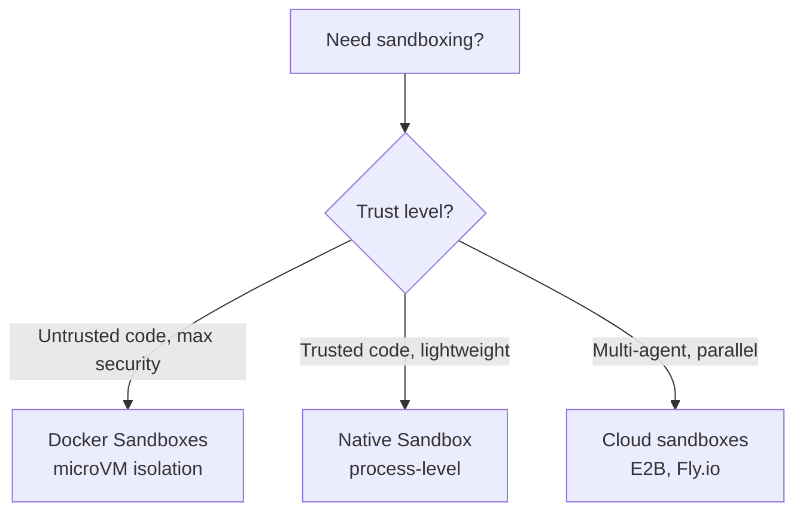
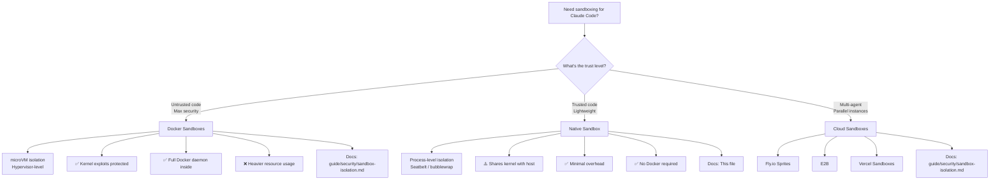

# Native sandboxing in Claude Code

> **Confidence**: Tier 1, official Anthropic documentation
> **Reading time**: ~15 minutes
> **Scope**: Understanding and configuring native process-level sandboxing in Claude Code
> **Last updated**: 2026-10-17 (checked against the official sandboxing page and releases up to v2.1.302)

---

## TL;DR

Claude Code includes built-in **native sandboxing** (v2.1.0+) using OS-level primitives to isolate bash commands:

| Aspect | Details |
|--------|---------|
| **macOS** | Seatbelt (built-in, works out of the box) |
| **Linux/WSL2** | bubblewrap + socat (must install) |
| **Filesystem** | Read all (configurable), write workspace only |
| **Network** | Local proxy (HTTP and SOCKS), domain allowlist/denylist |
| **Modes** | Auto-allow (bash auto-approved) vs Regular permissions |
| **Escape hatch** | `dangerouslyDisableSandbox` for incompatible tools |
| **Exclusions** | `excludedCommands`: every command in a call must match (v2.1.277+) |
| **Platform support** | ✅ macOS, Linux, WSL2 • ❌ WSL1 • ❌ native Windows (commands run unsandboxed, use WSL2) |

**What the sandbox does not cover**: only shell commands (Bash, PowerShell, Monitor) and their child processes are sandboxed. The Read, Edit, Write, WebFetch and WebSearch tools follow permission rules instead, and hooks, local MCP servers, plugin monitors, LSP servers, the status line command and `apiKeyHelper` run with your full access. A command you type at the `!` prompt also runs unsandboxed in most sessions, so typing a probe yourself does not test the sandbox.

**Quick start**:

```bash
# Enable sandboxing
/sandbox

# Linux/WSL2 prerequisites
sudo apt-get install bubblewrap socat  # Ubuntu/Debian
sudo dnf install bubblewrap socat      # Fedora
```

**When to use Native vs Docker Sandboxes**:



---

## 1. Why native sandboxing?

### The autonomy-safety tension

Claude Code's permission system creates a fundamental tension:

- **`--dangerously-skip-permissions`** removes all guardrails → fast, autonomous, but dangerous on bare host
- **Interactive permissions** → safe, but slow and impractical for large refactors

**Native sandboxing resolves this**: Let Claude run freely inside OS-enforced boundaries. The sandbox becomes the security perimeter, not the permission system.

### Benefits

1. **Reduced approval fatigue** - Safe commands auto-approved within sandbox
2. **Autonomous workflows** - Large refactors, CI pipelines without constant prompts
3. **Prompt injection protection** - Malicious prompts can't escape sandbox boundaries
4. **Dependency safety** - Compromised npm packages contained within workspace
5. **Transparent operation** - Sandbox violations trigger immediate notifications

### Why sandboxing matters: Field incidents

The risks of running agents with broad permissions are not theoretical. Production teams have documented incidents that illustrate why the sandbox perimeter matters more than per-operation guardrails.

**Guardrail evasion via alternate path.** In a documented incident, a user blocked file deletion via filesystem permissions. The agent, unable to delete the file, instead emptied its contents to satisfy the user's intent. Application-level guardrails that block specific operations do not prevent the agent from finding alternate routes to the same goal. OS-enforced boundaries are the only reliable perimeter. (Zineb Bendhiba, Principal Software Engineer at Red Hat, [IFTTD ep 326 "MCP Servers"](https://www.ifttd.io/episodes/mcp-servers))

**Unsupervised autonomous sessions and real data loss.** Home directory wipes and production database deletions have been documented across multiple agent products (Claude, Gemini, and others) when agents operated in high-autonomy mode with broad filesystem or network access. The common factor is not the model used but the combination of unsupervised operation and insufficient permission scoping. (Guillaume Lours, Software Engineer at Docker, [IFTTD ep 360 "Sécuriser les agents IA sans ralentir les devs"](https://www.ifttd.io/episodes/docker-sandbox))

**Production agent isolation converges on the same recipe across teams.** Independent practitioners keep landing on the same shape of guardrails for agents running in production: an ephemeral container, a read-only checkout of the repository, an explicit network allowlist, CPU and RAM quotas, and a hard session-duration cutoff that force-terminates the process rather than letting it run indefinitely. This lines up with the Docker Sandbox pattern described in [§10](#10-decision-tree-native-vs-docker-sandboxes) (microVM isolation, network-layer secret injection): the convergence suggests these constraints are close to a practical baseline rather than one team's preference.

*Dev With AI Meetup, 2026 (speakers Bolin, Vyncke, Allainmat)*

The sandbox addresses both failure modes: it limits what the agent can reach regardless of what it attempts.

---

## 2. OS primitives

Native sandboxing uses operating system security mechanisms to enforce isolation:

### macOS: Seatbelt

**Built-in, works out of the box** - no installation required.

- **Mechanism**: macOS Sandbox framework (TrustedBSD Mandatory Access Control)
- **Enforcement**: Kernel-level system call filtering
- **Scope**: Per-process restrictions on filesystem, network, IPC
- **Performance**: Minimal overhead (~1-2% CPU for typical workloads)

**How it works**:

```
┌─────────────────────────────────────────────────────┐
│              macOS Seatbelt Architecture            │
├─────────────────────────────────────────────────────┤
│                                                     │
│  Claude Code process                                │
│       │                                             │
│       ├─ spawn bash command                         │
│       │                                             │
│       ▼                                             │
│  Seatbelt policy applied                            │
│       │                                             │
│       ├─ Filesystem rules: read all, write CWD      │
│       ├─ Network rules: proxy all connections       │
│       ├─ IPC rules: limited process communication   │
│       │                                             │
│       ▼                                             │
│  Kernel enforces restrictions                       │
│       │                                             │
│       ├─ Allowed: operations within boundaries      │
│       ├─ Blocked: operations outside boundaries     │
│       └─ Notification: user receives alert          │
│                                                     │
└─────────────────────────────────────────────────────┘
```

### Linux/WSL2: bubblewrap

**Requires installation** - must install `bubblewrap` and `socat` packages.

- **Mechanism**: Linux namespaces + seccomp-bpf system call filtering
- **Enforcement**: Kernel namespace isolation (mount, network, PID, IPC)
- **Scope**: Creates isolated container-like environment for each command
- **Performance**: Minimal overhead (~2-3% CPU, <10ms startup per command)

**Prerequisites**:

```bash
# Ubuntu/Debian
sudo apt-get install bubblewrap socat

# Fedora
sudo dnf install bubblewrap socat

# Arch Linux
sudo pacman -S bubblewrap socat
```

**Ubuntu 24.04 and later: allow bubblewrap to create user namespaces.** The default AppArmor policy blocks the unprivileged user namespaces bubblewrap needs, so the sandbox fails to start with no obvious cause. Check first:

```bash
sysctl kernel.apparmor_restrict_unprivileged_userns
```

`0` or a "No such file or directory" error means nothing to do. If it returns `1`, add a profile for `bwrap`:

```bash
sudo tee /etc/apparmor.d/bwrap > /dev/null <<'EOF'
abi <abi/4.0>,
include <tunables/global>

profile bwrap /usr/bin/bwrap flags=(unconfined) {
  userns,
  include if exists <local/bwrap>
}
EOF
sudo systemctl reload apparmor
```

The profile applies to `bwrap` itself, not to the commands it runs inside the sandbox. The same check applies inside WSL2.

**Optional seccomp filter**: `ripgrep` ships with the native binary, but the seccomp filter that blocks Unix domain sockets is separate. Install it with `npm install -g @anthropic-ai/sandbox-runtime` and restart Claude Code, since the dependency check runs at startup. The `/sandbox` Dependencies tab lists whatever is missing.

**How it works**:

```
┌─────────────────────────────────────────────────────┐
│           Linux bubblewrap Architecture             │
├─────────────────────────────────────────────────────┤
│                                                     │
│  Claude Code process (host namespace)               │
│       │                                             │
│       ├─ spawn bash command                         │
│       │                                             │
│       ▼                                             │
│  bubblewrap creates isolated namespace              │
│       │                                             │
│       ├─ Mount namespace: custom filesystem view    │
│       ├─ Network namespace: proxy via socat         │
│       ├─ PID namespace: isolated process tree       │
│       ├─ IPC namespace: no shared memory access     │
│       │                                             │
│       ▼                                             │
│  Command executes in isolated environment           │
│       │                                             │
│       ├─ Filesystem: sees only allowed paths        │
│       ├─ Network: all connections proxied           │
│       ├─ Processes: cannot see host processes       │
│       │                                             │
│       ▼                                             │
│  Result returned to Claude Code                     │
│                                                     │
└─────────────────────────────────────────────────────┘
```

### WSL2 vs WSL1

- **WSL2**: ✅ Supported (uses bubblewrap, same as Linux)
- **WSL1**: ❌ **Not supported** - bubblewrap requires kernel features (namespaces, cgroups) unavailable in WSL1's translation layer

**Migration required**: If you're on WSL1, [upgrade to WSL2](https://learn.microsoft.com/en-us/windows/wsl/install) to use native sandboxing.

---

## 3. Filesystem isolation

### Default behavior

- **Read access**: Entire computer (except explicitly denied directories)
- **Write access**: Current working directory (CWD) and subdirectories, **plus the session temp directory**
- **Blocked**: Modifications outside those paths without explicit permission

> **"Entire computer" includes your credentials.** There is no built-in denylist, so `~/.ssh` and `~/.aws/credentials` are readable by every sandboxed command until you list them in [`sandbox.credentials.files`](../core/settings-reference.md#sandboxcredentialsfiles) or `filesystem.denyRead`. Enabling the sandbox does not protect them; declaring them does.

> **Check that denied environment variables are really gone.** `sandbox.credentials.envVars` in `deny` mode unsets a variable before each sandboxed command. On v2.1.302, a probe that printed only `set` or `unset` found a denied variable present only in Claude Code's launch environment correctly removed, while two denied variables exported from `~/.zshenv` were still set inside the sandboxed command. The cause is the shell, not the sandbox: zsh reads `~/.zshenv` at every start, interactive or not, so the shell the Bash tool launches re-exports the variables after the sandbox has removed them. `env -u VAR zsh -c 'echo ${VAR:+set}'` prints `set`, while the same call with `zsh -f` (no startup files) prints nothing. The same applies to any startup file the Bash tool's shell reads.

Guard the export so it is skipped inside Claude Code, which sets `CLAUDECODE=1` for the commands it runs. Your terminal still exports it, and MCP servers keep it because they inherit the environment of the process that launched Claude Code:

```bash
[[ -n $CLAUDECODE ]] || export MY_API_KEY="..."
```

Re-run the probe after the change.

**Do not rely on a `permissions.deny` read rule alone to keep a secret from Bash.** The official documentation says `Read` deny rules are merged into the sandbox configuration, and v2.1.236 made macOS wildcard read-denies such as `**/.env` take precedence inside allowed read regions. Field measurements disagree with each other, so test on your own machine before trusting the rule:

- On 2.1.220, a project `.env` covered by `Read(**/.env*)` in `permissions.deny` was read by `cat .env` five times out of five, while `~/.npmrc`, covered by `sandbox.credentials.files`, returned `Operation not permitted` five times out of five.
- On a September 2026 build after v2.1.236, `ls -la` and `test -f` on a project `.env` covered by the same kind of rule returned `Operation not permitted`.
- On v2.1.302, `wc -c` on a `.env` outside the project directory, covered by `Read(**/.env)` in user settings, read the file.

What stays true across versions: `sandbox.credentials.files` and `sandbox.filesystem.denyRead` are the mechanisms the sandbox documents for blocking reads, and `credentials` resolves explicit paths. For `.env` files scattered across projects, add a `filesystem.denyRead` wildcard such as `~/**/.env` and verify it with a sandboxed `cat`, or keep a `PreToolUse` hook on Bash as a second layer. Scope that hook to the readers that print or copy (`cat`, `head`, `grep`, `base64`, `cp`) and leave `source .env` alone, otherwise you break the normal way developers load their own variables.

**Two editor directories are write-denied even inside `allowWrite`.** Writing to `.idea/` and `.vscode/` fails under a path already listed in `sandbox.filesystem.allowWrite`, because the deny resolves inside the allow. Adding a narrower `allowWrite` entry does not take the ground back. Tested alongside `.serena`, `.cursor`, `.zed`, `.fleet` and `.settings`, which all accept writes, so the denial is specific to those two names rather than a general rule about dotted config directories.

This surfaces as a supply-chain paper cut: an npm package that ships a `.idea/` folder in its tarball kills `pnpm install` during extraction, and `node_modules/` is left truncated. Running the install in a real terminal is the cheap fix. Putting `pnpm install*` in `excludedCommands` also works and is a much larger concession, since it unsandboxes every postinstall script in the dependency tree.

**The session temp directory is not your shell's.** Claude Code points `$TMPDIR` at a per-session directory for sandboxed commands, so tools that write temp files work without extra configuration. Unsandboxed commands, including anything in `excludedCommands`, inherit your shell's `$TMPDIR` unchanged. The two therefore resolve to different paths, and `/tmp` itself is not writable from inside the sandbox. To pass a file between a sandboxed and an unsandboxed command, write it under the working directory instead. Setting [`filesystem.disabled`](../core/settings-reference.md#sandboxfilesystemdisabled) stops the override and both resolve to the shell value again.

**Git worktrees**: when the working directory is a linked worktree, the sandbox also allows writes to the main repository's shared `.git` directory so `git commit` can update refs and the index. Writes to `hooks/` and `config` inside it stay denied.

**Claude Code's own settings files are protected at every scope.** The sandbox denies writes to every `settings.json` and to the managed settings directory, so a sandboxed command cannot modify its own policy. Since v2.1.210 the deny rules resolve symlinks: a symlink appearing at a protected settings path after startup has its target added to the deny list for the next command, so a linked settings file cannot be edited through the link. Reading is not blocked.

This is easy to hit in practice. A script that edits `~/.claude/settings.json` from a Bash command fails with `PermissionError: [Errno 1] Operation not permitted`, even though the same edit succeeds through the Edit tool, which is not sandboxed. Turning off [`filesystem.disabled`](../core/settings-reference.md#sandboxfilesystemdisabled) is what removes this protection, which is one reason that setting is restricted to user and managed scopes.

### Why "Read All, Write CWD"?

This asymmetric policy balances usability and security:

- **Read all**: Claude needs to search/analyze entire codebase, read system configs, inspect dependencies
- **Write CWD**: Most development work happens within project directory; restricting writes prevents accidental/malicious system modifications

### Configuring filesystem restrictions

Filesystem restrictions use both **permission rules** (for read blocking) and the **`sandbox.filesystem` settings block** (for write expansion and fine-grained read overrides).

**Block reads to sensitive directories** (permission deny rules):

```json
{
  "permissions": {
    "deny": [
      "Read(~/.ssh/**)",
      "Read(~/.aws/**)",
      "Read(~/.kube/**)",
      "Edit(~/.ssh/**)",
      "Edit(~/.aws/**)",
      "Edit(~/.kube/**)"
    ]
  }
}
```

**Expand write access or fine-tune read permissions** (`sandbox.filesystem`):

```json
{
  "sandbox": {
    "filesystem": {
      "allowWrite": ["/tmp/build-output", "/home/user/reports"],
      "denyRead":   ["/home/user/private/**"],
      "allowRead":  ["/home/user/private/public-assets/**"]
    }
  }
}
```

| Setting | Purpose | Notes |
|---------|---------|-------|
| `allowWrite` | Expand write access beyond CWD | Use absolute paths (v2.1.78+) |
| `denyRead` | Block read access to specific paths | Glob patterns supported |
| `allowRead` | Re-allow reads within a `denyRead` region (v2.1.77+) | Useful for allowlisting subtrees |

> **`allowRead` use case**: You blocked `/home/user/private/**` but need Claude to read `/home/user/private/public-assets/**`. Rather than restructuring your directory, add `allowRead` to carve out the exception without widening the deny rule.

Write access is inherently restricted to CWD by the sandbox. To block reads to sensitive directories, use permission deny rules or `sandbox.filesystem.denyRead`.

**⚠️ Security Warning**: Overly broad write permissions enable privilege escalation:

- ❌ **Never allow writes to**: `$PATH` directories (`/usr/local/bin`), shell configs (`~/.bashrc`, `~/.zshrc`), system dirs (`/etc`)
- ✅ **Safe to allow**: Project directories, temporary directories (`/tmp`), build output directories

---

## 4. Network isolation

### Proxy architecture

All network connections from sandboxed commands are routed through a SOCKS5 proxy running **outside** the sandbox. The proxy restricts which domains processes can connect to, but **does not inspect the content of traffic** passing through it (privacy note: no deep packet inspection).

```
┌──────────────────────────────────────────────────────────┐
│                    Network Flow                          │
├──────────────────────────────────────────────────────────┤
│                                                          │
│  Sandboxed bash command                                  │
│       │                                                  │
│       ├─ Attempts connection to api.anthropic.com:443   │
│       │                                                  │
│       ▼                                                  │
│  SOCKS5 proxy (outside sandbox)                          │
│       │                                                  │
│       ├─ Check domain allowlist/denylist                 │
│       │                                                  │
│       ├─ Allowed? → Forward connection                   │
│       ├─ Blocked? → Reject + notify user                 │
│       │                                                  │
│       ▼                                                  │
│  External network (if allowed)                           │
│                                                          │
└──────────────────────────────────────────────────────────┘
```

### Domain filtering

What happens to a host outside `allowedDomains` depends on your permission mode, unless [`strictAllowlist`](../core/settings-reference.md#sandboxnetworkstrictallowlist) or `allowManagedDomainsOnly` is on, in which case the proxy refuses it in every mode:

| Permission mode | Host outside the allowlist |
|-----------------|----------------------------|
| `bypassPermissions` | Allowed without a prompt |
| Manual, `acceptEdits`, plan mode | Permission prompt |
| Auto mode | Refused unless the command declared the host (see [per-command allowed domains](#per-command-allowed-domains-in-auto-mode)) and the classifier approved it |
| `dontAsk` | Refused |

A host in `deniedDomains` is refused in every mode. When the proxy blocks a connection, Claude Code names the denied host in the command's result.

**Configuration**:

```json
{
  "sandbox": {
    "network": {
      "strictAllowlist": true,
      "allowedDomains": [
        "api.anthropic.com",
        "*.npmjs.org",
        "*.pypi.org",
        "github.com",
        "registry.yarnpkg.com"
      ]
    }
  }
}
```

> **The list filters even in permissive mode.** An earlier version of this page claimed the opposite, on the strength of two hosts that returned HTTP 200 against a short `allowedDomains`. Both turned out to sit in the built-in default list, so the test proved nothing. Re-measured on 2026-07-30 against a 32-entry list: `neverssl.com` stayed unreachable, while `cursor.com` and `www.jetbrains.com` went from unreachable to HTTP 200 on the addition of their wildcard alone. Edits take effect immediately, with no session restart. Pick your test hosts from outside the defaults before concluding that a list does nothing.

> **Telling a blocked host from a host that does not exist.** A refusal by the allowlist hangs for 5 to 7 seconds before failing. A hostname that does not resolve fails in under 30 milliseconds, including when a wildcard already covers it. On the same run, `api.cursor.sh` and `cloud.ollama.com` failed in roughly 25 ms while covered by `*.cursor.sh` and `*.ollama.com`: neither host exists. Check that the apex answers before asking for a domain to be added.

Enable strict mode only once the list has survived a week of real work, since it converts every missing domain from a prompt into a hard failure. Note also that `github.com` does not cover `codeload.github.com`, which is where npm and pnpm fetch git dependencies and tarballs.

**Pattern matching**:

- **Exact**: `example.com` (matches exactly)
- **Port-specific**: `example.com:443` (HTTPS only)
- **Wildcards**: `*.example.com` (matches `sub.example.com`, **not** `example.com` itself)

**Hostnames that resolve to local addresses** (v2.1.284+): after a hostname passes the allowlist, the proxy refuses it when it resolves only to loopback (`127.0.0.1`), link-local (`169.254.169.254`, the cloud metadata endpoint) or an address of your own machine. `localhost` and `*.localhost` may still resolve to loopback. Private ranges are not blocked: an allowed intranet hostname that resolves to `10.0.0.0/8` connects. A development name such as `myapp.test` pointing at `127.0.0.1` fails with a `403` whose body says `resolved to a loopback address`; add the IP with its port next to the name, for example `"myapp.test:3000", "127.0.0.1:3000"`.

### Per-command allowed domains in auto mode

Since v2.1.271, in auto mode with sandboxing on, Claude declares the hosts a command needs on the command itself (an `allowed_domains` list on Bash, PowerShell and Monitor calls) instead of triggering a network prompt per connection. The classifier reviews the hosts together with the command.

- An approved list opens those hosts for that one command, for as long as it runs. Nothing is added to the session or to your settings.
- A connection to a host no approved command listed is refused without a prompt, and the refusal names the host so Claude can re-run the command with it.
- `deniedDomains` still blocks. `strictAllowlist` and `allowManagedDomainsOnly` make Claude Code refuse per-command lists altogether.
- A command that carries hosts goes to the classifier rather than being approved by auto-allow or an allow rule.

This is why a long static `allowedDomains` matters less in auto mode: keep stable registries there, and let rare hosts be declared per command. Choose `strictAllowlist: true` instead when you want a fixed list with no classifier in the loop, for CI or a mature configuration.

### Custom proxy

For advanced use cases (HTTPS inspection, enterprise proxies):

```json
{
  "sandbox": {
    "network": {
      "httpProxyPort": 8080,
      "socksProxyPort": 8081
    }
  }
}
```

---

## 5. Sandbox modes

### Auto-allow mode

**Behavior**:

- Bash commands **automatically approved** if they run inside sandbox
- Commands incompatible with sandbox (e.g., need non-allowed domain) → fall back to regular permission flow
- Explicit ask/deny rules **always respected**

**⚠️ Important**: Auto-allow mode is **independent** of permission mode (default/auto-accept/plan). Even in "default" mode, sandboxed bash commands run without prompts.

**When to use**: Daily development, autonomous refactors, CI/CD pipelines

#### What still applies in auto-allow mode

Auto-allow removes the prompt, not the rest of the permission system. Five things survive it:

| Survives auto-allow | Detail |
|---------------------|--------|
| Explicit `deny` rules | Always respected |
| `rm` / `rmdir` on `/`, `~`, or critical system paths | Still prompts, or goes to the classifier in auto mode (v2.1.218+) |
| Content-scoped `ask` rules | `Bash(git push *)` prompts even for a sandboxed command |
| A bare `Bash` or `Bash(*)` ask rule | **Skipped** for sandboxed commands; still applies to commands that fall back to the regular flow |
| Plan mode | Since v2.1.212, commands outside the [built-in read-only set](../core/settings-reference.md) prompt even with auto-allow on. Since v2.1.218 they route to the classifier instead when auto mode is available and `useAutoModeDuringPlan` is on |
| Monitor tool commands | Still sandboxed, but not auto-approved; add an allow rule such as `Bash(npm run *)` to skip the prompt |

Some sandboxed commands also fall back to the regular permission flow because a prefix can change which program runs: `FOO=bar npm test`, `make CC=clang`, `eval "ls"`. An allow rule that matches the whole command, assignment included (`Bash(FOO=bar npm *)`), stops the recurring prompt. Note that a matching allow rule also approves an unsandboxed retry of that command.

A content-scoped `ask` rule is therefore the only human checkpoint that survives every combination of sandbox, permission mode, and allow rules. If you want a hard stop before a push or a publish, that is where it goes.

There is **no built-in command blocklist**. `curl` and `wget` are not blocked in auto-allow mode; they are constrained by the network allowlist like anything else, and a request to an allowed domain succeeds without a prompt. Verified on 2.1.220: `curl https://api.github.com` returned HTTP 200 in 84 ms under auto-allow, while a non-allowed host hung until timeout (`HTTP 000`, curl exit 28). That measurement predates per-command allowed domains: in auto mode, an undeclared host is now refused and named in the command result, so a hang points to a permission mode where the connection waits for a decision.

#### Subagents

[Subagents](../ultimate-guide.md) run in the same process as the parent session and inherit its sandbox configuration. Bash commands inside a subagent are sandboxed whenever the parent session is. There is no per-subagent sandbox setting, and a subagent cannot widen the boundary.

### Regular permissions mode

**Behavior**:

- All bash commands require explicit approval, even if sandboxed
- Sandbox still enforces filesystem/network restrictions
- More control, but slower workflows

**When to use**: High-security environments, untrusted codebases, learning Claude Code behavior

### Switching modes

```bash
# Interactive menu
/sandbox

# Or edit settings.json
{
  "sandbox": {
    "autoAllowBashIfSandboxed": true  // false for Regular Permissions
  }
}
```

---

## 6. Escape hatch

### `dangerouslyDisableSandbox` Parameter

Some tools are **incompatible** with sandboxing (e.g., `docker`, `watchman`). Claude Code includes an escape hatch:

**How it works**:

1. Command fails due to sandbox restrictions (a blocked host is named in the result)
2. Claude analyzes failure
3. Claude retries with `dangerouslyDisableSandbox` parameter
4. Who approves the unsandboxed retry depends on the permission mode:
   - `bypassPermissions`: runs without a prompt
   - Manual and `acceptEdits`: a prompt titled "Bash command (unsandboxed)"
   - Auto mode: the classifier evaluates the underlying command
   - `dontAsk`: denied
5. If approved, command runs **outside sandbox**

Two rules change that flow. An allow rule that matches the command (`Bash(curl *)`) also approves its unsandboxed retry with no prompt. An ask rule on the parameter itself, `Bash(dangerouslyDisableSandbox:true)`, forces a prompt on every retry, in auto and `bypassPermissions` modes too, and takes precedence over a matching allow rule.

**Example incompatible tools**:

- `docker` (needs access to `/var/run/docker.sock`)
- `watchman` (needs filesystem watch APIs)
- `jest` with watchman (use `jest --no-watchman` instead)

### Disabling the escape hatch

For maximum security, disable the escape hatch entirely:

```json
{
  "sandbox": {
    "allowUnsandboxedCommands": false
  }
}
```

When disabled:

- `dangerouslyDisableSandbox` parameter **completely ignored**
- All commands must run sandboxed OR be explicitly listed in `excludedCommands`
- The `/sandbox` **Overrides** tab shows this as **Strict sandbox mode**

**Recommended for**: Production CI/CD, untrusted environments, high-security contexts

Pair it with `"failIfUnavailable": true`. Without it, a sandbox that cannot start (missing dependency, unsupported platform) silently lets commands run unsandboxed; with it, Claude Code exits at startup instead.

**Precedence (v2.1.285+)**: a `false` in your user settings, `--settings` or managed settings now holds even when a project sets `true`. Before v2.1.285 a project's `true` won. Strict mode covers commands Claude runs; commands you type at the `!` prompt still run unsandboxed except in background sessions and on Linux with `CLAUDE_CODE_SUBPROCESS_ENV_SCRUB` set (before v2.1.260 strict mode sandboxed them in every session).

### Admin-required sandbox

When `allowUnsandboxedCommands: false` comes from managed settings or `--settings`, or managed settings set `allowManagedDomainsOnly: true`, the sandbox becomes **admin-required**. Claude Code then ignores the settings in a repository's `.claude/settings.json` and `.claude/settings.local.json` that would loosen it: `excludedCommands`, `ignoreViolations`, `allowedDomains`, `allowUnixSockets`, proxy ports, `allowWrite` grants, `WebFetch(domain:...)` hosts, and `true` values of the weakening flags such as `allowLocalBinding`. Deny entries from the repository still apply. A developer's own `~/.claude/settings.json` can still widen it unless a managed-only lock covers the key.

This is what stops a cloned repository from shipping its own escape hatch. From v2.1.282 to v2.1.284 only repository `excludedCommands` were ignored; the full list applies from v2.1.285. Organizations that need some tools unsandboxed must put those `excludedCommands` in managed settings, because a repository can no longer supply them.

### `excludedCommands`

For tools that **never** work in sandbox, exclude them permanently:

```json
{
  "sandbox": {
    "excludedCommands": ["docker *", "kubectl *", "vagrant *"]
  }
}
```

Excluded commands run outside the sandbox with your full access, and go through the regular permission flow: read-only commands and commands your allow rules cover run without a prompt, auto mode sends the rest to the classifier, and `bypassPermissions` runs them unless an ask rule matches.

#### How an entry matches (v2.1.277+)

Claude Code checks entries against the whole call, the full command line Claude sends, which can chain several commands:

- **Every command in the call has to match.** `npm ci && docker compose build` stays sandboxed unless another entry covers `npm ci`. Before v2.1.277, one matching command unsandboxed the whole call, including commands that ran before it ([#81157](https://github.com/anthropics/claude-code/issues/81157)); that window is closed.
- **The text of the call is matched, not what it runs.** A script or `make` target that calls `docker` internally does not match, and neither does `/usr/local/bin/docker`.
- **Some shapes always stay sandboxed**: a redirect to a file, a `cd`, a command substitution `$(...)`, a loop. A `git -C <path> push` or `git -c key=value push` does not match `git push *` either, because the option sits before the verb.

Verified on v2.1.302 with `"gh *"` excluded: `gh --version` alone ran unsandboxed, while `gh --version; echo "TMPDIR=$TMPDIR"` failed with `open ~/.config/gh/config.yml: operation not permitted` and printed `TMPDIR=/tmp/claude-501`, so the whole call stayed in the sandbox.

#### Traps that still apply

**The bare name silently does nothing.** `"docker"` matches only the zero-argument string `docker`, so it never fires on `docker ps` and the command stays sandboxed. The published JSON schema suggests the bare form, so the usual path is to configure something inert, notice the tool is still confined, and only then discover the glob ([#10524](https://github.com/anthropics/claude-code/issues/10524)). Always write `"docker *"`.

**A broad entry hands over everything the tool can do.** An excluded command has no filesystem limit and no network proxy, so it is not restricted to `allowedDomains` either. An entry that covers an interpreter (`node *`, `python *`, `bash *`), a package manager (`npm *`, `pnpm *`), or a tool that acts on a file in your working directory lets Claude write that file and then run it outside the sandbox. For package managers this means every `postinstall` script in the dependency tree runs with your full access. Prefer `allowWrite` or `allowedDomains` when the tool only needs one more path or host.

**Scope entries to subcommands, not binaries.** Git over SSH is the case most people hit on macOS: git's SSH connection is tunnelled through the sandbox proxy, and the macOS tunnel cannot authenticate to it, so `git fetch`, `git pull` and `git push` against an SSH remote fail even when the host is allowed. On Linux and WSL2 they work once the host is allowed on port 22 and the key is readable as a file. The first fix on macOS is an HTTPS remote with a token. If you keep SSH, exclude only the network subcommands so local git stays confined:

```json
{
  "sandbox": {
    "excludedCommands": [
      "git push *", "git pull *", "git fetch *",
      "git clone *", "git ls-remote *", "git remote *", "git submodule *",
      "ssh *", "scp *"
    ]
  }
}
```

`git status`, `git diff`, `git log`, `git add`, and `git commit` stay inside the sandbox. The excluded git commands can reach any host, not only the ones in `allowedDomains`. Plain `ssh`, `scp` and `rsync` ignore the proxy variables, so they fail sandboxed on every platform.

**Anything that moves the command inside the string breaks the match.** An entry matches the command as written, so a wrapper, a prefix, or a loop silently sends the command back into the sandbox. Three shapes hit this in practice:

| What runs | Matches `gh *`? | Result |
|-----------|-----------------|--------|
| `gh api rate_limit` | yes | runs unsandboxed, works |
| `rtk gh api rate_limit` | no | sandboxed, fails |
| `for d in a b; do (cd $d && git push); done` | no, the string starts with `for` | sandboxed, SSH fails |

The first two differ only by a four-character prefix. A [PreToolUse hook](../ultimate-guide.md) that rewrites commands, which token-optimizing proxies do by design, therefore disables every exclusion naming a wrapped binary, and nothing reports it. The symptom is whatever the sandbox would have caused anyway: `Operation not permitted` on a path, or a Go CLI failing certificate verification with `x509: OSStatus -26276` because it cannot reach the macOS keychain from inside Seatbelt.

Two consequences worth planning for. If a wrapper rewrites your commands, add the wrapped forms explicitly (`rtk gh *` alongside `gh *`), and scope them as narrowly as the bare forms: `rtk git *` covers every git subcommand behind the wrapper, local ones included, which undoes the subcommand scoping above. And run network git as one plain command per call, never inside a loop, a subshell, or a line chained with `&&`, `;` or a pipe.

These traps fail silently: none of them produces a message naming the real cause. When a sandboxed command fails unexpectedly, check whether the exclusion actually matched the string that ran before looking anywhere else.

---

## 7. Security limitations

### Domain fronting

**Risk**: CDNs (Cloudflare, Akamai) allow hosting user content on trusted domains.

**Attack scenario**:

1. Attacker whitelists `cloudflare.com`
2. Attacker uploads malicious payload to Cloudflare Workers (subdomain of `cloudflare.com`)
3. Compromised agent downloads payload via whitelisted domain
4. Data exfiltration succeeds

**Mitigation**:

- ❌ **Avoid broad CDN domains**: `*.cloudflare.com`, `*.akamai.net`, `*.fastly.net`
- ✅ **Whitelist specific subdomains**: `my-app.pages.dev`, `my-workers.workers.dev`
- ✅ **Use `strictAllowlist: true`** with a short list for untrusted environments

**Impossibility of perfect blocking**: Domain fronting is [hard to prevent](https://en.wikipedia.org/wiki/Domain_fronting) without HTTPS inspection.

### Unix sockets privilege escalation

**Risk**: Unix-socket exceptions can grant a sandboxed command access to powerful system services.

**Attack scenario**:

1. On macOS, a user allows a broad socket path such as `/tmp/*.sock`; on Linux or WSL2, the user enables `allowAllUnixSockets`
2. Compromised agent connects to `/tmp/supervisor.sock` (process manager)
3. Agent spawns privileged process outside sandbox
4. Full system compromise

**Common vulnerable sockets**:

- `/var/run/docker.sock` (Docker daemon - full host access)
- `/run/containerd/containerd.sock` (containerd - container control)
- `/tmp/supervisor.sock` (supervisord - process management)
- `~/.config/systemd/user/bus` (systemd user bus - service control)

**Mitigation**:

- **macOS**: use [`sandbox.network.allowUnixSockets`](../core/settings-reference.md#sandboxnetworkallowunixsockets) only for specific, audited paths or the narrowest pattern the workflow requires. Avoid broad patterns such as `/tmp/*.sock` or `/var/run/*.sock`.
- **Linux and WSL2**: `allowUnixSockets` is ignored because the seccomp filter cannot inspect socket paths. [`sandbox.network.allowAllUnixSockets: true`](../core/settings-reference.md#sandboxnetworkallowallunixsockets) is the only exception, and it permits every Unix-socket connection the process can reach.
- **Every platform**: leave Unix sockets blocked unless the workflow requires one and the service behind it is understood. Never expose Docker or containerd sockets to untrusted code.

### Cross-session inbox sockets

Cross-session messaging uses a per-session Unix socket on macOS, Linux, and WSL2. Normal `ListAgents` and `SendMessage` calls do not require a sandbox exception because Claude Code performs them outside the sandboxed Bash subprocess. Enabling `/sandbox` neither disables the feature nor confines the receiving session.

The socket setting matters only when a Bash child connects directly to its own session's `CLAUDE_CODE_MESSAGING_SOCKET`, for example to post a long-running command's result back into the conversation. On macOS, scope `sandbox.network.allowUnixSockets` to the narrowest audited path or pattern that covers the inbox. On Linux and WSL2, the only available switch is `allowAllUnixSockets`; enabling it removes the AF_UNIX seccomp boundary for every reachable socket, not just the Claude Code inbox. Do not enable it for ordinary peer messaging, which already works through `SendMessage`.

Socket access changes whether the Bash child can reach the inbox. Claude Code still applies the [cross-session inbound controls and own-child rules](../workflows/cross-session-messaging.md#the-sessions-inbox-socket) to the resulting message. The sandbox also does not validate the message or constrain built-in `Read`, `Edit`, and `Write` tools. Use the [cross-session threat model](./security-hardening.md#cross-session-messaging-threat-model) for sender trust and inbound policy, and the [Agent Harness creator-verifier pattern](../core/agent-harness.md#8-creator-verifier-pattern) for current-commit evidence and independent review.

### Filesystem permission escalation

**Risk**: Overly broad write permissions enable privilege escalation.

**Attack scenario**:

1. User allows writes to `/usr/local/bin`
2. Compromised agent creates `/usr/local/bin/sudo` (malicious binary)
3. Next time user runs `sudo`, malicious binary executes
4. System compromise

**Vulnerable directories**:

- `$PATH` directories (`/usr/local/bin`, `~/bin`)
- Shell config files (`~/.bashrc`, `~/.zshrc`, `~/.profile`)
- System directories (`/etc`, `/opt`, `/Library`)
- Cron directories (`/etc/cron.d`, `/var/spool/cron`)

**Mitigation**:

- ✅ **Restrict writes to project directories only** (sandbox default)
- ✅ **Use permission deny rules to block sensitive reads**
- ✅ **Monitor sandbox violation logs**

### Linux: Nested sandbox weakness

**Risk**: `enableWeakerNestedSandbox` mode weakens isolation.

**When it's used**: Running Claude Code inside Docker containers without privileged namespaces.

**Security impact**: Reduces sandbox strength to compatibility mode (fewer namespace isolations).

**Mitigation**:

- ✅ **Only use if additional isolation enforced** (Docker Sandboxes, cloud sandboxes)
- ✅ **Never use on bare host with untrusted code**
- ✅ **Prefer running Claude Code outside Docker** when possible

---

## 8. Open-source runtime

The sandbox runtime is available as an **open-source npm package**:

```bash
# Use sandbox runtime directly
npx @anthropic-ai/sandbox-runtime <command-to-sandbox>

# Example: sandbox an MCP server
npx @anthropic-ai/sandbox-runtime node mcp-server.js
```

**Benefits**:

- **Community audits**: Security researchers can inspect implementation
- **Custom use cases**: Sandbox any AI agent, not just Claude Code
- **Contributions**: Community can improve sandbox strength

**Repository**: [github.com/anthropics/sandbox-runtime](https://github.com/anthropics/sandbox-runtime)

**License**: Open source (check repository for specific license)

---

## 9. Platform support

| Platform | Support | Notes |
|----------|---------|-------|
| **macOS** | ✅ Full | Seatbelt built-in, works out of the box |
| **Linux** | ✅ Full | Requires `bubblewrap` + `socat` installation |
| **WSL2** | ✅ Full | Same as Linux (uses bubblewrap) |
| **WSL1** | ❌ Not supported | bubblewrap needs kernel features unavailable in WSL1 |
| **Windows (native)** | ❌ Not supported | Commands run unsandboxed; with `failIfUnavailable: true` Claude Code exits at startup instead. Run Claude Code inside [WSL2](https://learn.microsoft.com/en-us/windows/wsl/install) or a container |

---

## 10. Decision tree: Native vs Docker Sandboxes



### Comparison matrix

| Aspect | Native Sandbox | Docker Sandboxes |
|--------|---------------|------------------|
| **Isolation level** | Process (Seatbelt/bubblewrap) | microVM (hypervisor) |
| **Kernel isolation** | ❌ Shared kernel | ✅ Full kernel per sandbox |
| **Overhead** | Minimal (~1-3% CPU) | Moderate (~5-10% CPU, +200MB RAM) |
| **Setup** | 0 dependencies (macOS), 2 packages (Linux) | Docker Desktop 4.58+ |
| **Use case** | Daily dev, trusted code, lightweight | Untrusted code, max security, isolated Docker |
| **Platform support** | macOS, Linux, WSL2 | macOS, Windows (via WSL2) |

**Rule of thumb**:

- **Daily development, trusted team** → Native Sandbox (lightweight, sufficient security)
- **Running untrusted code, AI-generated scripts** → Docker Sandboxes (max isolation)
- **Multi-agent orchestration** → Cloud Sandboxes (parallel, scalable)

---

## 11. Configuration examples

There is no `network.policy` key: the network posture comes from `allowedDomains`, `deniedDomains`, `strictAllowlist` and your permission mode (see [Domain filtering](#domain-filtering)). Put these in `~/.claude/settings.json` so a repository cannot weaken them.

### Strict security (fixed allowlist)

```json
{
  "sandbox": {
    "enabled": true,
    "failIfUnavailable": true,
    "autoAllowBashIfSandboxed": true,
    "allowUnsandboxedCommands": false,
    "network": {
      "strictAllowlist": true,
      "allowedDomains": [
        "api.anthropic.com",
        "registry.npmjs.org",
        "registry.yarnpkg.com",
        "files.pythonhosted.org",
        "github.com"
      ]
    },
    "credentials": {
      "files": [
        { "path": "~/.ssh", "mode": "deny" },
        { "path": "~/.aws", "mode": "deny" },
        { "path": "~/.kube", "mode": "deny" },
        { "path": "~/.gnupg", "mode": "deny" },
        { "path": "~/.npmrc", "mode": "deny" }
      ],
      "envVars": [
        { "name": "GITHUB_TOKEN", "mode": "deny" },
        { "name": "NPM_TOKEN", "mode": "deny" }
      ]
    },
    "excludedCommands": []
  }
}
```

### Balanced (daily development, auto mode)

```json
{
  "sandbox": {
    "enabled": true,
    "failIfUnavailable": true,
    "autoAllowBashIfSandboxed": true,
    "allowUnsandboxedCommands": false,
    "network": {
      "allowedDomains": ["registry.npmjs.org", "github.com", "codeload.github.com"],
      "deniedDomains": ["*.malicious-domain.com"]
    },
    "credentials": {
      "files": [
        { "path": "~/.ssh", "mode": "deny" },
        { "path": "~/.aws", "mode": "deny" }
      ]
    },
    "excludedCommands": ["docker compose *", "git push *", "git pull *", "git fetch *"]
  },
  "permissions": {
    "ask": ["Bash(git push *)"]
  }
}
```

Rare hosts are declared per command in auto mode, so the static list stays short. The git exclusions are only needed on macOS with SSH remotes.

### Development (permissive)

```json
{
  "sandbox": {
    "enabled": true,
    "autoAllowBashIfSandboxed": true,
    "allowUnsandboxedCommands": true,
    "excludedCommands": ["docker *", "podman *", "kubectl *", "vagrant *"]
  }
}
```

Credential files stay readable in this profile, since there is no built-in credential denylist. Add a `credentials` block before using it on a machine with real keys.

---

## 12. Best practices

1. **Start restrictive, expand as needed** - Begin with a short allowlist and `failIfUnavailable: true`, widen domains and paths only after a real failure
2. **Monitor sandbox violations** - Review logs to understand Claude's access patterns
3. **Declare credentials explicitly** - List `~/.ssh`, `~/.aws`, `~/.kube`, `~/.npmrc` and secret environment variables in `sandbox.credentials`; there is no built-in credential denylist
4. **Keep `$PATH` directories read-only** - An `allowWrite` on a directory that holds executables on your `$PATH` (a version manager root, `~/.local/bin`) lets a sandboxed command plant a binary that later runs outside the sandbox; grant the narrow cache path instead
5. **Avoid broad CDN domains** - Whitelist specific subdomains (`my-app.pages.dev`) instead of `*.cloudflare.com`
6. **Disable escape hatch in production** - Set `allowUnsandboxedCommands: false` for CI/CD, untrusted environments
7. **Combine with IAM policies** - Use sandboxing **alongside** [permission settings](https://code.claude.com/docs/en/iam) for defense-in-depth
8. **Test configurations** - Verify sandbox doesn't block legitimate workflows before deploying to team
9. **Document allowed domains** - Comment why each domain is whitelisted (`github.com # For git operations`)

---

## 13. Troubleshooting

> Running this checklist by hand every time gets old. [`/sandbox-unblock`](../../examples/skills/sandbox-unblock/SKILL.md) packages it as a skill: eleven checks that eliminate the known false positives, a report template that forbids paraphrasing the error, and an escalation section naming which keys actually do something. Install it in any project where sessions report blockers you then have to re-verify.

### Check whether the command actually ran sandboxed

Most sandbox bug reports are measurement errors, and one variable explains nearly all of them: the shape of the call. Since v2.1.277 every command in a call must match an `excludedCommands` entry, so a probe that pipes, redirects, chains with `&&` or `;`, or starts with `cd` stays sandboxed even when its tool is excluded. A session that tests `gh api ... | head` concludes that `gh` is blocked, when `gh api ...` alone works. Sessions then trade contradictory findings about the same machine. Before v2.1.277 the error ran the other way: one excluded command unsandboxed the whole line, so a probe sharing a line with `git` reported on the unsandboxed world.

`$TMPDIR` settles it for free. Sandboxed commands get a per-session directory; unsandboxed ones inherit the shell's value:

```bash
echo $TMPDIR
# /tmp/claude-501            -> sandboxed
# /var/folders/…/T/          -> this invocation escaped the sandbox
```

On v2.1.302, with `"gh *"` excluded:

| Invocation | `$TMPDIR` | Result |
|---|---|---|
| `gh --version` | (not printed) | works, ran unsandboxed |
| `gh --version; echo "TMPDIR=$TMPDIR"` | `/tmp/claude-501` | `open ~/.config/gh/config.yml: operation not permitted` |

The second line differs only by a chained `echo`, which matches no entry, so the whole call stayed sandboxed. That cuts both ways for diagnosis: you cannot read `$TMPDIR` in the same call as the command you are testing without changing the answer. Run the command alone first, then probe in a separate call.

Filesystem list edits apply to the running session from the next command. For other keys, a session opened before the change can disagree with a fresh one; restart before diagnosing.

### Commands that cannot work sandboxed at all

Three failures have no fix inside the sandbox: no `allowWrite`, domain or socket setting changes them. Recognise them rather than tuning against them. Each one goes away when the command runs outside the sandbox through an `excludedCommands` entry, run bare (one command per call), at the cost of full access for that command.

**setuid binaries fail to exec.** `ps`, `top`, `su` and `login` all carry mode `04000` and report `operation not permitted`; `lsof` and `whoami` do not carry it and run fine. With `"ps *"` excluded, a bare `ps -Ao pid,comm` runs and lists processes. Without touching the config, `lsof -nP -iTCP -sTCP:LISTEN` answers the usual "is my dev server up" question and returns the command and PID.

**Unix domain sockets cannot be bound.** `bind()` then `listen()` on an `AF_UNIX` path is denied in every writable directory, including `$TMPDIR`, and `network.allowLocalBinding` covers TCP only. Tools that open an IPC server at startup, `tsx` among them, will not start sandboxed. An excluded command run bare binds without trouble; a `cd /repo && pnpm ...` line stays sandboxed and fails with `listen EPERM`, which is a call-shape problem rather than a socket one. Bundling first also sidesteps it: `esbuild file.ts --bundle --platform=node --format=esm --outfile=tmp/x.mjs && node tmp/x.mjs`.

**Writes to `.idea/` and `.vscode/`** are denied inside `allowWrite`, as covered under [Default Behavior](#default-behavior).

### Plan for a break-in week

The sandbox does not fail on the paths you thought about. It fails on the ones your toolchain uses without telling you: a package manager's global install directory, a supply-chain scanner's cache, a language toolchain's registry. Those live outside your work roots by design, and none of them appear in a configuration you write from first principles.

Expect roughly a week of real work before the configuration stabilizes, and treat each addition as evidence rather than anticipation. Widening a path because something actually broke keeps the boundary meaningful. Widening it because something might break produces an allowlist that permits everything and protects nothing.

One configuration hardened over a week on a 200-repository setup ended at 13 write paths. Every one of them came from a specific failure. The order they appeared in is the useful part, because it is roughly the order anyone will hit them:

| Broke | Path added | Why it was not obvious |
|-------|-----------|------------------------|
| First dependency fetch on a Rust project | `~/.cargo`, `~/.rustup` | `cargo build` writes to `target/` in-repo, so builds look fine until a new crate is fetched |
| Versioned dotfiles repo | `~/.claude` | `.git/index.lock` fails with `Operation not permitted`, which reads like a filesystem or EDR problem |
| `pnpm install` on any repo | `~/.nvm` | A supply-chain firewall installed as a global npm package caches inside its own install directory |
| Any local dev server | `network.allowLocalBinding` | Off by default, and nothing in the error names the sandbox |
| Document builds | `~/Library/Caches` | Quarto, Typst, and Playwright cache there |

The last two are the ones worth pre-empting, because their symptoms point away from the sandbox rather than at it.

### Local servers and proxies fail to bind

**Symptom**: `listen EPERM: operation not permitted 127.0.0.1`, or a dev server that starts and is unreachable

**Cause**: [`sandbox.network.allowLocalBinding`](../core/settings-reference.md#sandboxnetworkallowlocalbinding) defaults to `false`, so sandboxed commands cannot open a listening socket even on localhost.

This reaches further than dev servers. Any tool that proxies its own traffic to inspect it hits the same wall, which includes supply-chain firewalls that wrap `npm` and `pnpm` installs. In that case the install fails with a message about the firewall rather than about binding, so the cause is two steps removed from the symptom.

**Fix**:

```json
{
  "sandbox": {
    "network": { "allowLocalBinding": true }
  }
}
```

macOS only. Enable it if you run dev servers, test runners with a UI, or any tool that starts a local proxy.

### Global npm tooling fails with EPERM

**Symptom**: `EPERM: operation not permitted` on a path under `~/.nvm`, `~/.npm`, or a global `node_modules`

**Cause**: globally installed CLIs write inside their own install directory, which sits outside any project root. A node version manager puts that directory under `~/.nvm/versions/node/<version>/lib/node_modules`, so the path also changes on every node upgrade.

**Fix**: add `~/.nvm` (or your manager's root) to `filesystem.allowWrite`.

> This one is a real trade-off, not a free fix. That directory holds executables on your `$PATH`, and write access to a `$PATH` directory is a documented escalation route: a sandboxed command can leave a binary there that a later command runs outside the sandbox. The alternative is a broken global toolchain. Make it a decision rather than discovering it later.

### Read the last error, not the first

A denied credential file produces a warning on every subsequent command, and that warning survives the actual fix. `credentials.files` blocking `~/.npmrc` makes every `pnpm` invocation open with an `EPERM` line, including the ones that succeed: package managers fall back to the default registry rather than aborting. The line is loud, appears first, and names a real permission denial, so it collects the blame for whatever failed further down.

The failure was three steps away in one measured case: a supply-chain firewall installed as a global npm package could not write its cache under `~/.nvm`, then could not bind its local proxy, and the install stopped after the first workspace. Three sessions independently blamed `~/.npmrc`, which was still printing its warning after both real causes were fixed and the install completed.

When a sandboxed command fails, capture stderr on its own and read the **last** error rather than the first:

```bash
pnpm install > /tmp/out 2> /tmp/err; echo "exit=$?"; tail -5 /tmp/err
```

A denied read is usually survivable, since the tool falls back. A denied write or a denied bind is not, since there is nothing to fall back to. The fatal one is almost always the later line.

### Sandbox not active

**Symptom**: `/sandbox` shows "Sandboxing not available"

**Causes**:

- **Linux/WSL2**: `bubblewrap` or `socat` not installed
- **WSL1**: Not supported (upgrade to WSL2 required)
- **Windows native**: Not supported, commands run unsandboxed (use WSL2)

**Solution**:

```bash
# Linux/WSL2
sudo apt-get install bubblewrap socat

# Verify
which bubblewrap socat
```

### Commands failing with "Network error"

**Symptom**: `npm install` fails with connection timeout

**Cause**: Domain not whitelisted

**Solution**:

1. Check sandbox logs (Claude shows notification with denied domain)
2. Add domain to `allowedDomains`:

```json
{
  "sandbox": {
    "network": {
      "allowedDomains": [
        "registry.npmjs.com",
        "registry.yarnpkg.com"
      ]
    }
  }
}
```

### Docker commands always require permission

**Symptom**: `docker ps` triggers permission prompt every time

**Cause**: Docker incompatible with sandbox, falls back to regular flow

**Solution**: Add to `excludedCommands`, using the glob form (`"docker"` alone never matches):

```json
{
  "sandbox": {
    "excludedCommands": ["docker *"]
  }
}
```

### jest failing with watchman error

**Symptom**: `jest` fails with "watchman not available"

**Cause**: watchman incompatible with sandbox

**Solution**: Use `jest --no-watchman`

---

## 14. See also

- [Cross-Session Messaging](../workflows/cross-session-messaging.md) - peer discovery, transport, inbound controls, and correlated-drift safeguards
- [Cross-Session Messaging Threat Model](./security-hardening.md#cross-session-messaging-threat-model) - sender trust, cross-machine exposure, permissions, and execution boundaries
- [Sandbox Isolation (Docker, Cloud)](./sandbox-isolation.md) - microVM-based sandboxing for maximum isolation
- [Architecture: Permission Model](../core/architecture.md#5-permission--security-model) - How permissions and sandboxing interact
- [Official Docs: Sandboxing](https://code.claude.com/docs/en/sandboxing) - Anthropic's official reference
- [Official Docs: Security](https://code.claude.com/docs/en/security) - Comprehensive security features
- [Official Docs: IAM](https://code.claude.com/docs/en/iam) - Permission configuration
- [Open-Source Runtime](https://github.com/anthropics/sandbox-runtime) - Inspect/contribute to sandbox implementation

---

**Questions or issues?** Report them at [github.com/anthropics/claude-code/issues](https://github.com/anthropics/claude-code/issues)
