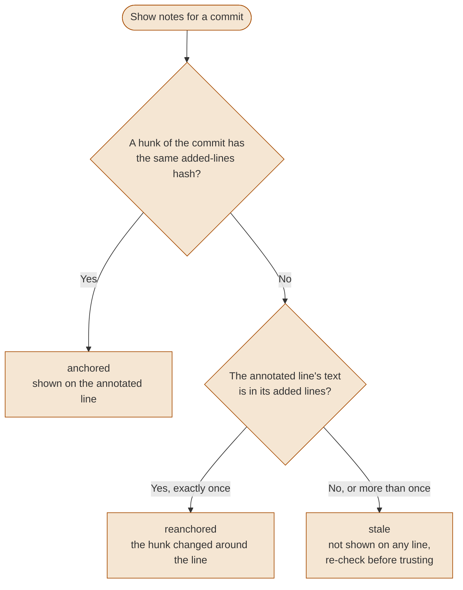
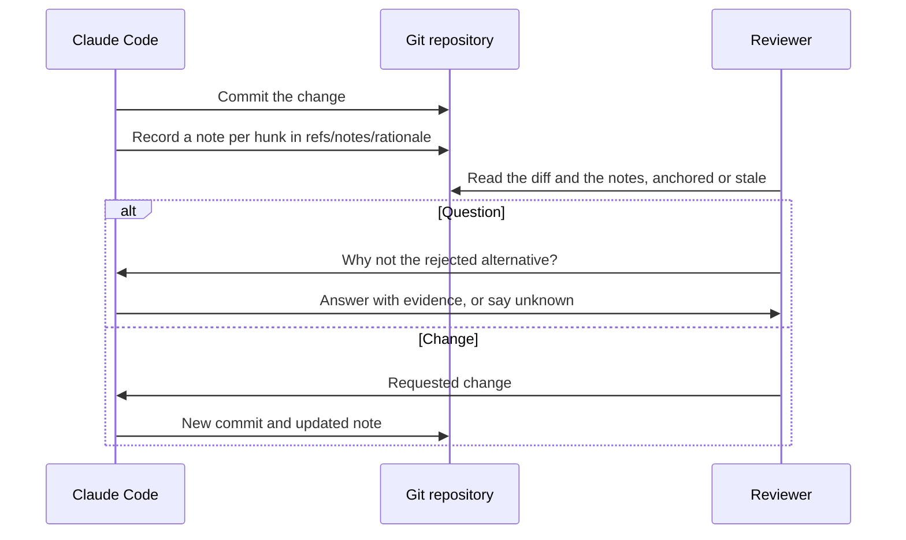

# Reviewable agent changes: rationale beside the diff

> **Evidence boundary**: this page proposes a practice and ships a template whose behavior is covered by its own tests. No study cited here shows that a rationale beside the diff improves review accuracy; one controlled experiment found that explanations of generated code gave no overall benefit. Treat the agent's rationale as a claim for the reviewer to check, not as evidence.

A reviewer of agent-written code has the diff but not the reasons. The agent had them while it worked: what the change is for, what it chose not to do, what could break. This page describes how to keep those reasons next to the hunk they explain, in the repository, and how to tell when they no longer match the code.

---

## Table of contents

1. [Why the diff is not enough](#why-the-diff-is-not-enough)
2. [What an agent note records](#what-an-agent-note-records)
3. [Where the note lives](#where-the-note-lives)
4. [Anchoring and stale notes](#anchoring-and-stale-notes)
5. [Feedback typed as a question or a change](#feedback-typed-as-a-question-or-a-change)
6. [The agent-rationale template](#the-agent-rationale-template)
7. [What is not established](#what-is-not-established)
8. [See also](#see-also)

---

## Why the diff is not enough

Geoffrey Litt (Notion) [frames understanding as the bottleneck](https://www.youtube.com/watch?v=WkBPX-oDMnA&t=73): "Agents are writing tons of code for us." Litt's practice is an explainer the agent writes for each change, starting with background and ending with a quiz the author must pass before asking for review. Kunal's essay [Resisting Cognitive Surrender](https://knlb.dev/essays/surrender) describes a custom pull request view with the diff, the agent's running commentary on why it made each change, and a column for the reviewer. Both are individual practices, not measured interventions. They are evaluated in [three talks on reviewing agent-written changes](../../docs/resource-evaluations/reviewable-agent-changes-talks.md) and [Resisting Cognitive Surrender](../../docs/resource-evaluations/knlb-cognitive-surrender.md).

The evidence on explanations is mixed and should shape how a note is used:

- [Kaufman et al.](https://arxiv.org/abs/2607.08885) (arXiv preprint, July 2026, 86 Python programmers, controlled experiment) found that natural-language explanations of generated assertions "provided no overall benefit", and that low-quality explanations lowered accuracy while raising confidence.
- [Gao et al.](https://arxiv.org/abs/2607.24601) (to appear at ISSTA 2026, 34 participants, within-subjects study of AI-generated code reviews) found that full explanations gave the highest perceived trust but not the highest agreement with the AI, and that explanation level did not significantly affect review time.

Neither study tested an agent's rationale beside its own diff. What they support is narrower: in these studies, explanations moved trust or confidence, and neither showed better detection of wrong output. A note is useful when it gives the reviewer something to check: a rejected alternative to weigh, a risk to test, a piece of evidence to rerun.

[Reviewing machine output is a third mode](../roles/learning-with-ai.md#reviewing-machine-output-is-a-third-mode) covers automation bias and the approval check that goes with this page.

---

## What an agent note records

This guide proposes five fields per hunk. They come from comparing what existing tools record ([local review surfaces](./multi-provider-code-review.md#local-review-surfaces-for-agent-written-changes), [agent provenance traces](../../docs/resource-evaluations/agent-provenance-traces.md)), not from a study of which fields help reviewers.

| Field | What to write | Why a reviewer needs it |
|---|---|---|
| Intent | What the change is for, in one sentence | The diff shows what changed, not why ([Gupta's "why, not what" criterion](https://www.youtube.com/watch?v=TJPInBjhE4Q&t=684)) |
| Rejected alternative | The option the agent considered and did not take, and why | The reviewer's first question is often "why not the obvious way?" |
| Risk | What this could break, for whom | Points the review at the part worth reading slowly |
| Evidence | The test, command or output that supports the change | Something the reviewer can rerun instead of trusting |
| Open question | What the agent could not decide | Turns a silent guess into a question for the reviewer |

`unknown` is a valid answer for every field except intent. An agent that writes "unknown" for evidence tells the reviewer more than one that invents a test name. [docket](../../docs/resource-evaluations/agent-provenance-traces.md#docket-35) labels hunks with little evidence as "no evidence" and orders hunks by a risk score that includes that density.

Write the note while the reasons are still in the agent's context, right after the commit, not reconstructed at review time. glassbox has the agent record notes with `glassbox note add` (no hook forces it), diffo has the agent post layers and comments through its CLI, and ai-pr-review writes its walkthrough after the fact from the diff ([evaluation](../../docs/resource-evaluations/agent-review-surfaces.md)).

---

## Where the note lives

| Storage | Example | Visible in the merge request | Through amend and rebase | Through a squash merge |
|---|---|---|---|---|
| Git notes | `refs/notes/rationale` (this template), `refs/notes/ai` (git-ai) | No, unless a tool posts it | Yes with `notes.rewriteRef` set (tested) | No for plain notes (tested); git-ai's daemon moved its note (tested) |
| File committed with the code | SARIF under `.pr-notes/` (glassbox), a JSON sidecar if you commit it (hunk) | As a changed file | Moves with the commit's content | Kept in the squashed content; line ranges may no longer match |
| Forge comment | Merge request discussion (drift posts them) | Yes | drift marks a thread outdated when the head changes | Depends on the forge; not checked |

"Tested" refers to the runs behind [git-ai: line-level AI attribution in git notes](../../docs/resource-evaluations/git-ai-provenance-notes.md) and to the template's own tests: one local repository each, git 2.56.0. The file-based and forge rows come from reading the tools' source, not from running them.

Git notes keep the history of the code clean and stay out of the diff, at the cost of extra setup: `git config notes.rewriteRef refs/notes/rationale` for amend and rebase, and an explicit `git push origin refs/notes/rationale`, since a plain push does not send them. A squash or rebase done by the forge's merge button happens on the server and was not tested; see [Provenance in git notes](../ops/ai-traceability.md#35-provenance-in-git-notes).

Do not put secrets or customer data in a note. Notes are pushed with the repository's refs and anyone who can fetch them can read them.

---

## Anchoring and stale notes

A note recorded against line 42 is wrong as soon as someone adds a line above it. Anchoring by content instead of position avoids that. The template combines the two approaches read in other tools: a hash of the hunk's content first (diffo hashes its hunks), then the annotated line's text (glassbox re-anchors by snippet) only when that text is unique among the file's added lines, then nothing.



The outcomes are covered by the template's tests: lines added above the hunk keep the note anchored on its line, an edit elsewhere in the hunk re-anchors it, an edit of the annotated line marks it stale, and a line whose text appears twice is marked stale rather than guessed. A stale note is still worth reading; it records what the agent intended before the code changed.

---

## Feedback typed as a question or a change

Review feedback that returns to the agent needs a type. Without one, an agent treats every comment as an instruction. Ryan Lopopolo (OpenAI) [describes giving the authoring agent](https://www.youtube.com/watch?v=CeOXx-XTYek&t=972) "the flexibility to either defer or push back against review feedback", because "without the context that this is permissible, the coding agents are going to bias toward what they do, which is following instructions." diffo types each reviewer thread as Change or Question, with a different reply contract for each ([evaluation](../../docs/resource-evaluations/agent-review-surfaces.md)).



A question asks the agent to explain and may end with no code change. A requested change asks for a new commit, and the agent writes a new note for it. The template records notes; it does not carry feedback. Carry the type in whatever channel the review uses: a prefix in the forge comment, or a tool that types threads.

---

## The agent-rationale template

[`examples/skills/agent-rationale/`](../../examples/skills/agent-rationale/) is a Claude Code skill with a standard-library Python script (3.9 or later):

```bash
# After committing, from the repository root
python3 -I .claude/skills/agent-rationale/scripts/rationale.py add --file src/cart.py --line 42 \
  --intent "Sum prices, not item objects" \
  --rejected "Give Item an __add__ method" \
  --risk "Items without a price attribute now raise AttributeError" \
  --evidence "tests/test_cart.py::test_total_uses_price" \
  --open-question "unknown"

python3 -I .claude/skills/agent-rationale/scripts/rationale.py show
```

Its 15 tests run in throwaway repositories and cover the behaviors this page relies on: the note is written with all five fields, a line outside the commit's changes is refused, the note follows amend and rebase with `notes.rewriteRef` and is lost on amend without it, anchoring reports anchored, reanchored or stale as drawn above, and edge cases (a line starting with `++`, a form feed inside a line, duplicate lines, a note not written by the script, a path given from a subdirectory) behave as documented.

```bash
python3 -I examples/skills/agent-rationale/scripts/test_rationale.py
```

The tests were written before the code they cover and failed first; deliberate mutations of the parser and the anchoring code each made the expected test fail. The skill has not been run by a real Claude Code session; only the script's tests were run.

---

## What is not established

- That a rationale beside the diff improves defect detection, review time or understanding. No study found for this page tested it on agent-written diffs.
- That the five fields are the right ones. They are this guide's proposal.
- How notes behave through a forge's merge button, through cherry-pick, or when several agents annotate the same commit.
- That an agent's rationale is accurate. It is written by the same agent whose code is under review.

---

## See also

- [Multi-provider code review: local review surfaces](./multi-provider-code-review.md#local-review-surfaces-for-agent-written-changes): diffo, glassbox, hunk, drift, ai-pr-review, guidedreview compared
- [Provenance in git notes](../ops/ai-traceability.md#35-provenance-in-git-notes): git-ai, AgentNote and docket, and what survives a rewrite
- [Approve only what you can explain](../diagrams/10-adoption-and-learning.md#approve-only-what-you-can-explain): a check before approving agent output
- [Three places an agent change gets explained](../diagrams/06-development-workflows.md#three-places-an-agent-change-gets-explained)
